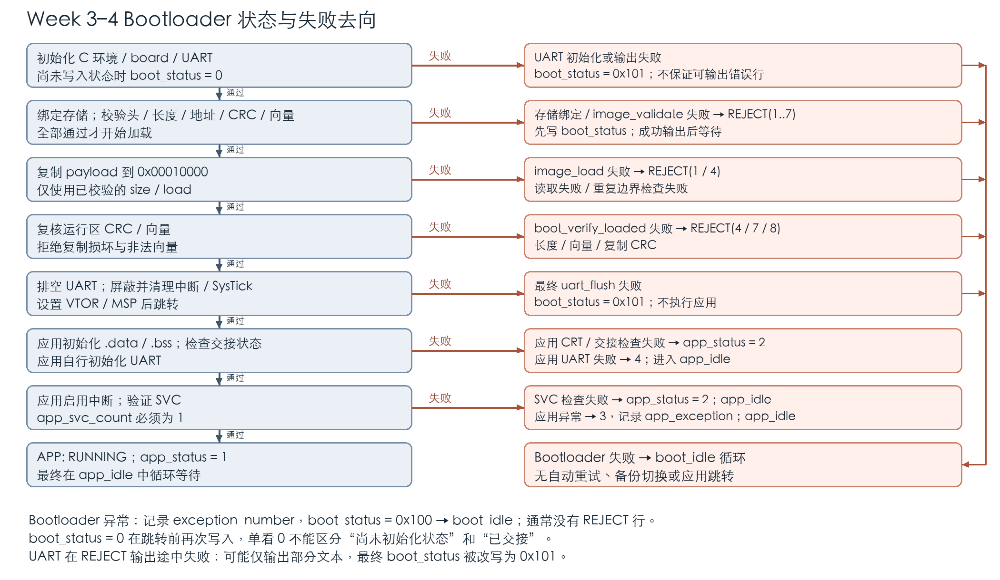

# Week 3–4 范围状态与交付清单复核报告

2026-10-25更新。本报告对应FB-08至FB-12。向量矩阵321项、8个QEMU/GDB路径和manifest校验41项均通过；修改记录保留基线提交与本地修订状态，老师尚未确认。

反馈编号、修改、验证、证据、版本及老师确认状态见planning/teacher-feedback-2026-10-24.md；本地文件指纹见planning/feedback-version.json。

## 向量合法范围与边界覆盖

本工程固定AN500、48项向量和192字节向量表。范围规则来自src/week4/image.c的vectors_ok，image_validate与boot_verify_loaded共同调用；宿主打包器scripts/image_format.py实施相同的输入规则。下表是本工程镜像契约，不将其扩展为所有Cortex-M芯片的统一地址规则。

| 检查对象 | 精确规则 | 边界含义 | 验证与证据 |
|---|---|---|---|
| 向量表位置 | payload复制到0x00010000；向量表[0x10000,0x100C0)，共48项 | load必须为固定地址；表本身按256字节对齐 | W4-BUILD、W4-HANDOFF；链接与GDB证据 |
| 初始MSP vector[0] | 0x20010000 < MSP <= 0x20200000；MSP模8=0 | 下界不接受；上界接受；保留Bootloader RAM | VEC-001..015；MSP-AT-BASE |
| Reset vector[1] | entry位0必须1；addr=entry按位与0xFFFFFFFE | Thumb位与地址分别检查，不按4字节对齐处理 | Reset索引7个边界；RESET-BELOW |
| 所有已实现异常及IRQ入口 | 0x100C0 <= addr < 0x10000+payload_size，且entry位0=1 | 代码下界接受；上界不接受；零入口拒绝 | 42个必填索引各7项；VEC-MATRIX |
| 核心保留项 | 索引7、8、9、10、13必须为0 | 每一项单独验证0可接受、非0拒绝 | 5项各2个断言 |
| 外部IRQ | 索引16..47对应IRQ0..31，每项必须为非零合法Thumb入口 | 未使用IRQ也要配置合法默认处理函数 | 全部32项都测，不仅测IRQ0 |
| 复制后的复核 | 先CRC，再用同一规则检查MSP及全部入口 | 先修正测试CRC才能直接触达向量拒绝分支 | LOAD-VECTOR-MSP、LOAD-VECTOR-IRQ31 |

新证据VLOG = `logs/vector-bounds-20261025-021521`（相对codes/）。`python3 scripts/verify-vector-bounds.py`在干净构建中执行321个宿主断言（ASan/UBSan），再做4个CPU镜像拒绝、2个复制后向量复核及2个状态路径验证。完整321项的输入、预期、实际、文件行号见codes/docs/vector-boundary-cases.json；原始输出为VLOG/matrix.txt。

| 覆盖类别 | 输入及预期 | 本轮结果 |
|---|---|---|
| MSP上下界 | 0、base-8、base、base+8、top-8、top、top+8、0xFFFFFFF8 | 只有base+8、top-8、top接受；8项PASS |
| MSP对齐 | base+8再分别加1..7 | 7种余数全部返回7；PASS |
| 每个必填入口 | 最低合法Thumb地址、低于代码区、最高内部地址、等于末端、超过末端、清Thumb位、零 | 42×7=294项PASS |
| 每个保留项 | 零与0x100C1 | 5×2=10项PASS |
| 表长边界 | payload=191、192 | 191返回长度错误4；192无代码可容纳合法入口，返回向量错误7；2项PASS |
| CPU拒绝 | MSP恰为RAM下界、保留项13非零、IRQ31恰到末端、Reset低于代码区 | 各输出REJECT: 0x00000007；4项PASS |
| 加载后复核 | 运行区MSP改为下界、IRQ31入口改零；更新boot_image.crc以越过CRC检查 | 两项均在boot_verify_loaded返回7；PASS |

对于基准972字节payload，代码起始地址范围为[0x100C0,0x103CC)；最低合法entry为0x100C1，最高合法entry为0x103CB，entry=0x103CD解码为末端，拒绝。接受边界值的宿主用例只验证地址判定，没有把修改成任意内部地址的镜像启动执行。当前规则只检查入口起始地址、Thumb位及范围，不证明该地址上的完整指令或函数语义有效；实际应用运行证据仍来自未修改的合法应用。最低可执行镜像还须包含代码，不能把192字节长度字段检查通过解释为整个镜像通过。

<!-- landscape -->

## 完整状态转移图



<!-- portrait -->

图中所有Bootloader失败最终都进入boot_idle循环，应用自己的成功或失败最终进入app_idle。当前没有备份槽切换、重试下载或自动恢复分支。完整可编辑图源为codes/docs/images/boot-state-complete.mmd，渲染脚本为codes/scripts/render-boot-state.py。图中“通过”表示继续下一步，不表示最终应用运行成功。

boot_status不是进度枚举：它在BSS初始化时为0，成功交接前也会被写为0；中间校验阶段没有逐状态写入。判断应用成功须结合APP: RUNNING、app_status=1及交接/CRT/SVC检查。应用出错时boot_status可能仍为0，应读取app_status和app_exception。

## REJECT 输出与状态字典

src/week4/main.c的reject(result)先把result写入boot_status，再依次输出前缀、十六进制码、CRLF和提示符，最后进入boot_idle。精确格式如下，其中h为小写十六进制数字；引号表示字符串边界，不是发送字节：

```text
"REJECT: 0xhhhhhhhh\r\n> "
```

前缀中的空格、0x、恰好8位十六进制和末尾提示符后的空格都是输出的一部分。`\r\n`表示CR/LF两个字节，不是发送反斜线字符；提示符之后没有额外换行。唯一字段是无符号32位错误码，来源是image_result，不含地址、时间、序号，也不是宿主进程退出码。

| boot_status值 | 名称与触发条件 | REJECT行为 | 最终停留及证据 |
|---|---|---|---|
| 0 | BSS初值，或完成最终flush后准备交接 | 不输出REJECT；单值0不证明应用成功 | 初期位置不定；交接后应用app_idle；W4-HANDOFF |
| 1 | IMAGE_IO：设备未绑定、读取失败等 | REJECT: 0x00000001 | boot_idle；VLOG/STATUS-IO.txt及-uart.log |
| 2 | IMAGE_FORMAT_ERROR：magic、format、header_size不符 | REJECT: 0x00000002 | boot_idle；IMG-02..05 |
| 3 | IMAGE_HEADER_CRC：前28字节CRC不匹配 | REJECT: 0x00000003 | boot_idle；IMG-06 |
| 4 | IMAGE_LENGTH：长度小于表、超过槽/执行区，或load/verify重复边界无效 | REJECT: 0x00000004 | boot_idle；IMG-07/08；load参数分支按源码映射 |
| 5 | IMAGE_ADDRESS：load不等于0x10000 | REJECT: 0x00000005 | boot_idle；IMG-09 |
| 6 | IMAGE_PAYLOAD_CRC：存储payload CRC不匹配 | REJECT: 0x00000006 | boot_idle；IMG-10 |
| 7 | IMAGE_VECTOR：存储或运行区向量非法 | REJECT: 0x00000007 | boot_idle；向量矩阵及LOAD-VECTOR两项 |
| 8 | IMAGE_COPY_CRC：运行区CRC与已校验info.crc不符 | REJECT: 0x00000008 | boot_idle；W4-COPY |
| 0x100 | CPU异常：记录exception_number=IPSR，再写状态 | 异常路径不调用reject，无REJECT保证 | boot_idle；VLOG/STATUS-HARDFAULT.txt读回exception_number=3 |
| 0x101 | UART初始化、write或最终flush失败 | UART不可用，不保证错误文本或完整REJECT | boot_idle；TX-W4-PRINT、TX-W4-FLUSH |

VLOG = `logs/vector-bounds-20261025-021521`（相对codes/）；IMG编号对应第四阶段输入表的宿主和UART日志，TX编号对应TX专项报告。状态1由GDB在image_validate入口将已绑定设备的memory指针置零触发实际flash_read失败；0x100由无效取指触发真实HardFault验证。它们分别是数据读取错误注入和CPU异常测试，不是篡改boot_status伪造结果。各load参数失败的所有子条件尚未逐一做GDB注入，应以表中具体验证范围为准。

应用使用独立状态：app_status=0为初值，1为CRT/交接/SVC通过后的运行状态，2为CRT、交接或SVC检查失败，3为应用异常（记录app_exception），4为UART失败。最终均在app_idle循环。app_status=4已由TX-W4-APP验证；不能将应用状态值套用为Bootloader的image_result。

格式错误示例（只展示拒绝行及提示符）：

```text
"REJECT: 0x00000002\r\n> "
```

复制损坏示例的完整UART为：

```text
BOOT: stage4 image validation\r\n
IMAGE: CRC32 PASS\r\n
"REJECT: 0x00000008\r\n> "
```

UART在reject输出途中失败时，可能留下不完整前缀，boot_status最终被print改写为0x101；这时以GDB状态取证，不要求再靠同一UART输出错误行。IRQ唤醒后idle函数仍循环，不自动恢复启动流程。

## 独立 manifest schema 与示例

交付manifest是包根目录的delivery-manifest.json，用于记录列出的交付文件路径、字节数和SHA256，帮助老师检查复制完整性及复核材料。它不进入Bootloader解析流程；固件仍使用32字节M7IM二进制头。manifest不是签名或老师批准证明，approval_status固定为pending-teacher-review。

独立schema路径为codes/schemas/delivery-manifest.schema.json，采用JSON Schema Draft 2020-12；实现为codes/scripts/delivery_manifest.py。校验器实现本schema使用的type、required、additionalProperties、const、enum、pattern、minItems、minimum及date-time检查，不作为任意schema的通用执行器。

| 字段 | 约束 | 本轮检验 |
|---|---|---|
| 根对象 | 6字段全部必填；不允许额外字段 | 各字段缺失及UNKNOWN均拒绝 |
| schema_version | 常量整数1，布尔true不作1接受 | VERSION、BOOLEAN-VERSION |
| plan_group | week1-2、week3、week4；week3-4仅兼容历史合并包 | GROUP拒绝week5 |
| generated_at | ISO日期时间，必须+08:00；秒必填，可有小数；日期必须真实有效 | DATE、DATE-TEXT、ZONE |
| image_format | 常量M7IM-v1 | FORMAT |
| approval_status | 常量pending-teacher-review | APPROVAL拒绝approved |
| files | 非空数组；每项只允许path、size、sha256，均必填 | FILES-TYPE、EMPTY、FILE-MISSING等 |
| files[].path | 相对POSIX路径；无绝对路径、盘符、反斜线、控制字符、.或..分段、双斜线；规范化后不变 | TRAVERSAL、ABSOLUTE、DOT等 |
| files[].size | 非负整数，拒绝布尔和小数 | SIZE、BOOL-SIZE、FLOAT-SIZE |
| files[].sha256 | 64个小写十六进制字符 | HASH、HASH-UPPER |

规范化路径、重复路径拒绝、真实文件存在性、长度/哈希、符号链接越界属于校验器的附加语义检查。基本字段形状由schema约束；schema本身不读取文件。生成器扫描目录中的文件，排除delivery-manifest.json自身以避免自引用；校验器核对清单列出的文件，不声称对未列出的额外文件做完整性认证。

有效示例完整JSON如下。配套README.txt字节存放在codes/schemas/examples/，其长度和SHA256与清单一致。

```json
{
  "schema_version": 1,
  "plan_group": "week3-4",
  "generated_at": "2026-10-25T02:16:04.132229+08:00",
  "files": [
    {
      "path": "README.txt",
      "size": 25,
      "sha256": "798fea15a540e232f4ae06c1888d0467da504195abb547083ebfec97ceb955fb"
    }
  ],
  "image_format": "M7IM-v1",
  "approval_status": "pending-teacher-review"
}
```

无效示例：缺少必填files字段，应抛出ValueError，不能作为空清单接受。

```json
{
  "schema_version": 1,
  "plan_group": "week3-4",
  "generated_at": "2026-10-25T02:16:04.132229+08:00",
  "image_format": "M7IM-v1",
  "approval_status": "pending-teacher-review"
}
```

完整的另外两份无效JSON为schemas/examples/invalid-traversal.json和invalid-hash.json，分别把path设为../escape和sha256设为xyz。有效与三个无效示例均在本轮脚本中生成并验证；校验成功0退出，字段/文件失败抛异常，命令非零退出。

复验：在codes/执行`python3 scripts/verify-manifest.py`。本轮41项全部通过，证据MLOG = `logs/manifest-20261025-021604`（相对codes/），每项完整输入JSON和预期/实际异常见summary.json及对应JSON文件，包括有效实例、6个必填字段、各标量/数组类型、日期、大小、哈希、路径、重复、缺失文件与符号链接越界。

生成正式交付清单：`python3 scripts/delivery_manifest.py 包目录 --group week4`；再次核验：`python3 scripts/delivery_manifest.py 包目录`。打包后还校验ZIP完整性。清单能检测非故意复制错误，但SHA256清单可被一同修改，不具备签名认证能力。


2026-10-25归档补充：Week3与Week4周报现分别位于reports/week3与reports/week4。交付清单plan_group新增week3、week4，保留week3-4兼容历史快照；此枚举扩展不改变原有校验约束。原跨周测试证据及实例保留执行时版本。
