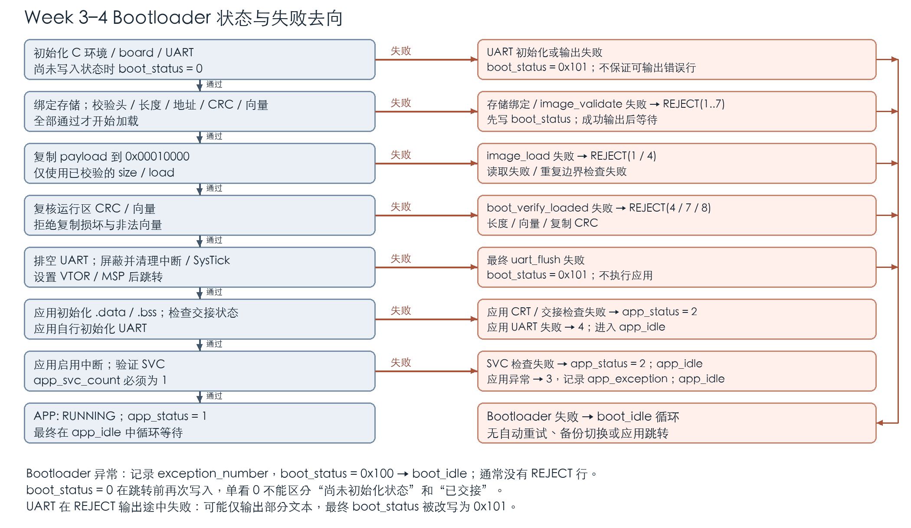

# Week 4 测试用例与验收报告

## 2026 年 11 月 1 日新增用例与当前验收结果

更新日期：2026 年 11 月 1 日。11 月 1 日新增 VB-04、VB-05、VB-06 三条独立 CPU 镜像拒绝测试，并重新构建、复跑完整向量专项：321 条宿主断言及 11 条 CPU/GDB 路径全部通过。三例分别检查 MSP=top+16、保留项 index 8 非零、IRQ31 的 Thumb 位错误，构造步骤、预期及 UART 证据见“11 月 1 日新增三条 CPU 测试”。10 月 31 日复验的核心链路 27 组、PRIMASK 22 条断言、异常与交接专项 7 组均通过，继续引用对应实测证据。

| 套件与执行日期 | 结果 | 证据目录 相对 codes |
|---|---|---|
| verify-vector-bounds.py 11 月 1 日 | 321 条宿主断言及 11 条 CPU/GDB 路径 PASS | logs/vector-bounds-20261101-164709 |
| verify-week4.py 10 月 31 日 | 27 组 PASS | logs/week4-20261031-161348-567486 |
| verify-handoff-contract.py 10 月 31 日 | 7 组 PASS | logs/handoff-contract-20261031-161440 |
| verify-irq-contract.py 10 月 31 日 | 22 条断言 PASS | logs/irq-contract-20261031-161420 |

宿主断言、CPU/GDB 路径、阶段分组和跨周回归分别统计。当前 CPU/GDB 路径为 7 条镜像拒绝、2 条加载后复核及 2 条状态路径，共 11 条；相较 10 月 31 日增加 3 条。下文 10 月 24 日至 31 日历史实验保留原始日期和计数，当前向量专项以 11 月 1 日结果为准。

### 本次变更对照

| 变更项 | 本次内容 | 对应章节 | 证据定位 |
|---|---|---|---|
| 补三个明确用例 | 新增 MSP 超上界、保留项 8 非零、IRQ31 Thumb 位错误三条 CPU 测试 | 向量用例与 MSP 端点详解 | VB-04 至 VB-06；各自 UART 日志 |
| MSP 区间 | 解释 (base,top]，列明四个端点判定 | MSP 左开右闭区间 | VEC-003/004/006/007；VB-04 |
| 异常与中断交接 | 五种异常优先级编码、屏蔽、栈与三阶段状态 | 异常与中断交接验证 | HANDOFF-REGISTERS 读回及 7 组专项 |
| FPU 条件要求 | 软浮点实测与启用 FPU 后的交接要求 | FPU 配置与扩展交接要求 | CPACR、FPCCR、CONTROL 读回 |
| 安全边界单列 | 完整性、认证、隔离和仿真适用限制 | 安全边界与适用限制 | image.c 检查范围及故障停留证据 |

日志均相对 codes/；完整目录见文末证据索引。

## 2026 年 10 月 29 日复验

2026 年 10 月 29 日执行 8 套测试，全部通过。Week4 核心验证为 27 组，包含 22 种镜像输入，以及构建、CRC、交接、复制损坏和模型诊断 5 组。阶段证据为 `logs/week4-20261029-151421-074982`。

22 份新输入的 SHA256 与 `logs/week4-20261025-015917-068252/summary.json` 同名输入逐项一致。因此下方历史输入表的偏移、数值、CRC 处理和预期码仍适用于本次输入；新的实际结果与原始日志保存在本轮目录，不改写旧实验日期。

| 固定编号 | 本轮实际检查与结果 | 本轮证据 |
|---|---|---|
| W4-BUILD | 干净构建；两个运行区、栈顶与向量地址符合，无 BKPT | 新目录 build.txt、boot-symbols.txt、app-symbols.txt |
| W4-CRC | 8 种长度逐一匹配 zlib，标准串结果正确，ASan/UBSan 无报错 | 新目录 crc-长度.txt、summary.json |
| IMG-01..22 | 宿主与 QEMU 均符合预期，完整 UART 字节串一致 | 新目录 场景名-native.txt、场景名/uart.log、summary.json/image_cases |
| W4-HANDOFF | 真实 CPSID 后注入；入口 MSP/VTOR/掩码、中断清理、CRT、哨兵与 SVC 断言通过 | 新目录 dirty-state-handoff-and-app-crt.txt 及 -uart.log |
| W4-COPY | 复制后运行区 0x100c8 一个字节异或 1；状态 8，完整拒绝输出，无应用日志 | 新目录 reject-corrupted-loaded-copy.txt 及 -uart.log |
| W4-DIAG | 除宿主主动终止消息外，无 QEMU guest-error | 新目录各 qemu.log、summary.json |

“新目录”均指本节开头的 Week4 证据目录。10 月 29 日历史补充验证：向量 321 个宿主断言及 8 条 CPU/GDB 路径、TX 7 组、PRIMASK 22 断言、manifest 41 项、两周 CLI 22 项、波特率读回 2 组、Week3 回归 11 组全部通过；各目录见 [周报材料与证据索引](../../reports/week4/week4-report.md)。阶段分组、专项断言和跨周回归分别统计。11 月 1 日向量专项已扩展为 321 条宿主断言及 11 条 CPU/GDB 路径，当前结果与新增用例见开篇及文末索引。

状态图为 `images/week4-boot-flow-reviewed.png`，可编辑图源为同名 `.mmd`，渲染入口为 `scripts/render-week4-flow.py`。图中列出正常启动和各类失败去向，包括日志发送失败时的状态变化；状态映射与实际注入覆盖范围分别说明。

当前 TX 是 1000000 次轮询预算，不是准确毫秒超时；manifest 是交付文件清单，不是固件认证协议。以下保留 10 月 24 日至 25 日详细记录及其原始证据。

## 历史执行明细

执行日期：2026-10-24 至 2026-10-25。以下为对应实验的步骤与结果，测试中的预期拒绝属于通过条件。

入口：在 codes/ 执行 make verify-week4。证据目录：`logs/week4-20261024-173015-915034`。完整步骤及输入保存在对应 .gdb／命令日志／验证脚本；摘要记录本轮判定。

验证路径：干净构建 → 指定新 ELF → 输入或故障注入 → 输出与状态断言 → 原始日志 → summary.json。未出现预期输出、断言失败或意外超时均判失败。以下按固定编号连接执行表和结果表。基础镜像表沿用2026-10-24及2026-10-25已执行证据；新增向量和状态专项实测见后文。文档编辑与实际测试分开记录。

## 执行表

日志根目录：`W4LOG = logs/week4-20261024-173015-915034`（相对 codes/）。表内路径由该根目录和文件名组成。

| 固定编号 | 测试方式 | 操作步骤 | 具体输入 |
|---|---|---|---|
| W4-BUILD | 构建/地址检查 | 1. 新目录构建Bootloader和独立应用；2. objcopy生成application.bin；3. 检查两ELF反汇编、符号及栈/向量地址。 | 独立Boot/App ELF；固定栈、VTOR和链接段 |
| W4-CRC | 独立zlib oracle及sanitizer | 1. 编译真实crc32.c和test_crc32.c，启用sanitizer；2. 用固定随机种子生成8种长度输入；3. 逐次运行；4. 将结果与独立zlib.crc32比较。 | 长度0,1,9,255,256,257,4096,458720，种子20261022；标准串123456789 |
| W4-HANDOFF | GDB真实CPSID后注入 | 1. 在boot_handoff停下并实际执行CPSID；2. 读回PRIMASK=1后注入挂起状态；3. 在应用Reset入口检查寄存器；4. 污染应用data/bss和设置哨兵；5. 运行到app_idle，检查CRT、交接、SVC状态。 | NVIC IRQ7、SysTick、PendSV挂起；应用data/bss污染 |
| W4-COPY | GDB复制后翻转 | 1. 正常镜像启动；2. 在boot_verify_loaded入口断点暂停；3. 翻转运行地址0x100c8一位；4. 继续到boot_idle；5. 检查boot_status和完整串口字节。 | 运行地址0x100c8一个字节异或1 |
| W4-DIAG | 模型日志检查 | 1. 遍历镜像场景及GDB场景的qemu.log；2. 排除主动终止消息；3. 断言没有其他guest-error。 | 所有正常/拒绝场景qemu.log |

## 结果与证据表

| 固定编号 | 预期输出 | 实际输出 | 判定 | 日志路径（根目录见上） |
|---|---|---|---|---|
| W4-BUILD | 无BKPT，地址符合 | 断言通过 | PASS | W4LOG/build.txt；W4LOG/summary.json |
| W4-CRC | CRC与zlib逐一相等；标准串cbf43926 | 全部相等，无sanitizer错误 | PASS | W4LOG/summary.json；W4LOG/summary.json |
| W4-HANDOFF | 入口MSP=20200000、VTOR=10000、PRIMASK=1；清中断；应用初始化恢复且SVC=1 | APP MSP VTOR masks NVIC SysTick CRT sentinel SVC: PASS | PASS | W4LOG/dirty-state-handoff-and-app-crt.txt；W4LOG/summary.json |
| W4-COPY | 状态8，REJECT 00000008，无应用日志 | boot_status=8；输出符合 | PASS | W4LOG/reject-corrupted-loaded-copy.txt；W4LOG/summary.json |
| W4-DIAG | 无guest error | 检查通过 | PASS | W4LOG/summary.json；W4LOG/summary.json |


头起点为镜像偏移0x10000，payload起点为0x10020。22种镜像输入的SHA256、完整头和48项向量十六进制值在summary.json/image_cases中。向量负向输入修复CRC后再测试，避免CRC错误遮蔽向量检测。CRC检查不认证来源；备份槽尚不用于启动。

## 镜像输入逐项对照

镜像输入包含18种基础场景和4种补充边界场景，按IMG编号逐行列出。表格依据已通过的 `logs/week4-20261025-015917-068252`，沿用实际执行结果，不将文档编辑算作重新测试。构造输入经重新还原，22份镜像SHA256均与原始summary.json一致；具体数值已与头、向量、宿主输出及QEMU UART逐项核对。

偏移均以整个1 MiB镜像文件起点为0；H = 0x00010000为镜像头起点，P = H + 0x20 = 0x00010020为payload/向量表起点。除注明“一个字节”及全文件/填充区外，修改均为小端uint32；区间均左闭右开。每行从同一有效基准独立构造，不将前一行修改带到下一行。基准payload为972字节，固件版本1。

“头重算”指对[H,H+0x1C)计算CRC32并写至0x0001001C；“内容CRC”对声明的payload计算并写至0x00010018。向量修改先重算内容CRC再重算头CRC，以免较早的CRC错误遮蔽目标向量错误。头字段负向输入只重算头CRC；头CRC错误及内容损坏用例保留旧CRC。

IMGLOG = `logs/week4-20261025-015917-068252`（相对codes/）。表内N为宿主image_validate的IMAGE_RESULT，不是宿主进程退出码；预期拒绝时测试程序断言匹配后退出0。Q为QEMU UART实际结果，“拒绝0xNN”对应完整REJECT十六进制行且没有APP: RUNNING；成功须出现APP: RUNNING。每行日志均在IMGLOG根目录下，前者为宿主输出，后者为UART。详细CRC数值、实际SIZE、输入SHA256和完整UART另存codes/docs/week4-image-inputs.json。

错误码对应：0=接受；2=格式；3=头CRC；4=长度；5=加载地址；6=内容CRC；7=向量。复制后运行区损坏对应8，属于W4-COPY的另一类GDB故障注入，不计入这18+4种输入。CRC只检测损坏，不证明固件来源可信。

<!-- landscape -->

### 原有18种镜像输入

| 编号与场景 | 修改偏移 | 具体数值 | CRC处理 | 预期错误码 | 实际结果与判定 | 日志（相对IMGLOG） |
|---|---|---|---|---|---|---|
| IMG-01 valid | 无修改 | 有效基准；version=1；payload_size=972 | 打包时计算两CRC | 0 (IMAGE_OK) | N=0；Q=APP: RUNNING；PASS | valid-native.txt；valid/uart.log |
| IMG-02 blank | 全文件[0x00000000,0x00100000) | 每字节=0xFF；1 MiB | 均不计算 | 0x02 | N=2；Q=拒绝0x02；PASS | blank-native.txt；blank/uart.log |
| IMG-03 bad-magic | H+0x00 = 0x00010000 | magic：0x4D49374D → 0x00000000 | 头重算；内容保留 | 0x02 | N=2；Q=拒绝0x02；PASS | bad-magic-native.txt；bad-magic/uart.log |
| IMG-04 unsupported-format | H+0x04 = 0x00010004 | format：1 → 2 | 头重算；内容保留 | 0x02 | N=2；Q=拒绝0x02；PASS | unsupported-format-native.txt；unsupported-format/uart.log |
| IMG-05 bad-header-size | H+0x08 = 0x00010008 | header_size：32 → 64 | 头重算；内容保留 | 0x02 | N=2；Q=拒绝0x02；PASS | bad-header-size-native.txt；bad-header-size/uart.log |
| IMG-06 bad-header-crc | H+0x14 = 0x00010014 | firmware_version：1 → 8；保留旧头CRC | 均不重算 | 0x03 | N=3；Q=拒绝0x03；PASS | bad-header-crc-native.txt；bad-header-crc/uart.log |
| IMG-07 empty-payload | H+0x0C = 0x0001000C | payload_size：972 → 0 | 头重算；内容保留 | 0x04 | N=4；Q=拒绝0x04；PASS | empty-payload-native.txt；empty-payload/uart.log |
| IMG-08 oversize-payload | H+0x0C = 0x0001000C | payload_size：972 → 0xFFFFFFFF | 头重算；内容保留 | 0x04 | N=4；Q=拒绝0x04；PASS | oversize-payload-native.txt；oversize-payload/uart.log |
| IMG-09 wrong-load-address | H+0x10 = 0x00010010 | load_address：0x00010000 → 0x20000000 | 头重算；内容保留 | 0x05 | N=5；Q=拒绝0x05；PASS | wrong-load-address-native.txt；wrong-load-address/uart.log |
| IMG-10 payload-corruption | P+0xC8 = 0x000100E8 | 一个字节：0x91 → 0x90（异或1） | 均不重算 | 0x06 | N=6；Q=拒绝0x06；PASS | payload-corruption-native.txt；payload-corruption/uart.log |
| IMG-11 unaligned-msp | P+0x00 = 0x00010020 | vector[0]：0x20200000 → 0x20200004 | 先内容CRC，再头CRC | 0x07 | N=7；Q=拒绝0x07；PASS | unaligned-msp-native.txt；unaligned-msp/uart.log |
| IMG-12 boot-ram-msp | P+0x00 = 0x00010020 | vector[0]：0x20200000 → 0x20010000 | 先内容CRC，再头CRC | 0x07 | N=7；Q=拒绝0x07；PASS | boot-ram-msp-native.txt；boot-ram-msp/uart.log |
| IMG-13 even-reset | P+0x04 = 0x00010024 | vector[1]：0x000100C1 → 0x000100C0 | 先内容CRC，再头CRC | 0x07 | N=7；Q=拒绝0x07；PASS | even-reset-native.txt；even-reset/uart.log |
| IMG-14 outside-reset | P+0x04 = 0x00010024 | vector[1]：0x000100C1 → 0x00080001 | 先内容CRC，再头CRC | 0x07 | N=7；Q=拒绝0x07；PASS | outside-reset-native.txt；outside-reset/uart.log |
| IMG-15 vector-table-reset | P+0x04 = 0x00010024 | vector[1]：0x000100C1 → 0x00010001 | 先内容CRC，再头CRC | 0x07 | N=7；Q=拒绝0x07；PASS | vector-table-reset-native.txt；vector-table-reset/uart.log |
| IMG-16 bad-irq-vector | P+0x40 = 0x00010060 | vector[16]：0x00010105 → 0x00000000 | 先内容CRC，再头CRC | 0x07 | N=7；Q=拒绝0x07；PASS | bad-irq-vector-native.txt；bad-irq-vector/uart.log |
| IMG-17 reserved-vector | P+0x1C = 0x0001003C | vector[7]：0x00000000 → 0x000100C1 | 先内容CRC，再头CRC | 0x07 | N=7；Q=拒绝0x07；PASS | reserved-vector-native.txt；reserved-vector/uart.log |
| IMG-22 maximum-payload | H+0x0C；文件[0x000103EC,0x00080000) | 长度972 → 458720 (0x6FFE0)；扩展部分填0xFF | 重新打包计算两CRC | 0 (IMAGE_OK) | N=0；Q=APP: RUNNING；PASS | maximum-payload-native.txt；maximum-payload/uart.log |

### 新增4种边界输入

| 编号与场景 | 修改偏移 | 具体数值 | CRC处理 | 预期错误码 | 实际结果与判定 | 日志（相对IMGLOG） |
|---|---|---|---|---|---|---|
| IMG-18 msp-above-top | P+0x00 = 0x00010020 | vector[0]：0x20200000 → 0x20200008 | 先内容CRC，再头CRC | 0x07 | N=7；Q=拒绝0x07；PASS | msp-above-top-native.txt；msp-above-top/uart.log |
| IMG-19 msp-below-base | P+0x00 = 0x00010020 | vector[0]：0x20200000 → 0x2000FFF8 | 先内容CRC，再头CRC | 0x07 | N=7；Q=拒绝0x07；PASS | msp-below-base-native.txt；msp-below-base/uart.log |
| IMG-20 reset-at-end | P+0x04 = 0x00010024 | vector[1]：0x000100C1 → 0x000103CD；(0x10000+972)按位或1 | 先内容CRC，再头CRC | 0x07 | N=7；Q=拒绝0x07；PASS | reset-at-end-native.txt；reset-at-end/uart.log |
| IMG-21 irq-before-code | P+0x40 = 0x00010060 | vector[16]：0x00010105 → 0x0000FFFF | 先内容CRC，再头CRC | 0x07 | N=7；Q=拒绝0x07；PASS | irq-before-code-native.txt；irq-before-code/uart.log |

<!-- portrait -->

## 向量合法范围与边界覆盖

本工程固定AN500、48项向量和192字节向量表。范围规则来自src/week4/image.c的vectors_ok，image_validate与boot_verify_loaded共同调用；宿主打包器scripts/image_format.py实施相同的输入规则。下表是本工程镜像契约，不将其扩展为所有Cortex-M芯片的统一地址规则。

| 检查对象 | 精确规则 | 边界含义 | 验证与证据 |
|---|---|---|---|
| 向量表位置 | payload复制到0x00010000；向量表[0x10000,0x100C0)，共48项 | load必须为固定地址；表本身按256字节对齐 | W4-BUILD、W4-HANDOFF；链接与GDB证据 |
| 初始MSP vector[0] | 0x20010000 < MSP <= 0x20200000；MSP模8=0 | 下界不接受；上界接受；保留Bootloader RAM | VEC-001..015；MSP-AT-BASE |
| Reset vector[1] | entry位0必须1；addr=entry按位与0xFFFFFFFE | Thumb位与地址分别检查，不按4字节对齐处理 | Reset索引7个边界；RESET-BELOW |
| 所有已实现异常及IRQ入口 | 0x100C0 <= addr < 0x10000+payload_size，且entry位0=1 | 代码下界接受；上界不接受；零入口拒绝 | 42个必填索引各7项；VEC-MATRIX |
| 核心保留项 | 索引7、8、9、10、13必须为0 | 每一项单独验证0可接受、非0拒绝 | 5项各2个断言 |
| 外部IRQ | 索引16..47对应IRQ0..31，每项必须为非零合法Thumb入口 | 未使用IRQ也要配置合法默认处理函数 | 全部32项都测，不仅测IRQ0 |
| 复制后的复核 | 先CRC，再用同一规则检查MSP及全部入口 | 先修正测试CRC才能直接触达向量拒绝分支 | LOAD-VECTOR-MSP、LOAD-VECTOR-IRQ31 |

10 月 25 日历史证据 VLOG = `logs/vector-bounds-20261025-021521`（相对codes/）。当日版本的 `python3 scripts/verify-vector-bounds.py` 在干净构建中执行321个宿主断言（ASan/UBSan），再做4个CPU镜像拒绝、2个复制后向量复核及2个状态路径验证。完整321项的输入、预期、实际、文件行号见codes/docs/vector-boundary-cases.json；原始输出为VLOG/matrix.txt。

| 覆盖类别 | 输入及预期 | 本轮结果 |
|---|---|---|
| MSP上下界 | 0、base-8、base、base+8、top-8、top、top+8、0xFFFFFFF8 | 只有base+8、top-8、top接受；8项PASS |
| MSP对齐 | base+8再分别加1..7 | 7种余数全部返回7；PASS |
| 每个必填入口 | 最低合法Thumb地址、低于代码区、最高内部地址、等于末端、超过末端、清Thumb位、零 | 42×7=294项PASS |
| 每个保留项 | 零与0x100C1 | 5×2=10项PASS |
| 表长边界 | payload=191、192 | 191返回长度错误4；192无代码可容纳合法入口，返回向量错误7；2项PASS |
| CPU拒绝 | MSP恰为RAM下界、保留项13非零、IRQ31恰到末端、Reset低于代码区 | 各输出REJECT: 0x00000007；4项PASS |
| 加载后复核 | 运行区MSP改为下界、IRQ31入口改零；更新boot_image.crc以越过CRC检查 | 两项均在boot_verify_loaded返回7；PASS |

对于基准972字节payload，代码起始地址范围为[0x100C0,0x103CC)；最低合法entry为0x100C1，最高合法entry为0x103CB，entry=0x103CD解码为末端，拒绝。接受边界值的宿主用例只验证地址判定，没有把修改成任意内部地址的镜像启动执行。当前规则只检查入口起始地址、Thumb位及范围，不证明该地址上的完整指令或函数语义有效；实际应用运行证据仍来自未修改的合法应用。最低可执行镜像还须包含代码，不能把192字节长度字段检查通过解释为整个镜像通过。

<!-- landscape -->

## 完整状态转移图



<!-- portrait -->

图中所有Bootloader失败最终都进入boot_idle循环，应用自己的成功或失败最终进入app_idle。当前没有备份槽切换、重试下载或自动恢复分支。完整可编辑图源为codes/docs/images/boot-state-complete.mmd，渲染脚本为codes/scripts/render-boot-state.py。图中“通过”表示继续下一步，不表示最终应用运行成功。

boot_status不是进度枚举：它在BSS初始化时为0，成功交接前也会被写为0；中间校验阶段没有逐状态写入。判断应用成功须结合APP: RUNNING、app_status=1及交接/CRT/SVC检查。应用出错时boot_status可能仍为0，应读取app_status和app_exception。

## REJECT 输出与状态字典

src/week4/main.c的reject(result)先把result写入boot_status，再依次输出前缀、十六进制码、CRLF和提示符，最后进入boot_idle。精确格式如下，其中h为小写十六进制数字；引号表示字符串边界，不是发送字节：

```text
"REJECT: 0xhhhhhhhh\r\n> "
```

前缀中的空格、0x、恰好8位十六进制和末尾提示符后的空格都是输出的一部分。`\r\n`表示CR/LF两个字节，不是发送反斜线字符；提示符之后没有额外换行。唯一字段是无符号32位错误码，来源是image_result，不含地址、时间、序号，也不是宿主进程退出码。

| boot_status值 | 名称与触发条件 | REJECT行为 | 最终停留及证据 |
|---|---|---|---|
| 0 | BSS初值，或完成最终flush后准备交接 | 不输出REJECT；单值0不证明应用成功 | 初期位置不定；交接后应用app_idle；W4-HANDOFF |
| 1 | IMAGE_IO：设备未绑定、读取失败等 | REJECT: 0x00000001 | boot_idle；VLOG/STATUS-IO.txt及-uart.log |
| 2 | IMAGE_FORMAT_ERROR：magic、format、header_size不符 | REJECT: 0x00000002 | boot_idle；IMG-02..05 |
| 3 | IMAGE_HEADER_CRC：前28字节CRC不匹配 | REJECT: 0x00000003 | boot_idle；IMG-06 |
| 4 | IMAGE_LENGTH：长度小于表、超过槽/执行区，或load/verify重复边界无效 | REJECT: 0x00000004 | boot_idle；IMG-07/08；load参数分支按源码映射 |
| 5 | IMAGE_ADDRESS：load不等于0x10000 | REJECT: 0x00000005 | boot_idle；IMG-09 |
| 6 | IMAGE_PAYLOAD_CRC：存储payload CRC不匹配 | REJECT: 0x00000006 | boot_idle；IMG-10 |
| 7 | IMAGE_VECTOR：存储或运行区向量非法 | REJECT: 0x00000007 | boot_idle；向量矩阵及LOAD-VECTOR两项 |
| 8 | IMAGE_COPY_CRC：运行区CRC与已校验info.crc不符 | REJECT: 0x00000008 | boot_idle；W4-COPY |
| 0x100 | CPU异常：记录exception_number=IPSR，再写状态 | 异常路径不调用reject，无REJECT保证 | boot_idle；VLOG/STATUS-HARDFAULT.txt读回exception_number=3 |
| 0x101 | UART初始化、write或最终flush失败 | UART不可用，不保证错误文本或完整REJECT | boot_idle；TX-W4-PRINT、TX-W4-FLUSH |

VLOG = `logs/vector-bounds-20261025-021521`（相对codes/）；IMG编号对应第四阶段输入表的宿主和UART日志，TX编号对应TX专项报告。状态1由GDB在image_validate入口将已绑定设备的memory指针置零触发实际flash_read失败；0x100由无效取指触发真实HardFault验证。它们分别是数据读取错误注入和CPU异常测试，不是篡改boot_status伪造结果。各load参数失败的所有子条件尚未逐一做GDB注入，应以表中具体验证范围为准。

应用使用独立状态：app_status=0为初值，1为CRT/交接/SVC通过后的运行状态，2为CRT、交接或SVC检查失败，3为应用异常（记录app_exception），4为UART失败。最终均在app_idle循环。app_status=4已由TX-W4-APP验证；不能将应用状态值套用为Bootloader的image_result。

格式错误示例（只展示拒绝行及提示符）：

```text
"REJECT: 0x00000002\r\n> "
```

复制损坏示例的完整UART为：

```text
BOOT: stage4 image validation\r\n
IMAGE: CRC32 PASS\r\n
"REJECT: 0x00000008\r\n> "
```

UART在reject输出途中失败时，可能留下不完整前缀，boot_status最终被print改写为0x101；这时以GDB状态取证，不要求再靠同一UART输出错误行。IRQ唤醒后idle函数仍循环，不自动恢复启动流程。

## 向量用例与 MSP 端点详解

### 三例向量边界的构造与验证

以下三例均从同一有效镜像独立构造。H=0x00010000 为存储文件中镜像头偏移，P=H+0x20=0x00010020 为 payload 偏移；修改 vector[1]，即文件偏移 P+4=0x00010024，小端写入 32 位值。运行地址与存储文件偏移不能混用。

每次修改后，先计算 payload 的 CRC32 并写入 H+0x18，再对头部 [H,H+0x1C) 重算 CRC32 并写入 H+0x1C。其余字段和向量保持基准值，确保错误能够到达向量检查，而非被先行 CRC 检查拦截。

| 用例编号 | 输入与解码地址 | 预期及本轮实际 |
|---|---|---|
| VB-01 代码区下界 | entry=0x000100C1；addr=0x000100C0，恰为向量表后的代码区起点 | image_validate 返回 0；VEC-016 actual=0 PASS |
| VB-02 代码区上界 | 本轮 payload=972 字节，end=0x000103CC；entry=0x000103CD，解码后 addr=end | 返回 IMAGE_VECTOR=7；VEC-019 actual=7 PASS；阶段 reset-at-end 的 UART 拒绝码为 0x00000007 |
| VB-03 Thumb 位错误 | entry=0x000100C0；地址位于代码区下界，但位 0 为 0 | 返回 IMAGE_VECTOR=7；VEC-021 actual=7 PASS；阶段 even-reset 的 UART 拒绝码为 0x00000007 |

VB-02 的构造式为 entry=(APP_EXEC_BASE+payload_size) 按位或 1。本轮末端为偶地址，解码后恰等于 end；若未来 payload 长度为奇数，应根据实际偶数取指地址构造越界值，不能机械套用该式。VB-01 仅为宿主地址判定测试，不启动篡改后的入口；通过范围检查不能证明任意内部位置是一条完整指令或合法函数。

三例的原始输入、expected 与 actual 见 logs/vector-bounds-20261031-161335/matrix.txt 的 VEC-016、019、021；VB-02、03 的 CPU 拒绝证据另见 logs/week4-20261031-161348-567486/reset-at-end/uart.log 和 logs/week4-20261031-161348-567486/even-reset/uart.log。三例给出具体构造、预期与实测；11 月 1 日另新增以下三条独立 CPU 路径。

### 11 月 1 日新增三条 CPU 测试

VB-04、VB-05、VB-06 均由脚本从同一有效镜像分别构造，每例只改一个向量项、依次重算 payload CRC 和头部 CRC，并启动独立 QEMU 会话。三例均断言完整 UART 输出为 BOOT: stage4 image validation 后接 REJECT: 0x00000007 及提示符；因此 PASS 表示 Bootloader 在 CPU 执行中按预期拒绝镜像。

| 用例编号 | 独立镜像输入与文件偏移 | 预期及实测 |
|---|---|---|
| VB-04 MSP 超上界 | vector[0]=0x20200010；偏移 0x00010020；为 top+16，8 字节对齐 | 预期 IMAGE_VECTOR=7；UART 实测 0x00000007，PASS |
| VB-05 保留项 8 非零 | vector[8]=0x000100C1；偏移 0x00010040；其余保留项维持 0 | 预期 IMAGE_VECTOR=7；UART 实测 0x00000007，PASS |
| VB-06 IRQ31 Thumb 位错误 | vector[47]=0x000100C0；偏移 0x000100DC；地址位于合法下界，位 0 为 0 | 预期 IMAGE_VECTOR=7；UART 实测 0x00000007，PASS |

本轮证据目录为 logs/vector-bounds-20261101-164709，分别见 VB-04-MSP-ABOVE-TOP/uart.log、VB-05-RESERVED-8/uart.log、VB-06-IRQ31-EVEN/uart.log；summary.json 记录输入、预期码与实际码。完整复跑为 321 条宿主断言及 11 条 CPU/GDB 路径通过，CPU/GDB 路径由 8 条增至 11 条。宿主矩阵与 CPU 执行分别统计；对应约束已有宿主断言，本轮新增的是独立 CPU 拒绝验证。

### MSP 左开右闭区间

应用 RAM 字节范围是 [0x20010000,0x20200000)，初始 MSP 的允许范围却是 (0x20010000,0x20200000]，另需 MSP 模 8 为 0。前者描述可访问字节，后者描述向下增长的空栈位置。MSP 等于 RAM 下界时，首次压栈就会落到应用 RAM 之外，因此排除下界；MSP 等于 RAM 末端时，压栈先递减再写入，可落回应用 RAM，因而允许上界。

| MSP 输入 | 预期与本轮实际 | 说明 |
|---|---|---|
| base=0x20010000 | VEC-003 返回 7 PASS | 排除下界；CPU 路径 MSP-AT-BASE 同样拒绝 |
| base+8=0x20010008 | VEC-004 返回 0 PASS | 通过范围及对齐检查 |
| top=0x20200000 | VEC-006 返回 0 PASS | 允许初始空栈位于末端 |
| top+8=0x20200008 | VEC-007 返回 7 PASS；核心 msp-above-top 的 CPU 拒绝码为 7 | 超过上界 |

此处 base+8 的接受结果只证明当前输入契约，不代表剩余 8 字节足够执行应用。普通异常基本栈帧就需要 32 字节，另可能需要对齐填充和函数栈；当前检查没有建立栈深度上界或运行时栈溢出保护。日志见 logs/vector-bounds-20261031-161335/matrix.txt；合法应用实际使用链接脚本设定的 top。

## 异常与中断交接验证

### 异常优先级和处理入口

异常号用于定位向量和识别 IPSR，不是优先级数值。可配置优先级的数值越小紧迫程度越高；抢占关系还取决于 AIRCR.PRIGROUP 和实际实现的优先级位数。不能将 MemManage、BusFault、UsageFault、SVC 按异常号直接排成固定的抢占顺序；同优先级同时待处理时的异常号裁决也不等于允许相互抢占。

| 异常 | 异常号及优先级位置 | 实测优先级编码 | 使能与屏蔽条件 | 本工程处理入口 |
|---|---|---|---|---|
| HardFault | 3；固定 -1，高于所有可配置优先级异常 | 固定 -1 | 无独立 enable；PRIMASK、BASEPRI 不屏蔽；FAULTMASK 可阻止激活，不能据此保证继续运行 | Boot 的 Default_Handler；App 的 App_Default_Handler |
| MemManage | 4；可配置，SHPR1.PRI_4 | 0x20 | SHCSR.MEMFAULTENA；受 PRIMASK、BASEPRI 阈值和 FAULTMASK 影响 | 同上，记录对应异常号 |
| BusFault | 5；可配置，SHPR1.PRI_5 | 0x40 | SHCSR.BUSFAULTENA；同样受三类屏蔽影响 | 同上，记录对应异常号 |
| UsageFault | 6；可配置，SHPR1.PRI_6 | 0x60 | SHCSR.USGFAULTENA；同样受三类屏蔽影响 | 同上，记录对应异常号 |
| SVC 或 SVCall | 11；可配置，SHPR2.PRI_11 | 0x80 | SVC 指令同步触发；没有外部 IRQ 的 ISER 使能位；受可配置异常的屏蔽和执行优先级限制 | Boot 使用默认处理；App_SVC_Handler 计数后返回 |

表中可配置编码为 10 月 31 日交接专项主动注入后的寄存器读回，取自 logs/handoff-contract-20261031-161440/HANDOFF-REGISTERS.txt 的 ENTRY 记录：SHPR1=0x00604020，SHPR2=0x80000000。PRI_4/5/6 分别为 0x20/0x40/0x60，PRI_11 为 0x80；SVC 和 FINAL 阶段仍保留这些值。普通冷启动 SHPR 为 0，表中数值用于验证交接后的保留行为，不是固件默认配置或已验证的抢占顺序。HardFault 的 -1 为架构固定优先级，不是 SHPR 编码。

NMI 的固定优先级为 -2，不受 PRIMASK、BASEPRI、FAULTMASK 屏蔽。BASEPRI=0 表示不按阈值屏蔽，非零值才参与优先级比较。清除 PRIMASK 仅解除这一层屏蔽，不保证其他层允许异常激活。

禁用 NVIC IRQ 是撤销相应外部中断使能，PRIMASK 是处理器级屏蔽，清 pending 是删除当前挂起请求，三者不同。禁用或屏蔽期间请求仍可能挂起；外设中断源未停止时，清 pending 后也可能再次置位。NVIC 的 ICER/ICPR 不负责清除核心 Fault 或 SVC，也不能把正在 active 的异常当作普通 pending 删除。

可配置 Fault 未使能或因执行优先级无法处理时，可能升级为 HardFault；若升级后的 HardFault 仍无法处理，可能进入 lockup。SVC 是同步异常，不能把 PRIMASK=1 时执行 SVC 描述为普通 IRQ 等待解屏蔽。本轮在线程模式屏蔽后执行 SVC，实际进入 HardFault，HFSR.FORCED=1。

### MSP PSP 与异常入栈

Thread 模式由 CONTROL.SPSEL 选择 MSP 或 PSP；CONTROL.nPRIV 指定线程权限。Handler 模式始终使用 MSP 执行处理函数，但异常现场压到哪个栈，取决于被打断的上下文。线程使用 PSP 时，硬件先把线程现场压到 PSP，再切换到 Handler 的 MSP；因此不能写成所有异常现场都保存在 MSP。

进入 Handler 时 LR 保存 EXC_RETURN，供异常返回识别模式、栈和帧类型。当前无浮点扩展帧：0xFFFFFFF9 表示返回 Thread 并使用 MSP，0xFFFFFFFD 表示返回 Thread 并使用 PSP；嵌套返回 Handler 的基本帧通常为 0xFFFFFFF1。应在处理函数序言之前检查 LR 和栈，避免把 C 函数压栈误当作硬件栈帧。

本轮应用 SVC 入口读回 IPSR=11、SP=MSP、PSP=0、LR=0xFFFFFFF9。独立 PSP 探针通过实际 MSR CONTROL 切换线程栈，再执行 SVC：PSP 从 0x201FF000 减至 0x201FEFE0，Handler 的 MSP=0x20010000，LR=0xFFFFFFFD，且已保存 xPSR 的 IPSR 为 0。这直接区分了处理函数所用栈和被打断线程的现场栈。

### 三阶段交接约定

| 阶段 | 期望状态及责任 | 检查位置 |
|---|---|---|
| 跳转前 | Bootloader 在特权 Thread 模式、使用 MSP；IPSR=0，没有正在处理的异常；先检查镜像，再停止外设中断源并清理请求 | boot_handoff 入口及真实 CPSID 后 |
| 应用 Reset 入口 | Bootloader 已设置 VTOR 和初始 MSP；PRIMASK 保持 1，供应用初始化；当前过程是 BX 软件跳转，不产生硬件复位 | App_Reset_Handler 第一条指令之前 |
| 应用初始化完成 | 应用完成 data/bss 与外设初始化，确认状态后解除 PRIMASK；执行 SVC 并返回线程，app_status=1 | App_SVC_Handler 入口与 app_idle |

| 检查项 | 当前入口约定及实测 | 责任与限制 |
|---|---|---|
| IPSR 与特权状态 | IPSR=0；CONTROL.nPRIV=0、SPSEL=0 | 调用前提是特权 Thread/MSP；现有代码未增加通用上下文拒绝接口 |
| MSP 与 PSP | Reset 入口 MSP=0x20200000、PSP=0、SP=MSP | Bootloader 汇编设置；应用执行后 MSP 随函数调用变化，不能再断言恒为栈顶 |
| CONTROL | 入口为 0，FPCA=0 | 写入后执行 ISB；仅设置 CONTROL 无法把 Handler 模式变成 Thread 模式 |
| PRIMASK | 入口为 1；SVC 与最终线程为 0 | Bootloader 屏蔽，应用初始化完成后解除 |
| BASEPRI 与 FAULTMASK | 入口、SVC 和最终线程均为 0 | 交接汇编清零；不把 FAULTMASK 当作通用故障恢复机制 |
| VTOR | 0x00010000 | 设置后 DSB、ISB；此后异常使用应用向量表 |
| NVIC 状态 | 入口 ISER、ISPR、IABR 均为 0 | 停止中断源，禁用并清 pending；Thread 前提排除 active 异常 |
| SysTick 与 PendSV | SysTick CTRL 的低 3 位为 0；两类 pending 均清零 | Bootloader 清理，应用按需重新配置 |
| 优先级与分组 | 普通冷启动 SHPR 为 0、PRIGROUP=0；专项注入的 PRI_4/5/6=0x20/0x40/0x60、PRI_11=0x80 在交接后保留 | 当前代码不重置 SHPR、NVIC IPR 或 PRIGROUP；应用如有调度要求须显式初始化 |
| Fault 配置和历史状态 | 正常入口 SHCSR=0、CFSR=HFSR=0 | 冷启动路径观测值；交接函数没有普遍清理 Fault 配置与历史状态，不推广为任意脏状态保证 |

目前入口保证限于本工程冷启动路径。NMI、HardFault 无法用 PRIMASK 封锁，因此 VTOR/栈切换窗口仍要求无不可屏蔽异常和未完成上下文；不能从“关中断”推导出整个交接过程不会发生异常。

### 本轮异常专项结果

执行入口为 python3 scripts/verify-handoff-contract.py。七组均使用新建 QEMU 实例；故障指令只注入一次性测试 RAM，不改发布固件，不通过改写 boot_status 或异常号制造通过结果。探针在 Bootloader 向量表下验证各 Fault；应用向量切换及正常 SVC 则由交接组验证，两种证据分别标注。

| 用例 | 真实输入或触发 | 本轮观察与结果 |
|---|---|---|
| HANDOFF-REGISTERS | 实际 CPSID 后确认 IRQ7、SysTick、PendSV 挂起；注入不同 SHPR 优先级 | 三阶段寄存器、清理结果及应用 SVC 符合；PASS |
| USAGE-ENABLED | 使能 UsageFault，执行 UDF | IPSR=6，CFSR=0x00010000；PASS |
| USAGE-DISABLED-ESCALATION | 不使能 UsageFault，执行相同 UDF | IPSR=3，HFSR=0x40000000；PASS |
| MEMMANAGE-XN | 使能 MemManage，尝试从系统 XN 区 0xE0000000 取指 | IPSR=4，CFSR=0x00000001；PASS；不是 MPU 隔离测试 |
| BUSFAULT-PRECISE | 使能 BusFault，实际 LDR 读取 0xFFFFFFF0 | IPSR=5，CFSR=0x00008200；PASS；不代表非精确写缓冲错误已覆盖 |
| SVC-MASKED-ESCALATION | 实际 CPSID i 后执行 SVC | IPSR=3、PRIMASK=1、HFSR.FORCED=1；PASS |
| SVC-PSP-FRAME | 实际设置 PSP、CONTROL.SPSEL，再执行 SVC | IPSR=11，Handler 使用 MSP，现场在 PSP，LR=0xFFFFFFFD；PASS |

证据位于 logs/handoff-contract-20261031-161440，每组对应同名 .gdb、.txt、-uart.log 和 -qemu.log，summary.json 保存读回值。异常测试到达默认处理函数后，继续确认 boot_status=0x100、exception_number 等于预期异常号。默认处理只记录后停留，不恢复执行。既有 PRIMASK 保存恢复契约另复验 22 条断言，见 logs/irq-contract-20261031-161420；不将这些断言与七组测试相加成同一种统计口径。

## FPU 配置与扩展交接要求

### 当前软浮点配置

Bootloader 与应用均使用 -mcpu=cortex-m7、-mthumb、-mfloat-abi=soft。当前启动链不启用硬件浮点，也不承诺接管已有浮点上下文。专项在应用入口读回 CPACR=0、CONTROL.FPCA=0、FPCCR=0xC0000000，其中 ASPEN=1、LSPEN=1、LSPACT=0。FPCCR 的自动保存策略位不为零，不等于应用已经获得 FPU 执行权限；需结合 CPACR 和实际指令判断。

本轮只验证上述未使用硬件浮点的状态与交接。以下为启用 FPU 后必须增加的设计和测试要求，不计入已通过测试。

### 启用 FPU 时的控制与交接要求

| 寄存器或状态 | 必须说明和检查的内容 |
|---|---|
| CPACR.CP10 与 CP11 | 确认目标实际实现的 FPU，两个协处理器访问权限保持一致；应用在首条浮点指令之前设置约定权限并执行同步；编译选项和浮点 ABI 与目标、链接库一致 |
| FPCCR.ASPEN | 自动浮点上下文管理策略；启用后执行浮点指令会设置 CONTROL.FPCA，影响异常帧保存 |
| FPCCR.LSPEN 与 LSPACT | LSPEN 选择惰性保存策略；LSPACT 表示仍有未完成的惰性保存上下文。必须在旧栈有效时按架构流程完成上下文收尾，确认没有遗留保存后才能切栈 |
| CONTROL.FPCA | 标识浮点上下文活动；不能仅清 FPCA 就宣称旧浮点现场已正确保存或清理 |
| FPSCR 与 FPDSCR | 明确浮点状态、舍入和默认行为由谁初始化；需要时处理 S0 至 S31 的旧值，异常硬件保存不自动覆盖所有软件上下文需求 |
| FPCAR | 在惰性保存活动时标识预留浮点帧位置；与旧栈的地址、可写性和生命周期一起核对，不能把它当成任意清零的普通栈指针 |
| EXC_RETURN 与栈帧 | 按 EXC_RETURN 位 4 区分基本帧和浮点扩展帧，按位 2 识别返回栈；扩展帧比 32 字节基本帧多 72 字节，还需考虑对齐填充与最坏栈深度 |

启用后的验证至少覆盖：Boot/App 均不使用浮点、仅 App 使用、Boot 使用后交接；MSP/PSP 两类线程栈；惰性保存开关；活动上下文的安全拒绝或收尾路径；浮点异常嵌套及保存恢复。明确比较 S0 至 S15、FPSCR、所需 S16 至 S31 和栈哨兵，确认没有向旧栈追加写入。当前 jump_to_app 直接清 CONTROL 并切栈，尚未实现这套浮点上下文交接；不能把软浮点测试结果外推到启用 FPU 的程序。

## 安全边界与适用限制

### 已实现的输入与执行边界

本章界定 Week4 冷启动镜像校验与交接的适用范围。长度检查限制内容在分区和运行区容量之内；加载地址固定为 0x00010000；存储内容和复制后内容均做 CRC 与向量复核。MSP 的左开右闭范围和 8 字节对齐检查、入口 Thumb 位、代码区范围及保留项检查，都属于软件输入契约。

向量检查只检查入口起始地址，没有验证完整 Thumb 指令长度、控制流或函数语义。MSP 检查也没有证明栈空间充足。合法地址内的恶意代码、运行时越界写入和栈溢出不能靠这些输入检查阻止。

### 完整性 真实性与隔离

CRC32 用于检测意外损坏，攻击者可修改内容后重新计算 CRC，因此它不提供来源认证。镜像头中的版本号没有被用作可信防回滚计数；交付清单的 SHA256 也没有签名信任根，不能替代固件签名验证。规划书的 SHA256、RSA 验签及可信恢复要求属于后续阶段，本报告不将它们描述为 Week4 已完成能力。

当前 MPU 未启用，Bootloader 与应用在同一特权地址空间中运行。RAM 区域划分、向量范围检查和复制后复核不构成硬件隔离；通过输入检查的应用仍可访问 Bootloader 可写内存和系统寄存器。Cortex-M7 的本次配置也未建立 TrustZone 安全域。MemManage-XN 探针证明架构系统区不可执行规则的响应，未证明应用与 Bootloader 之间已配置 MPU 保护。

### 故障响应与仿真适用范围

Bootloader 校验失败进入 boot_idle，默认 CPU 异常处理记录异常号与 0x100 状态后停留；应用默认异常处理记录 app_exception 和 app_status=3。上述为停止启动或停止继续执行的策略，不等于自动恢复、故障隔离、输出进入物理安全状态或工业功能安全保证。UART 不可用时依靠调试读回，故障处理也不能保证栈损坏或嵌套 HardFault 后仍能正常记录。

七组新增专项验证了本轮 QEMU 的精确异常与栈行为；没有覆盖真机非精确 BusFault、缓存或 DMA 一致性、Flash 掉电时序、看门狗及 FPU 活动现场交接。迁移真机时还需确认内存映射、优先级实现位数、外设中断源、MPU 权限、缓存清理和指令同步，并补充对应实测。仿真通过与项目规划中的工业可靠性目标相对应，但不是 IEC 62443 或功能安全合规的证明。

### 技术依据

架构解释参照 Arm Cortex-M7 Devices Generic User Guide ARM DUI 0646C 中的异常、Fault 与 FPU 章节，以及 CMSIS Core Register Access 和 NVIC 文档；项目地址和当前行为以源码、链接脚本及本报告日志为准。

参考资料：[Arm Cortex-M7 用户指南 ARM DUI 0646C](https://documentation-service.arm.com/static/61efd8352dd99944d05142d1)、[FPU 程序员模型](https://developer.arm.com/documentation/ddi0489/f/floating-point-unit/fpu-programmers-model)、[CMSIS 核心寄存器](https://arm-software.github.io/CMSIS_6/main/Core/group__Core__Register__gr.html)、[CMSIS NVIC](https://arm-software.github.io/CMSIS_6/main/Core/group__NVIC__gr.html)。

## 当前与历史证据索引

下表按实际执行日期列示。本报告、Week4 周报及交付索引统一引用 11 月 1 日的向量专项结果；历史 8 条 CPU/GDB 路径保留其原始含义。

| 执行日期与范围 | 证据目录 相对 codes | 结果 |
|---|---|---|
| 11 月 1 日 当前完整向量专项 | logs/vector-bounds-20261101-164709 | 321 条宿主断言及 11 条 CPU/GDB 路径 PASS |
| 11 月 1 日 新增三条 CPU 测试 | 同目录 VB-04-MSP-ABOVE-TOP、VB-05-RESERVED-8、VB-06-IRQ31-EVEN 各自的 uart.log | 预期及实测均为 IMAGE_VECTOR=7，三例 PASS |
| 10 月 31 日 核心链路 | logs/week4-20261031-161348-567486 | 27 组 PASS，含 22 种镜像输入 |
| 10 月 31 日 异常与交接专项 | logs/handoff-contract-20261031-161440 | 7 组 PASS，含 SHPR 及三阶段寄存器读回 |
| 10 月 31 日 PRIMASK 保存恢复 | logs/irq-contract-20261031-161420 | 22 条断言 PASS |
| 10 月 31 日 历史向量专项 | logs/vector-bounds-20261031-161335 | 321 条宿主断言及 8 条 CPU/GDB 路径 PASS |

复现当前向量专项：在 codes/ 执行 python3 scripts/verify-vector-bounds.py。每次重新构建固件，从有效镜像分别构造测试输入，启动独立 QEMU 会话，并保存 matrix.txt、各用例 UART、GDB 日志及 summary.json；摘要同时保存 ELF SHA256。11 月 1 日统计为 321 条宿主断言与 11 条 CPU/GDB 路径，两类验证分别计数。
