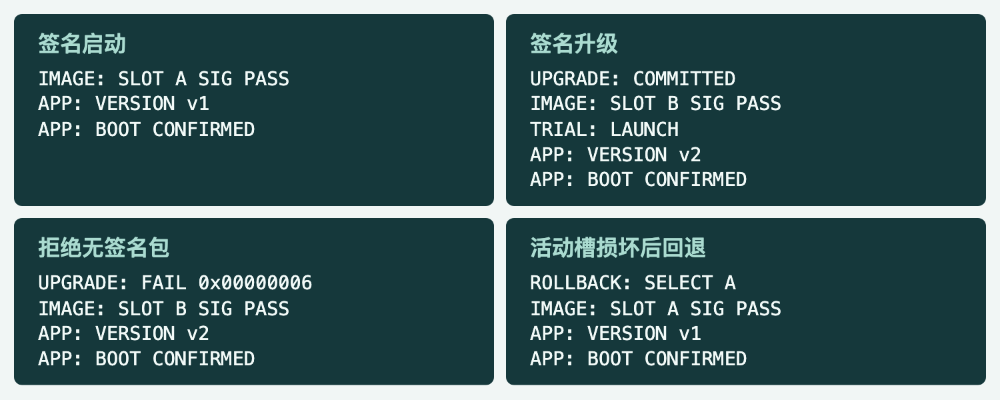
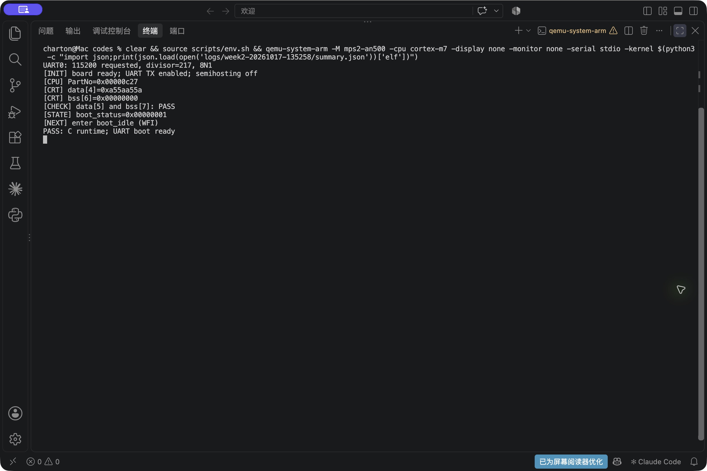

# QEMU 最终演示指南

从 `codes/` 运行以下命令。脚本重新构建正式目标和示例包，创建一次性目录，运行四个会话并核对实际版本、签名拒绝与确认输出。宿主需要本地 UNIX 套接字和 QEMU；没有实体板也可以复核。

```sh
bash scripts/demo-week8.sh
```

输出在 `build/demo-日期-时间/`。末尾应依次出现 `PASS boot`、`PASS upgrade`、`PASS refusal`、`PASS recovery`。也可给脚本一个尚不存在的目录名。运行中出现一次“upgrade did not commit”是拒绝无签名包的预期观察，最终以四项断言及进程退出码判定。

| 步骤 | 输入与动作 | 应当核对的客体输出 |
|---|---|---|
| 1 启动 v1 | A 装已签名 v1，构造 1 MiB NOR，运行正式 ELF | SLOT A SIG PASS，APP: VERSION v1，BOOT CONFIRMED |
| 2 升级 v2 | 从步骤 1 的快照经串口上传已签名 v2 | UPGRADE: COMMITTED，TRIAL: LAUNCH，APP: VERSION v2 |
| 3 拒绝无签名包 | 从步骤 2 的快照上传无签名 v3 | UPGRADE: FAIL，原 v2 仍启动、确认，整段无 COMMITTED |
| 4 恢复旧应用 | 复制步骤 2 的快照，在活动 B 槽载荷翻转一位，冷启动 | ROLLBACK: SELECT A，APP: VERSION v1，BOOT CONFIRMED |



截图选取了四场实测 UART 中的关键行。二进制协议字符和完整输出保存在[本轮演示证据](../../reports/week8/evidence/demo/)；每次重跑都会生成新的 uart.log 及快照。

早期串口驱动可与第二周的实际终端截图对照。该次运行在关闭 semihosting 后打印了时钟、UART 配置及运行时自检；上方四场记录来自第八周正式固件。



## 手动分步启动和升级

```sh
bash scripts/build-week7.sh
D=$(mktemp -d)
python3 scripts/seed-week6.py --slot-a build/week7/application-week7-v1.pkg --output "$D/seed.bin"
python3 scripts/send-week7.py --image "$D/seed.bin" --evidence "$D/boot"
python3 scripts/send-week7.py --image "$D/boot/nor.bin" --package build/week7/application-week7-v2.pkg --evidence "$D/upgrade"
python3 scripts/send-week7.py --image "$D/upgrade/nor.bin" --evidence "$D/restart"
```

最后一次冷启动应直接运行已确认 v2。若拒绝包，先从 uart.log 区分“此次升级未提交”和“当前活动槽无效”，再检查包与固件是否来自同一实验密钥。若需要检查未确认试运行，执行 `make verify-week7`，查看 `watchdog-trial` 的客体 RESET 事件和 `watchdog-snapshot-restart` 的旧版启动记录。快照恢复与客体复位各有独立断言。
