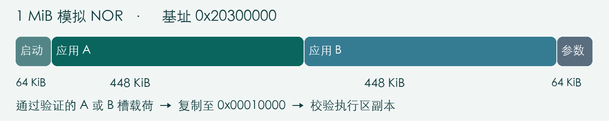

# Cortex-M7 启动器技术与开发说明

正式目标为 `bootloader-week7.elf`。第八周在已有目标上交付默认开启的签名路径 LTO，沿用包格式、版本串和用户命令。接手者从[工程操作说明](../README.md)构建，从[最终演示](week8-demo.md)运行，从[最终测试报告](../../reports/week8/最终测试报告.md)核对结果。

## 需求、实现与验证

| 需求及适用条件 | 设计决定 | 实现 | 可观察的验收结果 |
|---|---|---|---|
| AN500 复位后建立 C 环境 | 链接断言约束段边界，汇编复制与清零 | week3/startup.S、week6/linker.ld | 污染段内容后在 main 观察恢复 |
| 可维护的串口 | 中断接收、有界发送、前台命令窗口 | week3/uart.c、week7/main.c | 满队列返回错误、嵌套屏蔽状态恢复 |
| 接收更新仍保有一个好槽 | 只擦写非活动槽；参数页双副本 | week5/ymodem.c、boot_meta.c、week6/update.c | 失败或中断后，比较旧槽并冷启动 |
| 验证执行内容 | 校验头、长度、向量与 CRC，签名覆盖头和载荷，再检查装载副本 | week4/image.c、week6/secure_image.c | 合法包确认，缺签名、载荷损坏、签名不匹配均拒绝 |
| 试运行失败可退回 | 先记录意图再激活；挂起时看门狗复位 | week7/control.c、app_confirm.c、week6/watchdog.c | QMP RESET 与快照重启后的原版本确认 |
| 配置变更可追踪 | 配置另占两页，成功提交后公布新值 | week6/boot_config.c、week7/control.c | 写失败仍返回旧值，重启重读已保存值 |
| 装载区 64 KiB | 保留节回收并对密码路径进行 LTO | cmake/week7.cmake | 段统计及开关对照见最终测试报告 |

以上代码路径相对 `src/`，CMake 文件相对工程目录。操作员可在启动窗口整行输入 `status`、`boot`、`upgrade`、`recover` 或 `param`。参数值域、快捷键和重置确认详见[串口命令表](week7-guide.md)。

## 数据流与存储所有权

UART0 收到字节后进入中断环形队列。YMODEM 通过读、写和时钟回调访问通道，通过 sink 回调通知开始、数据、结束或取消。升级上下文持有非活动槽及其已接收、已写入进度。完成时从槽重新验证镜像；发布活动选择前还要检查 READY 记录并再次验证候选。应用确认代码在交接后独立绑定存储，读取持久记录核实自己是否有权确认。

镜像中的偏移与运行地址分开计算。A 槽位于 [0x10000, 0x80000)，B 槽位于 [0x80000, 0xf0000)。每槽最大签名载荷为 458,448 字节（458,752 − 32 − 272）。载荷复制至 0x00010000，应用 RAM 从 0x20010000 开始。受保护的启动预留区位于模拟 NOR，实际启动指令由 QEMU 从 ELF 加载。参数分区的前两页保存 48 字节升级记录，后两页保存 56 字节配置记录。写提交标记前须先核实正文；返回错误后选择槽位须重读持久记录。

## 指定手册与工业需求适用性

| 来源与范围 | 设计上的使用方式 | 核验或待确认条件 |
|---|---|---|
| Arm Cortex-M7 TRM，DDI 0489B §4.1 初始化 | 区分处理器复位入口与软件初始化，核对向量定位、初始栈、段准备 | startup.S 和链接图；启动专项污染数据后在 GDB 复核 |
| 同手册 §5.3 存储类型与行为、§5.8 一级缓存 | 区分执行区、普通存储与外设访问；实板须单独处理缓存一致性 | 现有 AN500 试验覆盖复制及副本校验；缓存启用条件留待板级配置 |
| 同手册 §7.2–7.3 NVIC、§9.1 调试 | 核对中断屏蔽、挂起状态、向量切换；用调试器读取交接状态 | verify-handoff-contract、verify-irq-contract.py；物理调试器待接入 |
| SIMATIC S7-1500 公开资料，CPU 1511-1 PN 研究样本 | 按装载、工作、保持存储的职责解释本实验分区 | 公开职责已对应；内部 ROM 布局、信任根及硬件型号须由项目方提供 |
| Siemens 对 IEC 62443-4-1 的说明，适用于产品开发过程 | 记录第三方来源、问题修复、构建参数与回归证据 | 仓库、测试与交付记录可核查；正式过程审计独立实施 |
| Siemens 对 IEC 62443-4-2 的说明，适用于特定组件及产品范围 | 将固件完整性与更新授权落实为签名校验和拒绝试验 | 项目未确定组件安全等级；实物密钥、调试权限及组件认证需另验 |

手册指向特定版本，便于按章节复核。仿真机型决定外设与实验地址。工程没有复刻 SIMATIC 内部固件布局。[Arm DDI 0489B](https://documentation-service.arm.com/static/5e906b038259fe2368e2a7bb) · [QEMU MPS2 机型](https://www.qemu.org/docs/master/system/arm/mps2.html) · [SIMATIC 存储研究及官方产品引用](simatic-memory-mapping.md) · [Siemens S7-1500 组件符合性文件第 2 章](https://support.industry.siemens.com/cs/attachments/109988966/s71500_iec_62443_4_2_conformity_en-US_en-US.pdf)

## 接口与扩展

Doxygen 覆盖正式固件和确认应用使用的 15 个公开头文件。解压[离线 API 参考](../../reports/week8/API参考.zip)后打开 html/index.html；Files 页面可查函数、类型和字段，源码页可看原声明。修改接口时在头文件更新输入、返回、持久化副作用和失败后允许的下一步，并运行 `make api`。第三方密码库保留上游许可与来源，项目 API 参考记录本工程包装层。

换板时按 board、UART、Flash、watchdog、linker 的顺序核对平台依赖。真实 Flash 的擦写粒度、寿命和中断后的可见状态是双页日志正确性的前提。首次用 GDB 在应用入口检查 MSP、VTOR 和屏蔽状态，再运行试运行与中断恢复矩阵。正式固件使用独立的无故障包装器链接，检查入口为 `make verify-release`。复位后由应用接管看门狗时，应复核设备的锁定与喂狗时序。
