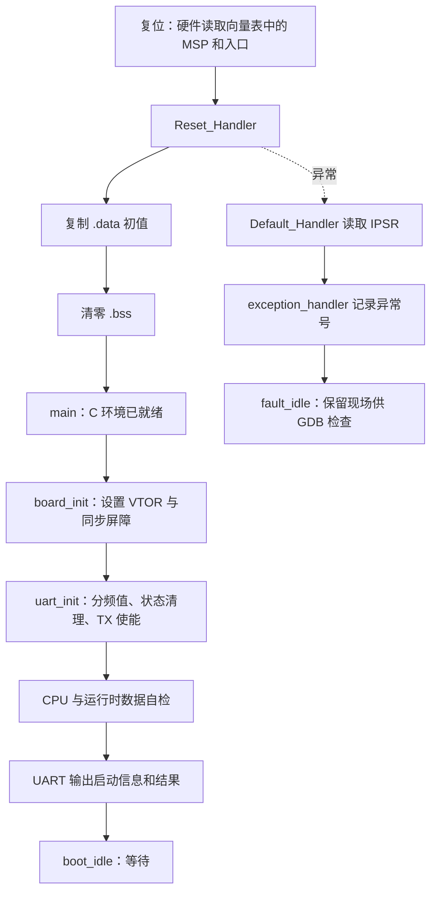

# 第二周：最小 Bootloader 启动架构与学习笔记

实现与记录日期：2026-10-14。视角：大四实习生，围绕实际代码、调试和实验整理。

## 1. 这次完成什么

任务依据为项目任务书第 3 页的 Week 2：汇编启动、C 环境初始化、系统时钟、基础 UART 及 QEMU 启动验证。现在新增 `bootloader.elf`，第一周 `demo.elf` 继续保留。第一周基线提交为 `8bb81c4`。

最明显的变化是输出路径。第一周由 semihosting 把字符串交给宿主机打印；第二周由固件访问 CMSDK APB UART0 寄存器，经 QEMU 串口后端输出。第二周运行命令不启用 semihosting，反汇编也没有 BKPT 指令。独立保留的第一周回归用例仍按原方式启用 semihosting。

这是能启动并自检的 Bootloader 核心，还没有固件校验、应用跳转、Flash 擦写或升级协议。任务书把这些能力分别安排在后续周次。

## 2. 从复位到输出的架构



| 文件 | 责任 | 我这样拆分的原因 |
|---|---|---|
| `src/week2/startup.S` | 向量表、复位、段初始化、默认异常入口 | 便于从复位入口逐条跟踪，不混入外设逻辑 |
| `src/week2/linker.ld` | CODE/RAM、段边界、加载地址、栈空间和断言 | 汇编使用链接器符号，不重复硬编码各段地址 |
| `src/week2/board.c/.h` | VTOR 和固定时钟信息 | 平台条件集中在板级层，避免散落在驱动中 |
| `src/week2/uart.c/.h` | 初始化、轮询发送、字符串、排空检查 | 主流程不直接读写 UART 寄存器，后续可增加接收和中断 |
| `src/week2/main.c` | 自检、结果输出、状态保存 | 保持启动过程能读懂，出错时能通过变量定位阶段 |
| `scripts/verify-week2.py` | 构建、注入、串口逐字节比对、证据保存 | 把“看上去正常”变成可重复的验收 |

### 向量表和栈

AN500 模型具有 32 个外部 IRQ，本实现提供 16 个核心向量项加 32 个外部项，总计 192 字节，起点按 256 字节对齐。保留项写零，其余未专门处理的异常进入默认处理函数。复位 MSP 由处理器读取第一项自动装载，不需要在普通 C 函数中重新设置栈。

保留 4 KiB 栈，范围 `[0x203ff000, 0x20400000)`，初始 MSP 为 `0x20400000`。链接器检查栈顶的 8 字节对齐及静态区不侵入栈。这个检查不等于运行时栈溢出保护，当前没有测量栈高水位。

默认异常入口读取 IPSR，把异常号传给 C 函数并停在 `fault_idle`。我没有在这里直接打印日志，因为异常可能发生在 UART 初始化之前。这样至少能用 GDB 确认发生了哪类异常。它不是故障恢复机制；本次只验证了 C 环境已经初始化后的 HardFault 路径，未验证初始化途中出错或栈损坏场景。

### C 环境初始化

`.data` 的运行地址在 RAM，初值的加载地址在 CODE。`_sidata` 表示初值位置，`_sdata` 到 `_edata` 表示目标区间；启动代码按字复制，再清零 `[_sbss, _ebss)`。链接器对起止地址做 4 字节对齐和断言，因此循环的字访问有明确前提。

本次构建实际布局如下，后续代码变化应以新 ELF 和 map 为准：

| 区域或符号 | 地址/长度 |
|---|---|
| 向量表 | `0x00000000`，192 字节 |
| Reset_Handler | `0x000000c0`；向量表第二项为 `0x000000c1`，最低位表示 Thumb |
| `.data` 初值 | `_sidata = 0x000003c8` |
| `.data` | `[0x20000000, 0x20000014)`，20 字节 |
| `.bss` | `[0x20000014, 0x20000038)`，36 字节 |
| 栈 | `[0x203ff000, 0x20400000)`，4096 字节 |

我把原来的单个检查变量扩展成 5 个已初始化字和 7 个待清零字，使测试覆盖多轮循环。GDB 在复位处主动污染整段内存，进入 `main` 后逐字节核对，并在 `.bss` 末尾放置哨兵检查上边界。它证明了当前布局下的初始化，不代表所有可能链接布局、空段或任意长度都已测试。

## 3. 时钟要求如何落到当前平台

QEMU `mps2-an500` 板级模型提供固定 25 MHz 系统时钟。除了核对官方实现，本次还用本机 QEMU 的 `info qtree` 检查 CPU 时钟输入和 UART 的 `pclk-frq`，均符合 25 MHz 假设。证据见最终日志中的 `model-clock.txt`。

因此本实现通过 `board_clock_hz()` 提供固定频率，`board_init()` 设置 VTOR 并执行 DSB/ISB。没有编造 PLL/RCC 配置寄存器，也没有实现运行时变频。任务书的“系统时钟配置”在这里按 QEMU 平台条件适配为：确认模型时钟、集中声明频率、据此配置外设并验证寄存器。如果验收要求真实 MCU 的 PLL、晶振切换与锁定等待，仍需另选硬件平台实现。

同样，CODE 所在的 `0x00000000` 区域是 QEMU SSRAM，并非持久化 Flash。这里完成的是“从加载地址复制到运行地址”的 C 初始化机制，不是 Flash 擦写驱动。第三周需要先明确 Flash 的仿真存储方案。

## 4. UART 驱动的最小实现

UART0 基址为 `0x40004000`，型号为 CMSDK APB UART。第二周只开启 TX，以轮询实现发送，不开启 RX 和 UART 中断。

| 偏移 | 寄存器 | 本次用途 |
|---|---|---|
| `0x00` | DATA | 写入待发送字节 |
| `0x04` | STATE | 查询 TXFULL；用 W1C 清除溢出标志 |
| `0x08` | CTRL | bit 0 使能 TX，其他使能位保持零 |
| `0x0c` | INTSTATUS | 初始化时清理状态 |
| `0x10` | BAUDDIV | 写入分频值 217 |

目标波特率为 115200，`25000000 / 115200` 四舍五入得到分频值 217；按该分频值计算约为 115207 baud。模型采用 8N1。串口文件后端收到日志不能证明物理线路的波特率精度，因此测试还读回分频寄存器，但不把这当作真机电气时序测量。

初始化拒绝零频率、零波特率及超出分频范围的参数，且拒绝后保持已有寄存器配置。发送前检查 TX 是否使能，并等待 TXFULL 清除。等待上限为 1000000 次查询，不是经过标定的毫秒超时。若失败则返回 `-1`，由主流程记录 `boot_status = 3`；不能指望损坏的 UART 再可靠地输出错误消息。

本次验证包含 144 字节启动日志的完整比对及状态寄存器检查，没有制造宿主串口持续阻塞条件，所以不能声称已经覆盖 TXFULL 长时间不释放的完整路径。第三周增加 RX/中断时，需继续考虑缓冲区溢出和并发访问。

## 5. 构建、运行与调试

在工程目录执行：

```sh
cd '/Users/charton/Projects/西门子实习/codes'
bash scripts/build-week2.sh
bash scripts/run-week2.sh
```

终端应显示以下内容；固件随后停留在等待循环，按 Ctrl-C 结束 QEMU。

```text
BOOT: week2 mps2-an500 Cortex-M7
CLOCK: 25000000 Hz (QEMU fixed)
UART0: 115200 requested, divisor=217, 8N1
PASS: C runtime; UART boot ready
```

自动验收：

```sh
python3 scripts/verify-week2.py
```

每次使用独立构建目录和带时间戳的证据目录。最新目录名见 `logs/week2-latest.txt`，最终判定见该目录的 `summary.json`。日志包含 CRLF，脚本按原始字节比较，不依赖终端的换行转换。

手工 GDB 调试：在第一个终端运行 `bash scripts/run-week2.sh -S -gdb tcp:127.0.0.1:3333`；在第二个终端进入工程，执行：

```sh
source scripts/env.sh
arm-none-eabi-gdb build/bootloader.elf
```

```gdb
target remote 127.0.0.1:3333
info registers sp pc
x/48wx 0
break *main
continue
print runtime_data
print runtime_bss
break boot_idle
continue
print boot_status
x/wx 0x40004010
```

`boot_status`：0 表示启动中，1 成功，2 C 环境检查失败，3 UART 失败，4 CPU 型号检查失败。异常则查看 `exception_number`。

当前通过 QEMU 标准输入输出即可演示，自动测试用串口文件后端；不需要物理串口适配器。GDB 使用 QEMU 自带调试接口。

## 6. 我从实验中得到的判断

第一，启动代码和链接脚本必须放在一起理解。只读复制循环容易忽略初值到底在哪里；这次把加载地址、目标范围和 map 对上之后，污染实验才有明确的预期值。

第二，UART 日志是启动过程的一个结果，不是所有底层工作正确的证明。我同时检查了复位寄存器、段内容、VTOR、UART 分频和异常号，避免一行 PASS 掩盖实际未执行的步骤。

第三，硬件模型的边界会影响任务实现。固定时钟和 SRAM 代码区都必须写清楚，否则虽然演示成功，后续做 Flash 或移植时会把错误假设带入设计。

第四，保留第一周目标有实际价值。第二周新增驱动时，原示例仍能独立运行，遇到问题可以先区分工具链故障与新驱动故障。

## 7. 官方参考与证据

查阅日期：2026-10-14。以下源码链接为 upstream master，可能变化；本机版本与寄存器行为另有本次实验记录，不把 master 当作本机版本的逐字源码证明。

- [QEMU MPS2 平台说明](https://www.qemu.org/docs/master/system/arm/mps2.html)
- [QEMU MPS2 板级实现：内存、时钟、IRQ 和 UART 绑定](https://github.com/qemu/qemu/blob/master/hw/arm/mps2.c)
- [QEMU CMSDK APB UART 实现：寄存器和发送行为](https://github.com/qemu/qemu/blob/master/hw/char/cmsdk-apb-uart.c)
- [第二周实测报告](week2-test-report.md)
