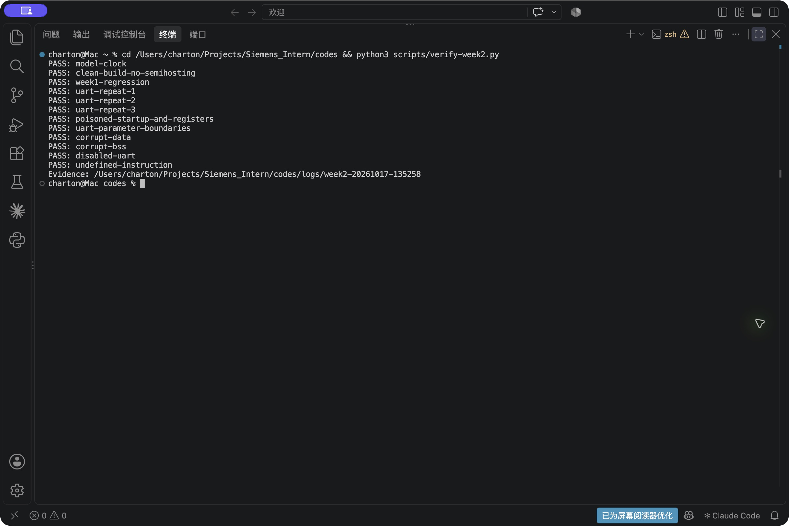
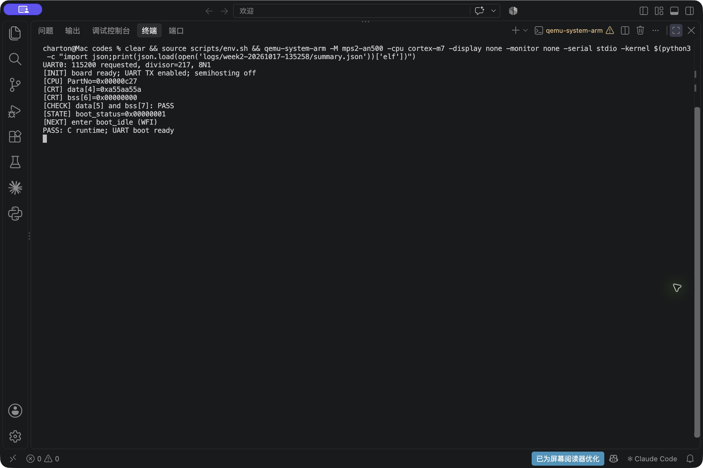
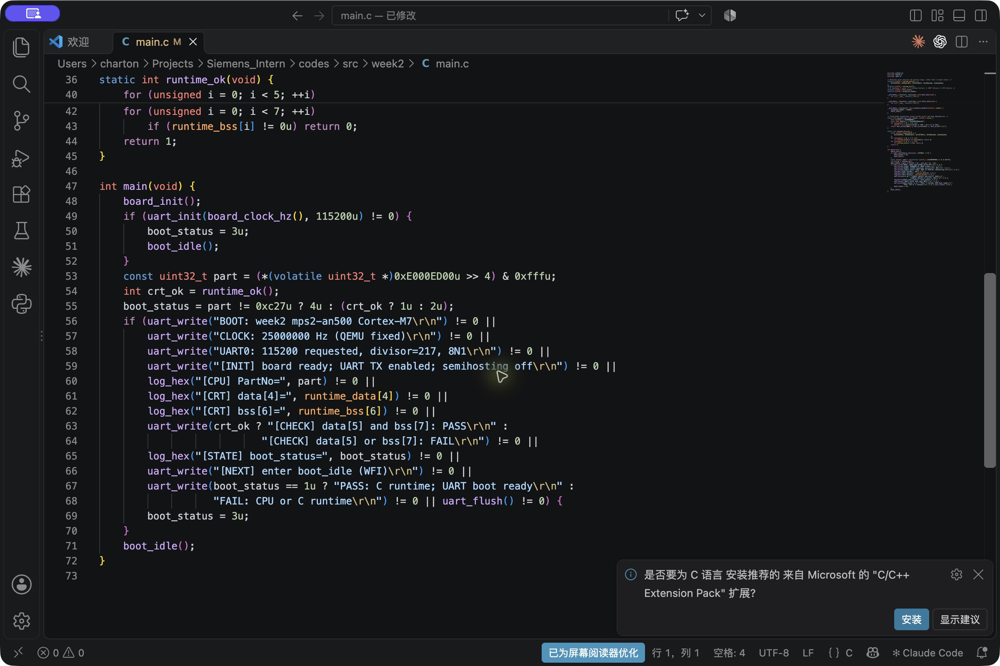

# 工业嵌入式 Bootloader 开发 Week 1–2 周报

本次反馈修订：2026-10-24。Week 1为6项、Week 2为12项检查分组通过，基础接口及脚本补测见末尾表格。以下原始阶段记录保留实验日期；当前判定以“老师反馈修订”表及本轮证据为准，待老师审核。
项目：基于 QEMU 的 Cortex-M7 工业 Bootloader
Week 1–2 阶段记录（原始实验日期）：2026 年 10 月 12 日至 13 日　更新日期：2026 年 10 月 17 日

第一周完成了开发环境搭建、最小裸机 Demo、GDB 启动调试和工业需求资料整理。已形成可复现的启动验证工程，10 月 13 日的增强验证共 6 项检查通过。当前工作重点是理解启动代码与测试之间的对应关系，为后续驱动及镜像加载开发打基础。

## 一 完成情况与工程架构

| 任务 | 已完成结果 | 主要交付 |
|---|---|---|
| 环境搭建 | QEMU、Arm GCC、CMake、Make、GDB 和 Git 可用 | 构建与运行脚本、版本日志 |
| 最小裸机启动 | 完成复位入口、数据初始化与 C 自检 | startup.S、linker.ld、main.c |
| 调试与验证 | 完成断点、单步、初始化污染和两个错误用例 | verify-startup.py、测试摘要 |
| 需求与工程整理 | 形成启动流程和工业需求笔记；建立基线提交 | README、学习笔记、8bb81c4 |
| Git 提交与云端同步 | 已完成本地提交并推送 GitHub；main 已关联 origin/main | 云端提交 9f8969f |

### 构建运行与调试关系

```text
CMake + Arm GCC + linker.ld → demo.elf
QEMU → 向量表 → Reset_Handler → main → 自检与输出
GDB  → QEMU gdbstub → 断点 单步 内存与寄存器观察
```

| 模块 | 文件位置（相对 codes） | 职责 |
|---|---|---|
| 启动层 | src/startup.S | 提供向量表，初始化 C 数据，调用 main |
| 内存布局 | src/linker.ld | 定义代码区、RAM、段边界和栈顶符号 |
| 示例主流程 | src/main.c | 检查内核与数据初值，输出 PASS 或 FAIL |
| 验证工具 | scripts/verify-startup.py | 独立构建、注入测试条件、断言并留存证据 |

这样划分后，启动代码只负责建立 C 运行条件，自检由 C 程序完成，测试脚本负责观察及故障注入。GDB 属于调试工具，不是固件启动步骤。第一周代码仍保留为独立 demo.elf，便于后续回归。

<!-- pagebreak -->
## 二 关键代码与实现思路

### 数据初始化为什么放在 main 之前

带初值的全局变量需要从装载位置复制到 RAM，零初始化变量需要清零。链接脚本输出 _sidata、_sdata、_edata 等符号，由启动汇编使用。下面摘录自 [src/startup.S](../../codes/src/startup.S)，与当前源文件一致。

```asm
  ldr r0, =_sidata
  ldr r1, =_sdata
  ldr r2, =_edata
1:
  cmp r1, r2
  bcs 2f
  ldr r3, [r0], #4
  str r3, [r1], #4
  b 1b
```

r0 指向 .data 初值，r1 指向 RAM 写入位置，r2 表示结束边界；每次复制 4 字节。当前链接脚本对段边界进行 4 字节对齐，与按字复制的实现相配合。

```asm
2:
  ldr r1, =_sbss
  ldr r2, =_ebss
  movs r3, #0
3:
  cmp r1, r2
  bcs 4f
  str r3, [r1], #4
  b 3b
4:
  bl main
```

第二个循环清零 [_sbss, _ebss)，随后调用 main。若 main 返回，则进入默认处理循环。第一周向量表只提供基本入口，完整异常和外部中断支持留在后续阶段。

### 在 C 入口检查启动结果

以下摘录自 [src/main.c](../../codes/src/main.c)。CPUID 的 PartNo 用于检查内核，两个变量分别观察 .data 和 .bss 的初始化结果。

```c
    const uint32_t cpuid = *(volatile uint32_t *)0xE000ED00;
    int ok = initialized_data == 0x12345678 && zero_data == 0
        && ((cpuid >> 4) & 0xfff) == 0xc27;
    demo_result = ok ? 0x600d : 0xdead;
    semihost(4, ok ? "PASS: Cortex-M7; .data initialized; .bss zero; bare-metal C99\n"
                   : "FAIL: Cortex-M7 or C runtime validation\n");
```

demo_result 提供 GDB 可观察的结果标记。该检查用于当前启动示例；semihosting 输出依赖宿主机调试服务，UART 驱动的验证见后续进度。

<!-- pagebreak -->
## 三 测试方法与实际结果

### 先设置错误初值再验证恢复

只观察 .bss 为零可能产生假阳性，因为模拟 RAM 初值可能恰好为零。因此测试先停在 Reset_Handler，污染 .data 和 .bss，再运行到 main 的第一条指令检查恢复结果；同时在 .bss 末尾后放置 4 字节哨兵，观察该位置是否被误写。

测试于 10 月 13 日执行，在独立构建目录生成并运行同一 ELF。汇总包含 6 项检查，其中工具和构建各 1 项，固件运行场景 4 项。

| 检查项 | 操作与预期 | 实际结果 |
|---|---|---|
| 工具检查 | 六个工具可用，满足版本约束 | PASS |
| 全新构建 | 编译链接成功，检查 ELF 段布局 | PASS；text 368、data 4、bss 8 字节 |
| 正常启动 | 输出 PASS，正常退出 | PASS；退出码 0 |
| 污染后启动 | data 填 CC、BSS 填 A5；应恢复且保留哨兵 | PASS；data 正确、BSS 全零、哨兵保留 |
| 破坏 data 变量 | main 入口改 initialized_data；应识别错误 | PASS；输出 FAIL，结果 0xdead，退出 1 |
| 破坏 BSS 变量 | main 入口改 zero_data；应识别错误 | PASS；输出 FAIL，结果 0xdead，退出 1 |

### 关键调试证据

以下为 [初始化污染 GDB 日志](../../codes/logs/week1-review-20261013-125900/poisoned-startup-gdb.txt) 的节选。

```text
RESET_MSP=0x20400000 RESET_PC=0xc4 RESET_VECTOR=0xc5
INJECTED_DATA=cccccccc
INJECTED_BSS=a5a5a5a5a5a5a5a5
RESTORED_DATA=78563412
CLEARED_BSS=0000000000000000
UPPER_SENTINEL=0x12345678
STEP_PC=0x46
CHECK_PASS:poisoned-startup
```

恢复后的字节 78 56 34 12 对应小端整数 0x12345678。复位向量值 0xc5 的最低位表示 Thumb 状态，实际指令地址为 0xc4。负向用例的退出码 1 是预期结果；最终测试脚本退出码为 0。

结论：当前布局中的数据复制、清零和错误识别符合预期。覆盖范围为 4 字节 .data、8 字节 .bss 和一处末尾哨兵；尚未覆盖任意段长度、空段和完整越界检测。

<!-- pagebreak -->
## 四 工业需求调研与下一阶段设计

### 将需求落实到模块与验收条件

已整理的 S7 资料帮助区分更新文件验证、启动前固件验证及 PLC 用户程序启动阶段。具体型号仍需确认；本项目使用 QEMU MPS2 Cortex-M7 平台，以下模块是后续设计草案，不代表已还原 S7 内部实现。

| 设计模块 | 要解决的问题 | 后续验收方法 |
|---|---|---|
| 镜像检查 | 镜像长度、入口和内容是否有效 | 输入截断、超长和非法入口，确认拒绝 |
| 存储层 | 写入约束与升级状态能否持久保存 | 模拟写入中断，检查有效记录判定 |
| 启动选择 | 候选镜像失败后如何恢复 | 验证失败和试运行失败时选择已确认镜像 |
| 应用交接 | 栈、向量表和中断状态如何交给应用 | 检查入口、MSP 和跳转前状态 |

候选设计是先保留已确认镜像，将更新写入候选区，验证通过后试运行，再由应用确认成功。这样可以把“接收完成”“验证通过”和“实际运行成功”作为不同阶段处理。持久化元数据的格式和切换时机需要先确定，随后才能进行有意义的断电恢复实验。

### 当前问题与改进计划

第一周将“能构建、运行、调试同一份固件”作为环境验收条件。进一步学习需要结合源码和 GDB，说明每一步的输入、输出和失败表现。开发中使用工具辅助生成和整理的部分，也需要逐项阅读和复现。

| 下一阶段工作 | 预期交付与验收条件 |
|---|---|
| 熟悉现有启动及驱动代码 | 演示复位到 main、UART 正常输出及一个故障定位过程 |
| UART 接收与中断 | 完成接收与缓冲区边界测试，明确溢出处理方式 |
| Flash 仿真方案 | 明确擦写约束、重启后保存方式和断电注入点 |

需请带教确认参考的 S7 CPU 型号，以及项目侧重功能演示还是需要对应安全标准条款。当前尚未实现持久化 Flash、独立应用跳转、签名验证与升级回滚；这些工作将按后续阶段安排。后续严格按规划书逐周推进：先完成当前阶段反馈修改与验证，提交更新报告，待老师确认后再进入下一阶段。

### 交付入口

工程位于 Siemens_Intern/codes。第一周 [环境报告](../../codes/docs/validation-report.md)、[增强验证报告](../../codes/docs/week1-audit.md)、[学习笔记](../../notes/week1-learning-notes.md) 和 [测试摘要](../../codes/logs/week1-review-20261013-125900/summary.json) 均已整理。测试日志中的旧绝对路径是当时运行记录，当前入口以项目目录为准。

复现方式：进入 codes 目录，执行 source scripts/env.sh，然后运行 python3 scripts/verify-startup.py；第二周验收使用 python3 scripts/verify-week2.py。每次生成新的证据目录。

<!-- pagebreak -->
## 五 Week 2 最小启动与 UART 任务

本节单独记录 10 月 14 日完成的第二周阶段工作。新增 bootloader.elf，保留第一周 Demo；第二周代码提交为 8cbafe1。已完成 Git 提交和 GitHub 推送：[远程仓库](https://github.com/Charttt0n/Siemens_Intern_Charton) 的 main 分支与本地已提交版本一致，提交号为 9f8969f。第一周基线 8bb81c4、第二周代码 8cbafe1 的提交历史均已保留。仓库统一管理代码、周报、规划及笔记。

### 模块关系与发送实现

```text
src/week2/startup.S → main.c → board.c（板级初始化与时钟）
                            → uart.c（配置与轮询发送）
                            → boot_idle（主流程等待）
异常入口 → exception_handler → fault_idle（异常等待）
```

UART 驱动独立处理寄存器访问和返回值，主流程组织自检及日志。当前模型使用固定 25 MHz 时钟，115200 配置的分频值为 217。下面摘录自 [src/week2/uart.c](../../codes/src/week2/uart.c)。

```c
int uart_flush(void) {
    if ((CTRL & TX_ENABLE) == 0u) return -1;
    for (uint32_t n = 0; n < POLL_LIMIT; ++n) {
        if ((STATE & TX_FULL) == 0u) return 0;
    }
    return -1;
}
```

uart_flush 检查 TX 使能并轮询发送缓冲区状态，超过循环上限返回错误；uart_putc 仅在允许发送后写数据寄存器。该上限是循环次数，尚不是按实际时间定义的超时。当前为轮询 TX，接收和中断处理仍待开发。

### 输出与验收结果

关闭 semihosting 后，UART 输出如下。原始记录保存 CRLF，本处按行展示。

```text
BOOT: week2 mps2-an500 Cortex-M7
CLOCK: 25000000 Hz (QEMU fixed)
UART0: 115200 requested, divisor=217, 8N1
PASS: C runtime; UART boot ready
```

| 场景 | 10 月 14 日记录中的实际结果 |
|---|---|
| 三次正常启动 | 每次输出预期的 144 字节，完整内容比对通过 |
| 初始化污染 | 20 字节 data 恢复、36 字节 BSS 清零、哨兵保留 |
| 参数边界与变量破坏 | 无效配置被拒绝；数据破坏被检测并输出 FAIL |
| 禁用 UART 与非法指令 | 分别记录串口错误状态和 HardFault 异常号 3 |

[最终验收报告](../../codes/docs/week2-test-report.md) 共 12 项检查通过，含时钟、构建、第一周回归及 9 个第二周运行场景。模拟器由宿主机在断言后结束；判定依据是日志与状态检查。当前结果支持最小启动与 UART TX，不包含物理波形验证、故障恢复或工业认证。


<!-- pagebreak -->
## 六 开发运行截图与日志补充

2026 年 10 月 17 日补充运行复验。为便于观察控制台程序的启动过程，新增 INIT、CPU、CRT、CHECK、STATE 和 NEXT 日志，输出内核标识、关键变量、自检结果及后续等待状态。以下图片直接截取自 VS Code 编辑器与集成终端窗口，保留工具栏、文件路径和实际运行画面。

### 终端自动验收



图 1 VS Code 终端中的 12 项验收结果

构建同时生成 demo.elf 与 bootloader.elf，退出码为 0。本次 12 项检查全部通过，包含第一周回归、三次正常启动、初始化污染、参数边界、数据破坏、禁用 UART 和非法指令场景。

### 正常启动过程



图 2 关闭 semihosting 后的 UART 启动日志

PartNo 为 0x00000c27；data[4] 为预期值 0xa55aa55a，bss[6] 为 0。CHECK 检查全部 5 个 data 元素与 7 个 BSS 元素，boot_status 为 1 后进入 WFI 等待。三次启动均逐字节比对通过，每次输出 370 字节。

### 日志代码开发界面



图 3 VS Code 中的启动流程与日志实现

编辑器截图展示 main.c 中的板级初始化、UART 初始化、内核与 C 运行环境检查，以及分阶段日志输出。输出错误时将 boot_status 设为 3；正常完成后进入 boot_idle。自动验收另覆盖数据破坏、禁用 UART 与非法指令等负向场景。

本次证据目录：codes/logs/week2-20261017-135258；验收入口：在 codes 目录执行 python3 scripts/verify-week2.py。历史章节中的 144 字节为 10 月 14 日版本输出，本次扩充日志后以新记录为准。

## 老师反馈修订

技术补充与图示见 [反馈技术说明](../../codes/docs/teacher-feedback-technical.md)。下阶段须在反馈修正经老师确认后按规划书推进。

更新日期：2026-10-24。本轮为老师反馈修订，待老师审核。历史记录保留；下列新证据为本轮判定依据。测试中的预期拒绝不等于套件失败。

此前章节记录原始实验过程；本节替代旧数量及输出字节数作为当前验收依据。已完成修改不代表老师已审核。

| 用例编号与方式 | 实际输入与步骤 | 预期输出 | 实际输出与验证证据 |
|---|---|---|---|
| W1-01 工具版本 | qemu/gcc/cmake/gdb/make/git --version | 工具存在；QEMU≥7.0，GCC≥12.3，CMake≥3.20 | 六工具检查通过；logs/week1-review-20261024-173002/qemu-system-arm-version.txt |
| W1-02 干净构建 | 新目录；CMake --target demo.elf；检查ELF段、向量和符号 | 编译退出0；生成同一被测ELF | 退出0，ELF/工具版本与源摘要见summary；logs/week1-review-20261024-173002/build.txt |
| W1-03 正常启动 | QEMU mps2-an500加载新demo.elf | PASS标记，退出0 | PASS: Cortex-M7; .data initialized; .bss zero; bare-metal C99；退出0；logs/week1-review-20261024-173002/nominal-qemu.txt |
| W1-04 GDB污染与单步 | 复位处data填CC、bss填A5，_ebss写0x12345678；运行main并stepi | data恢复，bss清零，哨兵不变，MSP/PC正确 | MSP=0x20400000，PC=0xc4；data=78563412；bss=8个00；哨兵0x12345678；单步PC=0x46；logs/week1-review-20261024-173002/poisoned-startup-gdb.txt |
| W1-05 负向data | main入口 initialized_data=0xdeadbeef | 固件FAIL，demo_result=0xdead，QEMU退出1 | FAIL及状态断言通过，退出1为预期；logs/week1-review-20261024-173002/corrupt-data-gdb.txt |
| W1-06 负向bss | main入口 zero_data=0xdeadbeef | 固件FAIL，demo_result=0xdead，QEMU退出1 | FAIL及状态断言通过，退出1为预期；logs/week1-review-20261024-173002/corrupt-bss-gdb.txt |
| W2-01 模型时钟 | info qtree | CPU及5个UART输入25000000Hz | 25MHz读回通过；logs/week2-20261024-173006/model-clock.txt |
| W2-02 构建与ELF | 新目录构建demo.elf和bootloader.elf；objdump/nm | 无BKPT；-Werror构建成功 | 退出0；无semihosting指令；logs/week2-20261024-173006/build.txt |
| W2-03 前期回归 | 运行独立Week1 ELF | PASS并正常退出 | PASS，退出0；logs/week2-20261024-173006/week1-regression.txt |
| W2-04 重复启动 | 第1次独立QEMU实例 | 与verify-week2.py expected_uart逐字节相同 | 370字节含CRLF完全匹配；logs/week2-20261024-173006/uart-repeat-1-uart.log |
| W2-05 重复启动 | 第2次独立QEMU实例 | 与verify-week2.py expected_uart逐字节相同 | 370字节含CRLF完全匹配；logs/week2-20261024-173006/uart-repeat-2-uart.log |
| W2-06 重复启动 | 第3次独立QEMU实例 | 与verify-week2.py expected_uart逐字节相同 | 370字节含CRLF完全匹配；logs/week2-20261024-173006/uart-repeat-3-uart.log |
| W2-07 GDB初始化 | data20字节填CC、bss36字节填A5、末尾哨兵；运行main及boot_idle | data五字恢复，bss清零，哨兵不变；状态/寄存器符合 | boot_status=1，VTOR=0，CTRL=1，BAUDDIV=217；bss36字节清零；logs/week2-20261024-173006/poisoned-startup-and-registers-gdb.txt |
| W2-08 参数边界 | (clock,baud)=(0,115200),(25000000,0),(25000000,2000000),(25000000,1)；NULL；禁用TX | 各非法调用=-1且配置不变；有效配置成功 | 全部拒绝；有效分频217；继续启动状态1；logs/week2-20261024-173006/uart-parameter-boundaries-gdb.txt |
| W2-09 data损坏 | main入口 runtime_data[4]=0xdeadbeef | boot_status=2，FAIL，无PASS | 状态2；输出逐字节符合负向模板；logs/week2-20261024-173006/corrupt-data-gdb.txt |
| W2-10 bss损坏 | main入口 runtime_bss[6]=0xdeadbeef | boot_status=2，FAIL，无PASS | 状态2；输出逐字节符合负向模板；logs/week2-20261024-173006/corrupt-bss-gdb.txt |
| W2-11 UART错误传播 | 首次uart_write前 CTRL=0 | boot_status=3，UART零字节 | 状态3；进入boot_idle；零字节；logs/week2-20261024-173006/disabled-uart-gdb.txt |
| W2-12 异常路径 | main首条指令改UDF #0 | HardFault，exception_number=3 | 进入fault_idle；异常号及xPSR异常位均3；logs/week2-20261024-173006/undefined-instruction-gdb.txt |

### 对应阶段的反馈补测

| 用例编号与方式 | 实际输入与步骤 | 预期输出 | 实际输出与验证证据 |
|---|---|---|---|
| FB-TX-01 compile real driver with fake volatile MMIO | UART_NATIVE_TEST | compiler exit=0 | exit=0, timeout=False; ；logs/feedback-20261024-173104/FB-TX-01.log |
| FB-TX-02 native driver assertions | CTRL=1 STATE=1 DATA=0x55 then STATE=0 | bounded -1, no DATA write; recovery writes 0x41 | exit=0, timeout=False; TX_FULL=1: flush/putc/write=-1; DATA=0x55 unchanged; bounded return PASS；TX_FULL=0 after timeout: write=0 DATA=0x41 PASS；disabled TX and NULL: -1 PASS；；logs/feedback-20261024-173104/FB-TX-02.log |
| FB-IRQ-01 cross compile production IRQ/UART | nested masks 0 and 1 | build succeeds | exit=0, timeout=False; ；logs/feedback-20261024-173104/FB-IRQ-01.log |
| FB-IRQ-02 real Cortex-M7 instructions under QEMU | initial mask=0/1; nested save/restore, uart_init, empty uart_getc | both original masks restored; exit=0 | exit=0, timeout=False; PRIMASK initial=0 nested/init/getc restored=0 PASS；PRIMASK initial=1 nested/init/getc restored=1 PASS；；logs/feedback-20261024-173104/FB-IRQ-02.log |
| CLI-W1-MISSING run before build | clean copy, ELF/image absent | nonzero error, no PASS | exit=1, timeout=False; build/demo.elf: No such file or directory；qemu-system-arm: Could not load kernel 'build/demo.elf'；；logs/feedback-20261024-173104/CLI-W1-MISSING.log |
| CLI-W1-BUILD actual build entry | clean stage output | exit=0 | exit=0, timeout=False; -- The C compiler identification is GNU 16.2.0；-- The ASM … target demo.elf；   text	   data	    bss	    dec	    hex	filename；    368	      4	      8	    380	    17c	build/demo.elf；；logs/feedback-20261024-173104/CLI-W1-BUILD.log |
| CLI-W1-RUN actual run entry | default demo | expected firmware marker; W2 host stops intentional idle | exit=0, timeout=False; PASS: Cortex-M7; .data initialized; .bss zero; bare-metal C99；；logs/feedback-20261024-173104/CLI-W1-RUN.log |
| CLI-W2-MISSING run before build | clean copy, ELF/image absent | nonzero error, no PASS | exit=1, timeout=False; build/bootloader.elf: No such file or directory；qemu-system-arm: Could not load kernel 'build/bootloader.elf'；；logs/feedback-20261024-173104/CLI-W2-MISSING.log |
| CLI-W2-BUILD actual build entry | clean stage output | exit=0 | exit=0, timeout=False; -- Configuring done (0.0s)；-- Generating done (0.0s)；CMak … oader.elf；   text	   data	    bss	    dec	    hex	filename；   1488	     20	   4132	   5640	   1608	build/bootloader.elf；；logs/feedback-20261024-173104/CLI-W2-BUILD.log |
| CLI-W2-RUN actual run entry | default demo | expected firmware marker; W2 host stops intentional idle | exit=0, timeout=True; BOOT: week2 mps2-an500 Cortex-M7；CLOCK: 25000000 Hz (QEMU … e (WFI)；PASS: C runtime; UART boot ready；qemu-system-arm: terminating on signal 15 from pid 81108 (<unknown process>)；；logs/feedback-20261024-173104/CLI-W2-RUN.log |
| CLI-W2-PAUSED paused emulator deadline | -S; CPU never starts | no PASS; watchdog terminates process | exit=0, timeout=True; qemu-system-arm: terminating on signal 15 from pid 81108 (<unknown process>)；；logs/feedback-20261024-173104/CLI-W2-PAUSED.log |
| CLI-BUILD-FAIL controlled tool failure | cmake returns 42 | build script returns 42; no stale success | exit=42, timeout=False; ；logs/feedback-20261024-173104/CLI-BUILD-FAIL.log |
