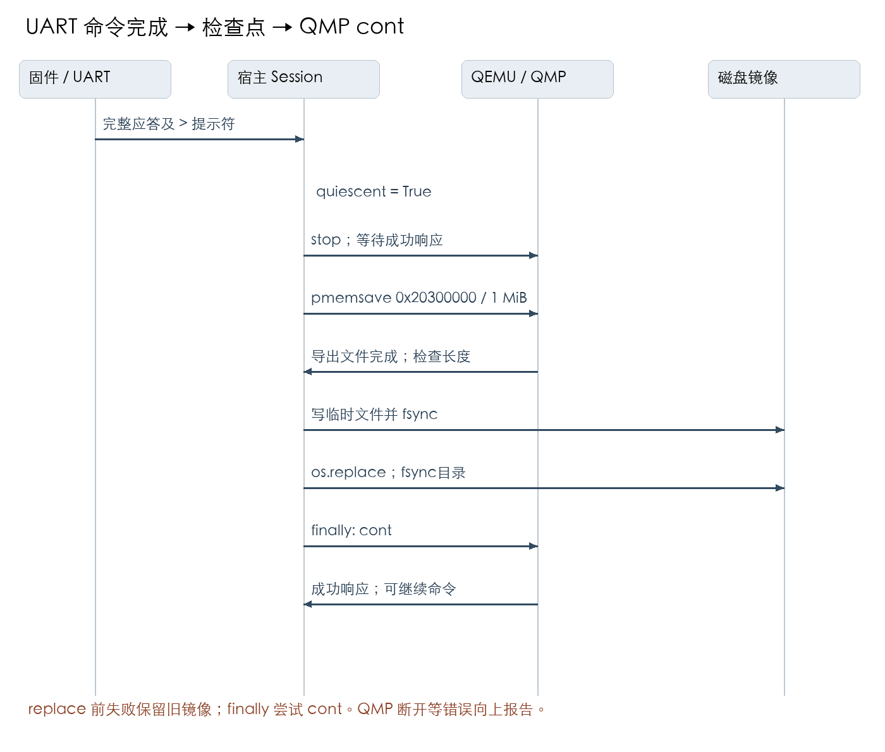

# 工业嵌入式 Bootloader 开发 Week 3 周报

项目：基于 QEMU AN500 的 Cortex M7 Bootloader　计划周次：Week 3

整理日期：2026-10-25

## 一 本周任务与完成情况

本周在最小启动工程上实现UART收发与RX中断、Flash抽象和四区存储管理。阶段测试11组通过；一键入口的Week3部分11项通过。持久化采用宿主显式检查点，SIMATIC对应仅限公开存储职责

| 原计划第3周要求 | 本周成果 | 交付与边界 |
|---|---|---|
| UART收发与中断 | 有界轮询TX、RX IRQ0及环形队列 | src/week3/uart.c；未启用TX中断 |
| Flash读写擦除抽象 | 分区、对齐、NOR规则、写前预校验 | src/week3/flash.c；SRAM后端模拟NOR |
| Boot、主应用、备份、参数分区 | 64/448/448/64 KiB四区连续覆盖1 MiB | week3-guide.md与simatic-memory-mapping.md；非SIMATIC内部物理布局 |
| 持久化与可靠性验证 | 保存/重启、擦除/重启、强制终止及保存失败 | 显式保存才持久化；未保存修改会丢失 |

本周交付范围为驱动源码、内存分区说明、操作指南、测试报告和原始日志。CRC32、镜像解析和应用跳转归入Week4；它们不计入本周完成量。Week2板级及临界区头文件作为已存在依赖使用。

```text
复位与C初始化 → 板级初始化 → UART初始化
RX IRQ0 → 环形队列 → 主循环命令 → Flash分区接口
UART完整响应/提示符 → 宿主检查点 → 磁盘镜像 → 下次启动恢复
```

## 二 实现思路与存储边界

### UART 接收中断与缓冲区

UART0 接收使用外部 IRQ 0。中断处理函数读取硬件 DATA 寄存器并将字节写入环形队列，主循环从软件队列取出数据。128 字节数组保留一个空槽区分空和满，因此有效容量为 127 字节。队列满时保留原有数据、丢弃新字节，并记录丢弃数量。

实现中先清除本次 RX 中断标志，再读取 DATA，避免读取后新字节到达时被误清中断。发送仍采用有次数上限的轮询方式，尚未启用 TX 中断。测试在暂停前台消费时经真实 QEMU 串口发送 200 个不同字节，验证接收 200、保留前 127、丢弃 73，恢复后仍能正常收发。

### 分区与模拟 Flash

AN500 当前代码和数据区使用 SRAM，因此我将 NOR Flash 的操作规则放在存储接口中模拟，并将跨进程保存交给宿主机检查点工具。存储总长为 1 MiB，分区如下。

| 分区 | 大小 | 用途和访问限制 |
|---|---|---|
| Bootloader 预留区 | 64 KiB | 逻辑预留区域，API 禁止编程和擦除 |
| 主应用区 | 448 KiB | 保存镜像头及应用内容 |
| 备份固件区 | 448 KiB | 保留可读写空间，尚未实现自动恢复 |
| 参数区 | 64 KiB | 保存实验标记和后续配置数据 |

编程偏移与长度按 4 字节对齐，擦除按 4 KiB 对齐；编程只允许位从 1 变为 0，擦除后恢复为 0xff。接口拒绝越界、跨分区、非法对齐、Bootloader 区写入和缓冲区与存储重叠。整个写入请求先检查再执行，避免参数错误留下部分修改。

保存时，宿主机等待命令完成，暂停 QEMU，将存储区导出为镜像文件，再通过临时文件替换已有检查点。测试已验证保存后重启恢复、擦除结果保存、并发使用同一镜像被拒绝，以及替换失败时旧镜像保留。

这种机制只提供显式检查点持久化。强制终止 QEMU 后，上次保存之后的修改会丢失；它还不能作为真实 Flash 抗掉电恢复方案。

## 三 构建 运行与验证入口

在项目或交付包的codes目录执行以下命令。运行时输入p可见PONG；输入r、w、r读取并写入参数，save保存检查点，quit保存并退出；再次启动r应读回0x4b4f3357，e后保存再重启应读回0xffffffff。

```sh
bash scripts/build-week3.sh
python3 scripts/run-week3.py
python3 scripts/verify-week3.py
```

验证路径为干净构建、选定ELF、实际输入或故障注入、检查UART/GDB/QMP状态、保留日志、汇总summary.json。负向输入被正确拒绝属于测试通过。

## 四 阶段测试明细

以下执行表与结果表按相同用例编号对应，合起来包含方式、步骤、输入、预期、实际和完整证据路径。W3LOG为2026-10-24细化报告的原日志；2026-10-25生产回归仍为11组PASS，目录为logs/week3-20261025-015915-135199，未覆盖或改写原记录。


### 执行表

日志根目录：`W3LOG = logs/week3-20261024-173044-978155`（相对 codes/）。表内路径由该根目录和文件名组成。

| 固定编号 | 测试方式 | 操作步骤 | 具体输入 |
|---|---|---|---|
| W3-01 | 新构建 | 1. 在新目录配置CMake；2. 构建bootloader-week3.elf及week3-test.elf；3. 执行size和objdump；4. 检查退出码及BKPT。 | 仅构建stage3与test目标 |
| W3-02 | 宿主Flash API | 1. cc编译flash.c和test_flash.c并启用ASan/UBSan；2. 运行native测试；3. 检查每条CHECK与进程退出码。 | test_flash.c；初始1MiB全FF；ASan/UBSan |
| W3-03 | CPU Flash API | 1. 启动week3-test.elf；2. 固件执行同一flash_selftest；3. 收集串口至提示符；4. 断言SELFTEST PASS。 | 同一test_flash.c在Cortex-M7运行 |
| W3-04 | RX中断溢出 | 1. GDB检查UART/NVIC/向量配置；2. 设置test_pause_rx=1；3. 串口发送200字节；4. GDB读取计数及队列逐字节比较；5. 清队列并恢复消费。 | 暂停消费，串口注入bytes(range(200)) |
| W3-05 | 环形队列与命令 | 1. 连续发送300次p并逐次等待提示符；2. 发送?；3. 发送s；4. 检查PONG、ERROR及统计值。 | 300次p，随后?及s |
| W3-06 | 检查点与互斥 | 1. 发送r/w/r；2. 执行checkpoint；3. 构造1MiB预期镜像并逐字节比较；4. 同镜像再开Session，验证互斥拒绝。 | r,w,r；save；另一Session打开同镜像 |
| W3-07 | 保存失败恢复 | 1. 保存已有W3OK镜像；2. 发送e；3. 用mock令os.replace抛OSError；4. 调checkpoint并捕获异常；5. 比较旧文件；6. 发送p验证CPU已恢复。 | erase后os.replace抛OSError |
| W3-08 | 未保存丢失 | 1. 已保存W3OK后擦除但不保存；2. SIGKILL并等待QEMU退出；3. 新Session加载同镜像；4. 发送r并检查应答。 | 保存W3OK后erase不保存并SIGKILL；重开QEMU |
| W3-09 | 保存擦除 | 1. 发送e；2. 显式checkpoint；3. 关闭并新建Session；4. 发送r；5. 检查文件全1MiB为FF。 | erase、save、重启 |
| W3-10 | 错误镜像尺寸 | 1. 写入3字节bad文件；2. 使用该文件启动Session；3. 捕获ValueError；4. 重新读取文件确认未改动。 | 文件内容bad，仅3字节 |
| W3-11 | 模型诊断 | 1. 遍历各场景qemu.log；2. 排除宿主主动终止消息；3. 断言其余非空行列表为空。 | 检查全部qemu.log |

### 结果与证据表

| 固定编号 | 预期输出 | 实际输出 | 判定 | 日志路径（根目录见上） |
|---|---|---|---|---|
| W3-01 | 退出0且无BKPT | 构建及反汇编断言通过 | PASS | W3LOG/build.txt；W3LOG/summary.json |
| W3-02 | 参数/边界/NOR规则/原子性断言通过 | 退出0，PASS: flash API, partition boundaries, NOR rules, validation atomicity | PASS | W3LOG/native-flash.txt；W3LOG/summary.json |
| W3-03 | SELFTEST PASS | SELFTEST PASS | PASS | W3LOG/irq/uart.log；W3LOG/summary.json |
| W3-04 | 收到200；保留前127；丢73；无硬件overrun | count=200/drop=73/overrun=0；队列逐字节通过 | PASS | W3LOG/irq-overflow.txt；W3LOG/summary.json |
| W3-05 | 每次PONG；未知命令ERROR；drop=0x49 | 300次应答通过；ERROR command；DROP 0x00000049 | PASS | W3LOG/irq/uart.log；W3LOG/summary.json |
| W3-06 | PARAM从ffffffff到4b4f3357；仅0xf0000四字节W3OK；拒绝第二写者 | 完整1MiB逐字节匹配；锁异常符合 | PASS | W3LOG/write/uart.log；W3LOG/summary.json |
| W3-07 | 旧镜像不变；finally执行cont；后续p能应答 | 旧镜像相同；PONG；QMP请求可追溯 | PASS | W3LOG/write/qmp.json；W3LOG/summary.json |
| W3-08 | 恢复最近检查点W3OK | PARAM 0x4b4f3357 | PASS | W3LOG/restart/uart.log；W3LOG/summary.json |
| W3-09 | 整镜像FF；PARAM ffffffff | 1MiB逐字节全FF；PARAM 0xffffffff | PASS | W3LOG/erased-restart/uart.log；W3LOG/summary.json |
| W3-10 | 拒绝且原文件不变 | ValueError exactly；原字节bad | PASS | W3LOG/summary.json；W3LOG/summary.json |
| W3-11 | 除主动终止消息外无guest error | 无其他诊断 | PASS | W3LOG/summary.json；W3LOG/summary.json |


Flash具体断言输入和预期错误码见 tests/test_flash.c；同一断言集同时在宿主和CPU执行。模型为SRAM实现NOR规则，持久化为显式宿主检查点，不代表真实断电安全。

## 五 Week3一键入口测试

证据根目录CLI34LOG = logs/cli-week34-20261024-234802（相对codes/）。原专项覆盖两周共22项，下列只归纳Week3的11项。测试在临时副本运行真实交付命令；依赖失败、未建socket和无UART输出分别用于触发启动失败与内部超时。每个启动用例检查QEMU进程回收、临时目录删除、文件锁释放；20秒外层看门狗本轮未触发。Week3允许首次运行创建默认镜像；构建失败保留退出码42，运行错误返回1。

完整专项复验入口为python3 scripts/verify-cli-week34.py，需在完整主工程执行；本周独立交付包提供核心阶段verify-week3.py，未将跨周专项冒充单周测试。

#### Week 3 执行表
| 固定编号 | 实际命令 | 操作步骤 | 具体输入 |
|---|---|---|---|
| CLI34-W3-MISSING | python3 scripts/run-week3.py | 复制工程时排除 build；直接运行默认命令 | ELF 和镜像均不存在 |
| CLI34-W3-BUILD | bash scripts/build-week3.sh | 确认不存在 build；执行交付构建命令 | 原始工程，无构建缓存 |
| CLI34-W3-RUN | python3 scripts/run-week3.py | 构建后执行默认运行命令；检查输出及清理 | p、save、quit |
| CLI34-W3-MISSING-ELF | python3 scripts/run-week3.py | 保留镜像；仅移走ELF；直接运行 | ELF不存在 |
| CLI34-W3-NEW-IMAGE | python3 scripts/run-week3.py | 保留ELF；移走镜像；执行并输入quit | 默认镜像不存在；quit |
| CLI34-W3-QEMU-FAIL | python3 scripts/run-week3.py | 只在副本替换QEMU启动依赖；执行原运行命令 | 子命令返回42 |
| CLI34-W3-START-TIMEOUT | python3 scripts/run-week3.py | 只在副本替换QEMU启动依赖；执行原运行命令 | 子进程不建socket且忽略SIGTERM |
| CLI34-W3-UART-TIMEOUT | python3 scripts/run-week3.py | 仅将副本ELF换成无限循环固件；运行真实QEMU | 有效ELF，无UART输出 |
| CLI34-W3-FAIL-CONFIGURE | bash scripts/build-week3.sh | 保留旧产物；注入cmake失败；运行交付构建命令 | cmake configure 返回42 |
| CLI34-W3-FAIL-BUILD | bash scripts/build-week3.sh | 保留旧产物；注入cmake失败；运行交付构建命令 | cmake build 返回42 |
| CLI34-W3-RECOVERY | python3 scripts/run-week3.py | 恢复依赖和ELF后再次运行，检验无残留锁/进程干扰 | 原有效ELF和镜像；Week3输入quit |

#### Week 3 结果与证据
| 固定编号 | 预期输出及退出码 | 实际输出及清理 | 判定 | 日志路径 |
|---|---|---|---|---|
| CLI34-W3-MISSING | 退出1；不启动QEMU | exit=1；0.038秒；外层看门狗未触发。未启动QEMU。缺少ELF | PASS | CLI34LOG/CLI34-W3-MISSING.log |
| CLI34-W3-BUILD | 退出0，生成该阶段ELF及所需镜像 | exit=0；0.444秒；外层看门狗未触发。未启动QEMU。构建产物存在 | PASS | CLI34LOG/CLI34-W3-BUILD.log |
| CLI34-W3-RUN | 退出0；固件成功标记；QEMU退出、临时目录删除、文件锁释放 | exit=0；1.706秒；外层看门狗未触发。子进程已回收；临时目录已删除；文件锁已释放。PONG / Saved | PASS | CLI34LOG/CLI34-W3-RUN.log |
| CLI34-W3-MISSING-ELF | 退出1；ELF not found；不启动QEMU | exit=1；0.034秒；外层看门狗未触发。未启动QEMU。ELF not found | PASS | CLI34LOG/CLI34-W3-MISSING-ELF.log |
| CLI34-W3-NEW-IMAGE | Week3允许首次创建；退出0；保存1MiB镜像且清理QEMU | exit=0；0.093秒；外层看门狗未触发。子进程已回收；临时目录已删除；文件锁已释放。Saved；镜像1048576字节 | PASS | CLI34LOG/CLI34-W3-NEW-IMAGE.log |
| CLI34-W3-QEMU-FAIL | 入口退出1；无成功标记；清理子进程、临时目录和文件锁 | exit=1；0.055秒；外层看门狗未触发。子进程已回收；临时目录已删除；文件锁已释放。QEMU exited before opening sockets | PASS | CLI34LOG/CLI34-W3-QEMU-FAIL.log |
| CLI34-W3-START-TIMEOUT | 入口退出1；无成功标记；清理子进程、临时目录和文件锁 | exit=1；8.057秒；外层看门狗未触发。子进程已回收；临时目录已删除；文件锁已释放。QEMU socket startup timeout | PASS | CLI34LOG/CLI34-W3-START-TIMEOUT.log |
| CLI34-W3-UART-TIMEOUT | 约5秒内部UART超时；入口退出1；QEMU和资源清理完成 | exit=1；5.096秒；外层看门狗未触发。子进程已回收；临时目录已删除；文件锁已释放。ERROR: timed out | PASS | CLI34LOG/CLI34-W3-UART-TIMEOUT.log |
| CLI34-W3-FAIL-CONFIGURE | 退出42；不被旧产物掩盖；不启动QEMU | exit=42；0.026秒；外层看门狗未触发。未启动QEMU。CMake配置失败 | PASS | CLI34LOG/CLI34-W3-FAIL-CONFIGURE.log |
| CLI34-W3-FAIL-BUILD | 退出42；不被旧产物掩盖；不启动QEMU | exit=42；0.057秒；外层看门狗未触发。未启动QEMU。CMake构建失败 | PASS | CLI34LOG/CLI34-W3-FAIL-BUILD.log |
| CLI34-W3-RECOVERY | 退出0并完成清理 | exit=0；0.089秒；外层看门狗未触发。子进程已回收；临时目录已删除；文件锁已释放。Saved | PASS | CLI34LOG/CLI34-W3-RECOVERY.log |

## 六 UART 波特率计算与寄存器验证

本周记录Week3 UART0的计算依据、取整、读回与仿真边界。跨周专项共两组，本周引用BAUD-W3；BAUD-W4归Week4。

### 公式与取整

本工程外设为CMSDK APB UART。设UART输入时钟为 fPCLK、目标波特率为 Btarget、整数分频为 D，则 Dideal = fPCLK / Btarget；分频后的理论波特率 Bactual = fPCLK / D。此BAUDDIV直接记录时钟分频值，无需在分母额外乘16。依据见Arm CMSDK手册4.3节、表4-7及4-10页的分频示例。[Arm CMSDK技术手册 DDI0479D](https://documentation-service.arm.com/static/5e8f224c7100066a414f7810)

输入 fPCLK = 25000000 Hz，Btarget = 115200 baud：

```text
Dideal = 25000000 / 115200 = 217.0138888889
整数商 q = 217
余数 r = 25000000 - 217 * 115200 = 1600
四舍五入阈值 = ceil(115200 / 2) = 57600
1600 < 57600，因此不进位，D = 217 = 0x000000D9
```

实际代码在 src/week3/uart.c 的 uart_init 中先做整除，再判断 r >= baud - baud/2 才进位；采用商和余数避免 clock_hz + baud/2 的加法溢出。两个输入须非零，取整后D须落在[16, 0xFFFFF]；不合格时返回-1，在修改寄存器之前退出。Week4复用同一驱动。此处记录源码规则，本次专项只新增默认配置的读回验证，不声称重跑了所有非法参数测试。

### 实际波特率及量化误差

```text
Bactual = 25000000 / 217 = 115207.3732718894 baud
差值 = Bactual - Btarget = +7.3732718894 baud
相对误差 = (Bactual - Btarget) / Btarget
         = 0.00006400409626
百分比误差 = 相对误差 * 100% = +0.006400409626%
ppm误差 = 相对误差 * 1000000 = +64.00409626 ppm
理论位宽 = D / fPCLK = 8.68 us
8N1连续发送一帧为10位，理论帧时间 = 86.8 us（不含帧间空闲）
```

正号表示分频结果略快于目标。误差只含整数分频量化误差，未计入晶振偏差、PLL/时钟树误差、抖动和对端时钟偏差，不能据此直接判断真机链路的总体容差。

### 寄存器读回与证据

复验命令：在 codes/ 执行 `python3 scripts/verify-uart-baud.py`。脚本在临时目录构建两个Bootloader，用QMP的info qtree定位MMIO基址0x40004000对应的UART0，读取其pclk-frq，随后经GDB读回32位寄存器并断言。证据根目录 BAUDLOG = `logs/uart-baud-20261024-235338`（相对 codes/）。该目录也保存构建输出、QEMU版本、GDB命令文件和ELF SHA256；本轮QEMU为11.1.2。

| 固定编号 | 操作与具体输入 | 预期 | 实际与判定 |
|---|---|---|---|
| BAUD-W3 | 干净构建Week3；默认空白存储；启动至UART提示符；读qtree和寄存器 | UART0 pclk-frq=25000000；BAUDDIV=217；CTRL=0x0B | 25000000；0x000000D9 (217)；0x0000000B；PASS |

BAUD-W3证据：BAUDLOG/week3-qtree.txt、BAUDLOG/week3-registers.gdb、BAUDLOG/week3-registers.txt、BAUDLOG/week3/uart.log。汇总为BAUDLOG/summary.json；本周week3-registers.txt包含UART_BAUD_READBACK_PASS。

UART0基址为0x40004000；BAUDDIV偏移0x10，读回地址为0x40004010。CTRL偏移0x08，读回地址0x40004008；0x0B表示bit0 TX使能、bit1 RX使能、bit3 RX中断使能，bit6高速测试模式未开启。GDB可用 `x/wx 0x40004010` 和 `x/wx 0x40004008` 人工复核。

### 仿真验证边界

本轮证明模型UART0的时钟属性、固件写入的分频和使能寄存器符合设计，且启动字符可通过模型后端接收。QEMU 11.1.2的cmsdk-apb-uart.c通过整数除法将pclk_frq/bauddiv传给字符后端的串口参数接口，数值为115207；它与上述精确分频推导值的表示精度不同。[QEMU 11.1.2 UART模型源码](https://github.com/qemu/qemu/blob/v11.1.2/hw/char/cmsdk-apb-uart.c)

本工程使用Unix socket字符后端，接收的是字节流，没有测量物理TX/RX波形。因此终端字符正确、PONG应答成功、宿主日志时间间隔都不能作为115200物理线速、8.68 us位宽、对端容差或实物时钟准确性的实测证据。真机验收仍需确认实际UART输入时钟，并用示波器或逻辑分析仪测量重复0x55等数据的TX位宽，按 Bmeasured = 1/Tbit 计算实测波特率，再与目标及对端容差比较。此项尚未开展。

## 七 PRIMASK 保存与恢复接口契约

接口位于 src/week2/irq.h，由 src/week3/uart.c 的初始化和队列消费复用。此公共基础接口已在前轮整理到前一阶段，本次仅补注释和可追溯测试，不移动文件，不改变驱动执行逻辑。第二阶段轮询UART没有接收队列临界区，不为形式统一增加调用。

### 调用约束与效果

`uint32_t irq_save(void)`：读取进入时PRIMASK，返回0或1，随后通过CPSID i设置PRIMASK=1。调用返回后才进入受保护区；读取和屏蔽是两条指令，不应把读取瞬间视为已经屏蔽。

`void irq_restore(uint32_t saved)`：通过MSR PRIMASK写回对应irq_save返回的原值。参数必须是这一层保存的值；本接口不做参数校验。正常、错误和提前返回路径都须配对恢复。嵌套必须后进先出，内层恢复内层值、外层恢复外层值；不得用固定0替代保存值，否则调用者原本屏蔽中断时会被错误解除屏蔽。

适用范围为单核Cortex-M特权执行环境。PRIMASK=1阻止可配置优先级异常激活，不屏蔽NMI和HardFault；恢复0仅解除PRIMASK这一层屏蔽，不保证NVIC、BASEPRI及FAULTMASK等其他条件允许中断立即执行。接口不改这些寄存器，也不清除pending状态。语义依据：[Arm CMSIS Core寄存器说明](https://arm-software.github.io/CMSIS_6/main/Core/group__Core__Register__gr.html)。

内联汇编的memory clobber约束编译器对内存访问的重排，不等同于DMB或DSB硬件屏障。该接口不提供多核互斥，不替代Bootloader跳转时的完整处理器状态交接；设备操作需要的硬件屏障由调用处按需求安排。临界区应保持短小，当前UART消费端只访问队列和索引。

```c
uint32_t outer = irq_save();
/* 外层临界区 */
uint32_t inner = irq_save();
/* 内层临界区 */
irq_restore(inner); /* 仍为1 */
irq_restore(outer); /* 回到调用者的0或1 */
```

### 专项验证方法

在 codes/ 执行 `python3 scripts/verify-irq-contract.py`。脚本临时交叉编译实际src/week3/uart.c与tests/test_irq.c，在QEMU AN500 Cortex-M7中执行MRS、CPSID、MSR指令。初始状态分别用独立CPSIE i及CPSID i建立，不用被测irq_restore设置前置条件。每组11个断言，每个断言打印实际值、预期值和OK/FAIL；两组全部通过，QEMU退出0。

证据根目录 IRQLOG = `logs/irq-contract-20261024-235737`（相对codes/）：build.txt记录编译命令及退出码，qemu.txt记录完整逐项结果和退出码，summary.json记录两组判定与ELF SHA256，qemu-version.txt记录版本。测试用semihosting输出结果并退出，仅用于测试固件，不引入生产固件。

| 固定编号 | 输入与操作步骤 | 预期结果 | 实际结果与证据 |
|---|---|---|---|
| IRQ-INIT-0 | CPSIE i建立0；外层save；内层save；内层restore；外层restore；实际uart_init；空队列uart_getc | 外层保存0；内层保存1；内层恢复1；外层恢复0；UART调用后保持0 | 11个断言全部OK；PASS；IRQLOG/qemu.txt中GROUP initial=0 |
| IRQ-INIT-1 | CPSID i建立1；依次执行相同操作 | 外层保存1；内层保存1；两层恢复都为1；UART调用后保持1 | 11个断言全部OK；PASS；IRQLOG/qemu.txt中GROUP initial=1 |

下表每一行对应日志中的同名断言。两列使用“预期/实际”格式，所有行均为PASS；联合固定编号由组编号与断言名构成，例如IRQ-INIT-0/OUTER_RESTORE。

| 断言名 | 检查点 | 初值0 预期/实际 | 初值1 预期/实际 |
|---|---|---|---|
| ENTRY | 独立设置后读PRIMASK | 0/0 | 1/1 |
| SAVE_RETURN | 外层irq_save返回值 | 0/0 | 1/1 |
| SAVE_MASK | 外层save后读PRIMASK | 1/1 | 1/1 |
| NEST_RETURN | 内层irq_save返回值 | 1/1 | 1/1 |
| NEST_MASK | 内层save后读PRIMASK | 1/1 | 1/1 |
| INNER_RESTORE | 恢复内层后读PRIMASK | 1/1 | 1/1 |
| OUTER_RESTORE | 恢复外层后读PRIMASK | 0/0 | 1/1 |
| UART_INIT_RETURN | uart_init(25000000,115200)返回值 | 0/0 | 0/0 |
| UART_INIT_MASK | 初始化调用后读PRIMASK | 0/0 | 1/1 |
| UART_GETC_RETURN | 空接收队列uart_getc返回值 | 0/0 | 0/0 |
| UART_GETC_MASK | 队列消费调用后读PRIMASK | 0/0 | 1/1 |

本轮验证范围为默认配置、空队列路径、两层嵌套和特权模式下的掩码读回。不将其扩展为非特权调用有效性、NMI/HardFault注入、所有异常出口或真机中断延迟的测量结论。既有FB-IRQ-02仍保留历史证据；当前tests/test_irq.c仍输出两条PASS汇总，兼容旧补测脚本的检查条件。

## 八 UART命令完成至QMP cont时序



固件处理命令，输出完整响应及提示符“> ”。宿主response收到提示符才将quiescent置真；checkpoint要求该状态，然后发送stop并等待成功响应，发送pmemsave导出0x20300000起1MiB。宿主检查长度，写同目录临时文件、fsync文件、os.replace原子替换、fsync目录。finally发送cont。保存中断或replace失败时会尝试恢复QEMU；replace前失败保持旧镜像。若目录fsync在替换后失败，则新文件可能已经可见，不承诺回退旧文件；若QMP断开则cont可能失败，向调用者报告错误。

本实现只有一个同步命令发送者；提示符证明本轮命令处理完成，不等同于任意并发设备均静止。W3-06/07/08/09覆盖成功、replace失败恢复及重启，qmp.json同时保留请求和响应。


## 九 TX持续阻塞与异常控制

本周引用TXLOG = logs/tx-full-20261025-015904。7组跨周专项中，Week3使用TX-WEEK3-DRIVER的10项断言、TX-W3-PRINT以及生产Week3目标隔离证据；其余Week4路径归下周。注入每次状态读取都返回TX_FULL=1，真实驱动自行达到1000000次预算后返回-1，putc/write传播失败，DATA不改变；解除FULL后恢复发送。该预算为次数，不是毫秒。

下表“两版”中的Week3结果来自week3-driver.txt；同一驱动也作为Week4的已有依赖。断言编号为TX-WEEK3-DRIVER/断言名。

| 断言名 | 具体输入或操作 | 预期结果 | Week3实际结果 |
|---|---|---|---|
| INIT | uart_init(25000000,115200) | 返回0 | 0；OK |
| FULL_FLUSH_RETURN | 持续TX_FULL=1；uart_flush() | -1 | -1；OK |
| FULL_FLUSH_READS | 上一步返回后读计数 | 1000000 | 1000000；OK |
| FULL_PUTC_RETURN | uart_putc('A') | -1 | -1；OK |
| FULL_PUTC_TOTAL_READS | flush和putc累计状态读取 | 2000000 | 2000000；OK |
| FULL_WRITE_RETURN | uart_write("ABC") | 首字符发送失败即返回-1 | -1；OK |
| FULL_WRITE_TOTAL_READS | 三次调用后累计状态读取 | 3000000，未继续发送B/C | 3000000；OK |
| FULL_DATA_UNCHANGED | 读取测试DATA | 仍为0x55，无失败写入 | 0x55；OK |
| RECOVER_WRITE_RETURN | TX_FULL=0，计数清零；write("A") | 0 | 0；OK |
| RECOVER_DATA_READS | 恢复后读DATA和计数 | DATA=0x41，读取1次 | 0x41、1；OK |

| 用例编号 | 方式与实际输入 | 预期输出或状态 | 实际输出与证据 |
|---|---|---|---|
| TX-W3-PRINT | 持续FULL=1、DATA=0x55；执行实际main，GDB停在fault_idle | write失败上传；boot_status=3；有限退出 | 状态0x3；读1000000次；DATA=0x55；TXLOG/TX-W3-PRINT.txt及.gdb |
| TX-PRODUCTION的Week3部分 | 干净构建正常bootloader-week3.elf并检查nm | 不包含uart_tx_test_* | 无注入符号；TXLOG/bootloader-week3-symbols.txt |

状态与返回值由GDB/固件断言取证，不以没有UART文本或宿主杀进程作为驱动超时证明。该注入验证控制流，不测量物理串口拥塞或真实超时时长。
