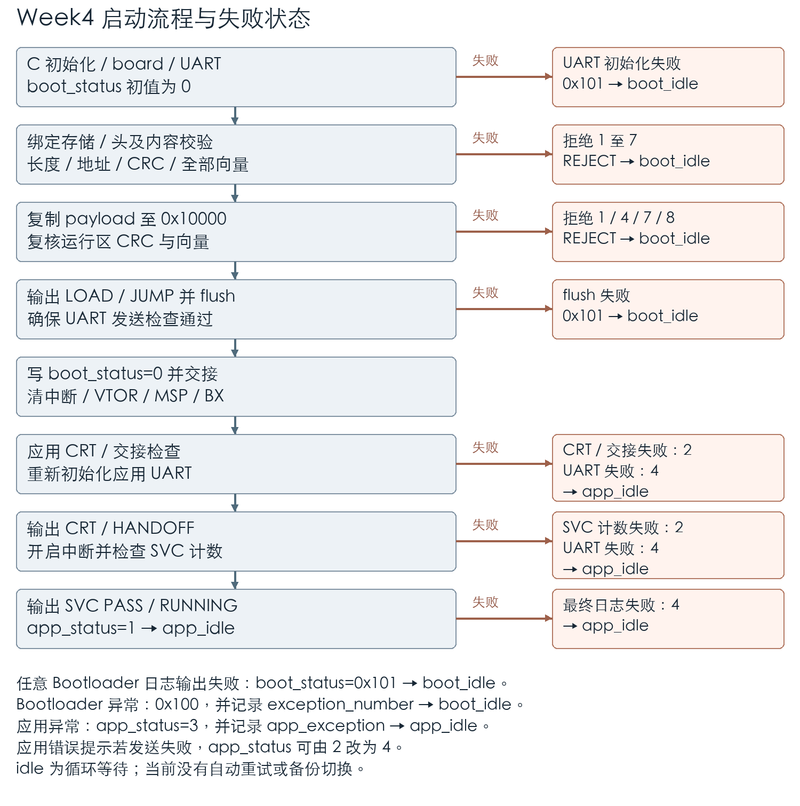

# 工业嵌入式 Bootloader 开发 Week 4 周报

项目：基于 QEMU AN500 的 Cortex M7 Bootloader　计划周次：Week 4

更新日期：2026 年 11 月 1 日

本周在已有串口与模拟 Flash 接口上，完成 CRC32 镜像校验、独立应用加载和处理器状态交接。Bootloader 从存储镜像中读取应用，检查内容和向量，复制到运行区后再次验证，最后启动应用。10 月 29 日执行的 Week4 阶段验证共 27 组检查，全部通过，涵盖正常启动、22 种镜像输入、交接状态及复制损坏等场景。

本次补充了向量边界测试、MSP 左开右闭区间、异常优先级与栈交接，以及 FPU 条件要求，并将安全边界独立成章。10 月 31 日复验的 Week4 核心 27 组、PRIMASK 保存恢复 22 条断言及异常与交接专项 7 组全部通过。11 月 1 日实际新增三条独立 CPU 镜像拒绝测试，并复跑完整向量专项：321 条宿主断言及 11 条 CPU/GDB 路径全部通过。下文历史实验保留原日期，本轮新增用例和证据见第五章及末尾索引。

### 本次变更对照

| 变更项 | 本次内容 | 对应章节 | 证据定位 |
|---|---|---|---|
| 补三个明确用例 | 新增 MSP 超上界、保留项 8 非零、IRQ31 Thumb 位错误三条 CPU 测试 | 第五章 | VB-04 至 VB-06；各自 UART 日志 |
| MSP 区间 | 解释 (base,top]，列明四个端点判定 | 第五章 | VEC-003/004/006/007；VB-04 |
| 异常与中断交接 | 五种异常优先级编码、屏蔽、栈与三阶段状态 | 第六章 | HANDOFF-REGISTERS 读回及 7 组专项 |
| FPU 条件要求 | 软浮点实测与启用 FPU 后的交接要求 | 第七章 | CPACR、FPCCR、CONTROL 读回 |
| 安全边界单列 | 完整性、认证、隔离和仿真适用限制 | 第八章 | image.c 检查范围及故障停留证据 |

日志均相对 codes/；完整目录见文末复验索引。

## 一 本周完成情况

| 计划任务 | 已完成结果 | 主要交付 |
|---|---|---|
| CRC32 完整性检查 | 检查镜像头、存储内容和复制后的运行区 | crc32.c、image.c 及 CRC 对照测试 |
| 从 Flash 加载应用 | 主应用分区读取 payload，复制至 0x00010000 | image_load、独立 application.elf |
| 栈 向量表与中断交接 | 检查 MSP 和入口，清理中断状态，设置 VTOR 后切栈跳转 | boot_handoff、handoff.S |
| 完整启动与异常验证 | 应用自行初始化、检查交接状态并执行 SVC；错误输入停止启动 | 应用源码、阶段测试及专项证据 |

本周复用 Week3 的串口、分区和显式检查点，重点验证镜像校验、应用加载与跳转。Ymodem、主备升级和恢复机制列入后续计划。

### 模块之间如何配合

```text
存储槽 → image_validate → image_load → boot_verify_loaded
         头/CRC/向量       复制应用      运行区CRC/向量
       → UART flush → boot_handoff → jump_to_app
       → App_Reset_Handler → app_main → SVC → app_idle
```

Bootloader 位于 0x00000000，应用运行地址为 0x00010000。Bootloader 使用 RAM [0x20000000,0x20010000)，应用使用 [0x20010000,0x20200000)，模拟存储使用 [0x20300000,0x20400000)。分开运行区与存储区后，可以检查应用是否确实经过读取和复制。

## 二 关键实现与理解

### 先检查镜像 再使用其中的数据

镜像采用 32 字节小端头。Bootloader 先检查格式和头 CRC，再检查内容长度、加载地址，随后分块计算内容 CRC，最后检查完整向量表。当前只接受固定的应用运行地址，不能直接把头字段作为任意内存写入地址。

下面摘录自 src/week4/image.c。复制后重新计算 CRC，再使用同一套向量规则检查实际准备执行的内容。

```c
if (crc32((const void *)APP_EXEC_BASE, info->size) != info->crc)
    return IMAGE_COPY_CRC;
if (!vectors_ok((const uint8_t *)APP_EXEC_BASE, info->size))
    return IMAGE_VECTOR;
```

这分别检查了存储镜像与复制结果。CRC 用于检测数据损坏，不能认证固件来源，也没有防回滚能力。

### 将处理器状态交给应用

boot_handoff 先屏蔽可配置中断，关闭 UART 和 SysTick，清除外部 IRQ、SysTick 与 PendSV 挂起状态，再设置应用 VTOR。汇编随后设置 CONTROL、BASEPRI、FAULTMASK、PSP 和 MSP，跳至应用复位入口。切换 MSP 后不再访问 Bootloader 的 C 栈。

应用自行初始化 .data 和 .bss，检查交接状态并重新初始化 UART，然后开启中断、执行一次 SVC。以下是本轮正常镜像的真实 UART 输出节选；原日志使用 CRLF，末尾还有提示符。

```text
BOOT: stage4 image validation
IMAGE: CRC32 PASS
LOAD: verified at 0x00010000
JUMP: application
APP: CRT PASS
APP: HANDOFF PASS
APP: SVC PASS
APP: RUNNING
```

QEMU 只直接加载 Bootloader ELF，应用由 Bootloader 复制启动。GDB 另检查入口 MSP=0x20200000、VTOR=0x10000、PRIMASK=1；最终 app_status=1、app_handoff_ok=1、app_svc_count=1，避免只凭打印信息判断成功。

### 调试中的认识

交接测试先执行真实 CPSID 指令，再注入 NVIC、SysTick 和 PendSV 挂起状态。此前直接用 GDB 写 PRIMASK，没有在该模型中得到预期状态；改为执行指令并读回后，才建立了有效的测试前提。这说明故障注入也需要取证，不能只看调试命令是否返回成功。

IMAGE 或 LOAD 成功只说明该步骤完成，应用仍可能因初始化、SVC 或 UART 失败而停止。因此最终判定同时检查应用状态、完整输出和 GDB 证据。

## 三 测试方法与实际结果

### 验证范围与结果

10 月 29 日执行了 Week4 阶段测试及串口、中断、向量和交付清单等专项验证，共 8 套测试，全部通过。各套件在独立构建目录或测试副本中执行。下表分别列出阶段结果、专项断言和依赖回归，不合并计算用例数。

| 验证内容 | 方法与具体输入 | 本轮实际结果 |
|---|---|---|
| Week4 核心链路 | CRC 对照、22 种镜像、脏中断交接及复制后翻转 | 27 组通过；正常启动与异常拒绝符合 |
| 向量范围 | MSP、全部入口、保留项、表长及加载后注入 | 321 宿主断言和 11 条 QEMU/GDB 路径通过（11 月 1 日复跑） |
| TX 持续阻塞 | 两版真实驱动持续 FULL=1，检查计数、DATA 和调用方状态 | 7 组通过，含两驱动 20 断言和 4 条上层失败路径 |
| PRIMASK 恢复 | 初始 0/1、两层嵌套、UART 初始化和空队列读取 | 两组各 11 断言通过，恢复进入时状态 |
| Week3 依赖回归 | Flash API、RX 队列、保存成功/失败及重启 | 11 组通过 |
| 一键构建与运行 | 缺失产物、依赖失败、启动和 UART 超时、资源清理 | 22 项通过，Week3/Week4 各 11 项 |
| UART 配置读回 | 两阶段 UART0 时钟、分频与控制寄存器 | 两组通过，25 MHz、BAUDDIV=217、CTRL=0x0B |
| manifest | 字段、类型、路径、文件长度和哈希、越界链接 | 41 项通过 |

### 如何检查错误路径

CRC 测试编译真实 crc32.c，启用 ASan/UBSan，与 Python zlib 独立结果比较。输入长度为 0、1、9、255、256、257、4096、458720 字节，随机种子 20261022；标准串 123456789 的 CRC 为 0xcbf43926。

交接测试先注入挂起中断，在应用入口检查清理结果，再污染应用 .data/.bss 并设置末尾哨兵，运行后验证初始化恢复且哨兵不变。复制损坏测试在复核前将运行地址 0x100c8 的一个字节异或 1，实际得到 boot_status=8 和完整 REJECT 行，没有应用运行日志。

TX 测试让 FULL 持续为 1，驱动自行完成 1000000 次轮询后返回 -1，DATA 未被写入；解除阻塞后发送恢复。Week4 Bootloader 打印或最终 flush 失败时状态为 0x101，进入 boot_idle；应用输出失败时 app_status=4。预算按轮询次数计，不是毫秒超时，未测量物理 UART 持续拥塞时长。

### 构建与复现

在 codes 目录执行。构建脚本会重新生成演示镜像，不应在输出位置保存需要保留的实验数据。

```sh
bash scripts/build-week4.sh
python3 scripts/run-week4.py
python3 scripts/verify-week4.py
python3 scripts/verify-vector-bounds.py
python3 scripts/verify-tx-full.py
python3 scripts/verify-manifest.py
```

完整步骤、GDB 注入脚本和逐字节 UART 比较见 codes/docs/week4-test-report.md 及原始日志。预期拒绝属于测试通过；宿主结束 QEMU 不表示固件主动成功退出。

## 四 镜像格式与输入对照

### 32 字节镜像头

所有字段均为小端 uint32，偏移相对镜像头。存储文件总长 1 MiB，头起点 H=0x10000，payload 起点 P=0x10020；复制到运行区的是 payload，不含头。

| 偏移 | 字段 | 当前约定 |
|---|---|---|
| 0x00 | magic | 0x4d49374d，小端字节为 M7IM |
| 0x04 | format | 1 |
| 0x08 | header_size | 32 字节 |
| 0x0c | payload_size | 至少包含 192 字节向量表，最大 458720 字节 |
| 0x10 | load_address | 固定 0x00010000 |
| 0x14 | firmware_version | uint32；基准为 1，未实施防回滚 |
| 0x18 | payload_crc32 | 对声明长度的全部 payload 计算 |
| 0x1c | header_crc32 | 对头的前 28 字节计算 |

长度达到 192 字节只满足向量表长度前提；没有有效代码区时，仍因入口范围检查失败而被拒绝。

### 22 种镜像输入

每行从同一有效基准独立构造，payload 为 972 字节，版本为 1。H/P 偏移以整个存储文件起点为 0，区间左闭右开；除明确说明外，修改为小端 uint32。头字段负向输入重算头 CRC；向量输入先重算内容 CRC 再重算头 CRC，避免 CRC 错误遮蔽向量拒绝。头 CRC 错误与内容损坏用例保留旧 CRC。

N 为宿主 image_validate 返回码，不是进程退出码；Q 为 QEMU 实际行为。“拒绝 n”表示按第九章的完整 REJECT 格式输出 n，没有 APP: RUNNING。以下 22 种输入全部通过，最大长度输入为 IMG-22。

| 编号及场景 | 具体输入及 CRC 处理 | 预期与实际 |
|---|---|---|
| IMG-01 valid | 无修改；有效基准；version=1；payload_size=972；打包时计算两CRC | 预期 0 (IMAGE_OK)；N=0；Q=APP: RUNNING；PASS |
| IMG-02 blank | 全文件[0x00000000,0x00100000)；每字节=0xFF；1 MiB；均不计算 | 预期 0x02；N=2；Q=拒绝0x02；PASS |
| IMG-03 bad-magic | H+0x00 = 0x00010000；magic：0x4D49374D → 0x00000000；头重算；内容保留 | 预期 0x02；N=2；Q=拒绝0x02；PASS |
| IMG-04 unsupported-format | H+0x04 = 0x00010004；format：1 → 2；头重算；内容保留 | 预期 0x02；N=2；Q=拒绝0x02；PASS |
| IMG-05 bad-header-size | H+0x08 = 0x00010008；header_size：32 → 64；头重算；内容保留 | 预期 0x02；N=2；Q=拒绝0x02；PASS |
| IMG-06 bad-header-crc | H+0x14 = 0x00010014；firmware_version：1 → 8；保留旧头CRC；均不重算 | 预期 0x03；N=3；Q=拒绝0x03；PASS |
| IMG-07 empty-payload | H+0x0C = 0x0001000C；payload_size：972 → 0；头重算；内容保留 | 预期 0x04；N=4；Q=拒绝0x04；PASS |
| IMG-08 oversize-payload | H+0x0C = 0x0001000C；payload_size：972 → 0xFFFFFFFF；头重算；内容保留 | 预期 0x04；N=4；Q=拒绝0x04；PASS |
| IMG-09 wrong-load-address | H+0x10 = 0x00010010；load_address：0x00010000 → 0x20000000；头重算；内容保留 | 预期 0x05；N=5；Q=拒绝0x05；PASS |
| IMG-10 payload-corruption | P+0xC8 = 0x000100E8；一个字节：0x91 → 0x90（异或1）；均不重算 | 预期 0x06；N=6；Q=拒绝0x06；PASS |
| IMG-11 unaligned-msp | P+0x00 = 0x00010020；vector[0]：0x20200000 → 0x20200004；先内容CRC，再头CRC | 预期 0x07；N=7；Q=拒绝0x07；PASS |
| IMG-12 boot-ram-msp | P+0x00 = 0x00010020；vector[0]：0x20200000 → 0x20010000；先内容CRC，再头CRC | 预期 0x07；N=7；Q=拒绝0x07；PASS |
| IMG-13 even-reset | P+0x04 = 0x00010024；vector[1]：0x000100C1 → 0x000100C0；先内容CRC，再头CRC | 预期 0x07；N=7；Q=拒绝0x07；PASS |
| IMG-14 outside-reset | P+0x04 = 0x00010024；vector[1]：0x000100C1 → 0x00080001；先内容CRC，再头CRC | 预期 0x07；N=7；Q=拒绝0x07；PASS |
| IMG-15 vector-table-reset | P+0x04 = 0x00010024；vector[1]：0x000100C1 → 0x00010001；先内容CRC，再头CRC | 预期 0x07；N=7；Q=拒绝0x07；PASS |
| IMG-16 bad-irq-vector | P+0x40 = 0x00010060；vector[16]：0x00010105 → 0x00000000；先内容CRC，再头CRC | 预期 0x07；N=7；Q=拒绝0x07；PASS |
| IMG-17 reserved-vector | P+0x1C = 0x0001003C；vector[7]：0x00000000 → 0x000100C1；先内容CRC，再头CRC | 预期 0x07；N=7；Q=拒绝0x07；PASS |
| IMG-18 msp-above-top | P+0x00 = 0x00010020；vector[0]：0x20200000 → 0x20200008；先内容CRC，再头CRC | 预期 0x07；N=7；Q=拒绝0x07；PASS |
| IMG-19 msp-below-base | P+0x00 = 0x00010020；vector[0]：0x20200000 → 0x2000FFF8；先内容CRC，再头CRC | 预期 0x07；N=7；Q=拒绝0x07；PASS |
| IMG-20 reset-at-end | P+0x04 = 0x00010024；vector[1]：0x000100C1 → 0x000103CD；(0x10000+972)按位或1；先内容CRC，再头CRC | 预期 0x07；N=7；Q=拒绝0x07；PASS |
| IMG-21 irq-before-code | P+0x40 = 0x00010060；vector[16]：0x00010105 → 0x0000FFFF；先内容CRC，再头CRC | 预期 0x07；N=7；Q=拒绝0x07；PASS |
| IMG-22 maximum-payload | H+0x0C；文件[0x000103EC,0x00080000)；长度972 → 458720 (0x6FFE0)；扩展部分填0xFF；重新打包计算两CRC | 预期 0 (IMAGE_OK)；N=0；Q=APP: RUNNING；PASS |

测试日志位于 codes/logs/week4-20261029-151421-074982。场景名称对应“场景名-native.txt”和“场景名/uart.log”，例如 bad-magic-native.txt 与 bad-magic/uart.log。summary.json/image_cases 保存每份镜像 SHA256、32 字节头、48 项向量及实际 UART。

## 五 向量合法范围与状态转移

### 范围规则与边界测试

src/week4/image.c 的 vectors_ok 对存储与加载后的向量实施同一规则。本工程为 AN500、48 项向量、192 字节表，不将该地址约定推广为所有 Cortex M 平台的通用规则。

| 检查对象 | 精确规则 | 本轮覆盖 |
|---|---|---|
| MSP 即 vector[0] | 0x20010000 < MSP ≤ 0x20200000，且模 8 为 0 | 上下界 8 值、7 种不对齐余数，共 15 断言 |
| Reset 及其他必填入口 | entry 位 0 为 1；addr=entry & 0xfffffffe；0x100c0 ≤ addr < 0x10000+payload_size | 42 项入口各 7 种输入，共 294 断言 |
| 保留项 7、8、9、10、13 | 必须为 0 | 每项检查 0 与非零，共 10 断言 |
| 向量表长度 | 191 字节为长度错误；192 字节没有有效代码区，为向量错误 | 2 断言 |
| CPU 与加载后拒绝 | 原 4 个镜像拒绝加 VB-04/05/06 三例；另改运行区 MSP 或 IRQ31 | 7 个镜像拒绝、2 个加载后拒绝均符合；另 2 条状态路径通过 |

321=15+294+10+2，均在 ASan/UBSan 下通过。IRQ0 至 IRQ31 全部包含在 42 项必填入口中，未使用的 IRQ 也须配置合法默认处理函数。基准 972 字节 payload 的入口地址范围为 [0x100c0,0x103cc)，最低合法 entry 为 0x100c1，最高为 0x103cb；0x103cd 解码为末端，拒绝。

加载后向量注入会更新测试用 boot_image.crc，直接触达向量拒绝分支。边界接受只证明地址判定符合规则，不证明任意内部位置都是有效函数；实际运行使用未修改的合法应用。

### 启动与失败去向



图示控制流程，不表示 boot_status 会逐阶段变化。Bootloader 失败进入 boot_idle，应用正常或失败最终进入 app_idle；没有自动重试、备份槽切换或升级恢复分支。任何 Bootloader 日志输出失败都会写入 0x101；应用错误提示若输出失败，也可能把 app_status 从 2 改为 4。

### 三例向量边界的构造与验证

以下三例均从同一有效镜像独立构造。H=0x00010000 为存储文件中镜像头偏移，P=H+0x20=0x00010020 为 payload 偏移；修改 vector[1]，即文件偏移 P+4=0x00010024，小端写入 32 位值。运行地址与存储文件偏移不能混用。

每次修改后，先计算 payload 的 CRC32 并写入 H+0x18，再对头部 [H,H+0x1C) 重算 CRC32 并写入 H+0x1C。其余字段和向量保持基准值，确保错误能够到达向量检查，而非被先行 CRC 检查拦截。

| 用例编号 | 输入与解码地址 | 预期及本轮实际 |
|---|---|---|
| VB-01 代码区下界 | entry=0x000100C1；addr=0x000100C0，恰为向量表后的代码区起点 | image_validate 返回 0；VEC-016 actual=0 PASS |
| VB-02 代码区上界 | 本轮 payload=972 字节，end=0x000103CC；entry=0x000103CD，解码后 addr=end | 返回 IMAGE_VECTOR=7；VEC-019 actual=7 PASS；阶段 reset-at-end 的 UART 拒绝码为 0x00000007 |
| VB-03 Thumb 位错误 | entry=0x000100C0；地址位于代码区下界，但位 0 为 0 | 返回 IMAGE_VECTOR=7；VEC-021 actual=7 PASS；阶段 even-reset 的 UART 拒绝码为 0x00000007 |

VB-02 的构造式为 entry=(APP_EXEC_BASE+payload_size) 按位或 1。本轮末端为偶地址，解码后恰等于 end；若未来 payload 长度为奇数，应根据实际偶数取指地址构造越界值，不能机械套用该式。VB-01 仅为宿主地址判定测试，不启动篡改后的入口；通过范围检查不能证明任意内部位置是一条完整指令或合法函数。

三例的原始输入、expected 与 actual 见 logs/vector-bounds-20261031-161335/matrix.txt 的 VEC-016、019、021；VB-02、03 的 CPU 拒绝证据另见 logs/week4-20261031-161348-567486/reset-at-end/uart.log 和 logs/week4-20261031-161348-567486/even-reset/uart.log。三例给出具体构造、预期与实测；11 月 1 日另新增以下三条独立 CPU 路径。

### 11 月 1 日新增三条 CPU 测试

VB-04、VB-05、VB-06 均由脚本从同一有效镜像分别构造，每例只改一个向量项、依次重算 payload CRC 和头部 CRC，并启动独立 QEMU 会话。三例均断言完整 UART 输出为 BOOT: stage4 image validation 后接 REJECT: 0x00000007 及提示符；因此 PASS 表示 Bootloader 在 CPU 执行中按预期拒绝镜像。

| 用例编号 | 独立镜像输入与文件偏移 | 预期及实测 |
|---|---|---|
| VB-04 MSP 超上界 | vector[0]=0x20200010；偏移 0x00010020；为 top+16，8 字节对齐 | 预期 IMAGE_VECTOR=7；UART 实测 0x00000007，PASS |
| VB-05 保留项 8 非零 | vector[8]=0x000100C1；偏移 0x00010040；其余保留项维持 0 | 预期 IMAGE_VECTOR=7；UART 实测 0x00000007，PASS |
| VB-06 IRQ31 Thumb 位错误 | vector[47]=0x000100C0；偏移 0x000100DC；地址位于合法下界，位 0 为 0 | 预期 IMAGE_VECTOR=7；UART 实测 0x00000007，PASS |

本轮证据目录为 logs/vector-bounds-20261101-164709，分别见 VB-04-MSP-ABOVE-TOP/uart.log、VB-05-RESERVED-8/uart.log、VB-06-IRQ31-EVEN/uart.log；summary.json 记录输入、预期码与实际码。完整复跑为 321 条宿主断言及 11 条 CPU/GDB 路径通过，CPU/GDB 路径由 8 条增至 11 条。宿主矩阵与 CPU 执行分别统计；对应约束已有宿主断言，本轮新增的是独立 CPU 拒绝验证。

### MSP 左开右闭区间

应用 RAM 字节范围是 [0x20010000,0x20200000)，初始 MSP 的允许范围却是 (0x20010000,0x20200000]，另需 MSP 模 8 为 0。前者描述可访问字节，后者描述向下增长的空栈位置。MSP 等于 RAM 下界时，首次压栈就会落到应用 RAM 之外，因此排除下界；MSP 等于 RAM 末端时，压栈先递减再写入，可落回应用 RAM，因而允许上界。

| MSP 输入 | 预期与本轮实际 | 说明 |
|---|---|---|
| base=0x20010000 | VEC-003 返回 7 PASS | 排除下界；CPU 路径 MSP-AT-BASE 同样拒绝 |
| base+8=0x20010008 | VEC-004 返回 0 PASS | 通过范围及对齐检查 |
| top=0x20200000 | VEC-006 返回 0 PASS | 允许初始空栈位于末端 |
| top+8=0x20200008 | VEC-007 返回 7 PASS；核心 msp-above-top 的 CPU 拒绝码为 7 | 超过上界 |

此处 base+8 的接受结果只证明当前输入契约，不代表剩余 8 字节足够执行应用。普通异常基本栈帧就需要 32 字节，另可能需要对齐填充和函数栈；当前检查没有建立栈深度上界或运行时栈溢出保护。日志见 logs/vector-bounds-20261031-161335/matrix.txt；合法应用实际使用链接脚本设定的 top。

## 六 异常与中断交接

### 异常优先级和处理入口

异常号用于定位向量和识别 IPSR，不是优先级数值。可配置优先级的数值越小紧迫程度越高；抢占关系还取决于 AIRCR.PRIGROUP 和实际实现的优先级位数。不能将 MemManage、BusFault、UsageFault、SVC 按异常号直接排成固定的抢占顺序；同优先级同时待处理时的异常号裁决也不等于允许相互抢占。

| 异常 | 异常号及优先级位置 | 实测优先级编码 | 使能与屏蔽条件 | 本工程处理入口 |
|---|---|---|---|---|
| HardFault | 3；固定 -1，高于所有可配置优先级异常 | 固定 -1 | 无独立 enable；PRIMASK、BASEPRI 不屏蔽；FAULTMASK 可阻止激活，不能据此保证继续运行 | Boot 的 Default_Handler；App 的 App_Default_Handler |
| MemManage | 4；可配置，SHPR1.PRI_4 | 0x20 | SHCSR.MEMFAULTENA；受 PRIMASK、BASEPRI 阈值和 FAULTMASK 影响 | 同上，记录对应异常号 |
| BusFault | 5；可配置，SHPR1.PRI_5 | 0x40 | SHCSR.BUSFAULTENA；同样受三类屏蔽影响 | 同上，记录对应异常号 |
| UsageFault | 6；可配置，SHPR1.PRI_6 | 0x60 | SHCSR.USGFAULTENA；同样受三类屏蔽影响 | 同上，记录对应异常号 |
| SVC 或 SVCall | 11；可配置，SHPR2.PRI_11 | 0x80 | SVC 指令同步触发；没有外部 IRQ 的 ISER 使能位；受可配置异常的屏蔽和执行优先级限制 | Boot 使用默认处理；App_SVC_Handler 计数后返回 |

表中可配置编码为 10 月 31 日交接专项主动注入后的寄存器读回，取自 logs/handoff-contract-20261031-161440/HANDOFF-REGISTERS.txt 的 ENTRY 记录：SHPR1=0x00604020，SHPR2=0x80000000。PRI_4/5/6 分别为 0x20/0x40/0x60，PRI_11 为 0x80；SVC 和 FINAL 阶段仍保留这些值。普通冷启动 SHPR 为 0，表中数值用于验证交接后的保留行为，不是固件默认配置或已验证的抢占顺序。HardFault 的 -1 为架构固定优先级，不是 SHPR 编码。

NMI 的固定优先级为 -2，不受 PRIMASK、BASEPRI、FAULTMASK 屏蔽。BASEPRI=0 表示不按阈值屏蔽，非零值才参与优先级比较。清除 PRIMASK 仅解除这一层屏蔽，不保证其他层允许异常激活。

禁用 NVIC IRQ 是撤销相应外部中断使能，PRIMASK 是处理器级屏蔽，清 pending 是删除当前挂起请求，三者不同。禁用或屏蔽期间请求仍可能挂起；外设中断源未停止时，清 pending 后也可能再次置位。NVIC 的 ICER/ICPR 不负责清除核心 Fault 或 SVC，也不能把正在 active 的异常当作普通 pending 删除。

可配置 Fault 未使能或因执行优先级无法处理时，可能升级为 HardFault；若升级后的 HardFault 仍无法处理，可能进入 lockup。SVC 是同步异常，不能把 PRIMASK=1 时执行 SVC 描述为普通 IRQ 等待解屏蔽。本轮在线程模式屏蔽后执行 SVC，实际进入 HardFault，HFSR.FORCED=1。

### MSP PSP 与异常入栈

Thread 模式由 CONTROL.SPSEL 选择 MSP 或 PSP；CONTROL.nPRIV 指定线程权限。Handler 模式始终使用 MSP 执行处理函数，但异常现场压到哪个栈，取决于被打断的上下文。线程使用 PSP 时，硬件先把线程现场压到 PSP，再切换到 Handler 的 MSP；因此不能写成所有异常现场都保存在 MSP。

进入 Handler 时 LR 保存 EXC_RETURN，供异常返回识别模式、栈和帧类型。当前无浮点扩展帧：0xFFFFFFF9 表示返回 Thread 并使用 MSP，0xFFFFFFFD 表示返回 Thread 并使用 PSP；嵌套返回 Handler 的基本帧通常为 0xFFFFFFF1。应在处理函数序言之前检查 LR 和栈，避免把 C 函数压栈误当作硬件栈帧。

本轮应用 SVC 入口读回 IPSR=11、SP=MSP、PSP=0、LR=0xFFFFFFF9。独立 PSP 探针通过实际 MSR CONTROL 切换线程栈，再执行 SVC：PSP 从 0x201FF000 减至 0x201FEFE0，Handler 的 MSP=0x20010000，LR=0xFFFFFFFD，且已保存 xPSR 的 IPSR 为 0。这直接区分了处理函数所用栈和被打断线程的现场栈。

### 三阶段交接约定

| 阶段 | 期望状态及责任 | 检查位置 |
|---|---|---|
| 跳转前 | Bootloader 在特权 Thread 模式、使用 MSP；IPSR=0，没有正在处理的异常；先检查镜像，再停止外设中断源并清理请求 | boot_handoff 入口及真实 CPSID 后 |
| 应用 Reset 入口 | Bootloader 已设置 VTOR 和初始 MSP；PRIMASK 保持 1，供应用初始化；当前过程是 BX 软件跳转，不产生硬件复位 | App_Reset_Handler 第一条指令之前 |
| 应用初始化完成 | 应用完成 data/bss 与外设初始化，确认状态后解除 PRIMASK；执行 SVC 并返回线程，app_status=1 | App_SVC_Handler 入口与 app_idle |

| 检查项 | 当前入口约定及实测 | 责任与限制 |
|---|---|---|
| IPSR 与特权状态 | IPSR=0；CONTROL.nPRIV=0、SPSEL=0 | 调用前提是特权 Thread/MSP；现有代码未增加通用上下文拒绝接口 |
| MSP 与 PSP | Reset 入口 MSP=0x20200000、PSP=0、SP=MSP | Bootloader 汇编设置；应用执行后 MSP 随函数调用变化，不能再断言恒为栈顶 |
| CONTROL | 入口为 0，FPCA=0 | 写入后执行 ISB；仅设置 CONTROL 无法把 Handler 模式变成 Thread 模式 |
| PRIMASK | 入口为 1；SVC 与最终线程为 0 | Bootloader 屏蔽，应用初始化完成后解除 |
| BASEPRI 与 FAULTMASK | 入口、SVC 和最终线程均为 0 | 交接汇编清零；不把 FAULTMASK 当作通用故障恢复机制 |
| VTOR | 0x00010000 | 设置后 DSB、ISB；此后异常使用应用向量表 |
| NVIC 状态 | 入口 ISER、ISPR、IABR 均为 0 | 停止中断源，禁用并清 pending；Thread 前提排除 active 异常 |
| SysTick 与 PendSV | SysTick CTRL 的低 3 位为 0；两类 pending 均清零 | Bootloader 清理，应用按需重新配置 |
| 优先级与分组 | 普通冷启动 SHPR 为 0、PRIGROUP=0；专项注入的 PRI_4/5/6=0x20/0x40/0x60、PRI_11=0x80 在交接后保留 | 当前代码不重置 SHPR、NVIC IPR 或 PRIGROUP；应用如有调度要求须显式初始化 |
| Fault 配置和历史状态 | 正常入口 SHCSR=0、CFSR=HFSR=0 | 冷启动路径观测值；交接函数没有普遍清理 Fault 配置与历史状态，不推广为任意脏状态保证 |

目前入口保证限于本工程冷启动路径。NMI、HardFault 无法用 PRIMASK 封锁，因此 VTOR/栈切换窗口仍要求无不可屏蔽异常和未完成上下文；不能从“关中断”推导出整个交接过程不会发生异常。

### 本轮异常专项结果

执行入口为 python3 scripts/verify-handoff-contract.py。七组均使用新建 QEMU 实例；故障指令只注入一次性测试 RAM，不改发布固件，不通过改写 boot_status 或异常号制造通过结果。探针在 Bootloader 向量表下验证各 Fault；应用向量切换及正常 SVC 则由交接组验证，两种证据分别标注。

| 用例 | 真实输入或触发 | 本轮观察与结果 |
|---|---|---|
| HANDOFF-REGISTERS | 实际 CPSID 后确认 IRQ7、SysTick、PendSV 挂起；注入不同 SHPR 优先级 | 三阶段寄存器、清理结果及应用 SVC 符合；PASS |
| USAGE-ENABLED | 使能 UsageFault，执行 UDF | IPSR=6，CFSR=0x00010000；PASS |
| USAGE-DISABLED-ESCALATION | 不使能 UsageFault，执行相同 UDF | IPSR=3，HFSR=0x40000000；PASS |
| MEMMANAGE-XN | 使能 MemManage，尝试从系统 XN 区 0xE0000000 取指 | IPSR=4，CFSR=0x00000001；PASS；不是 MPU 隔离测试 |
| BUSFAULT-PRECISE | 使能 BusFault，实际 LDR 读取 0xFFFFFFF0 | IPSR=5，CFSR=0x00008200；PASS；不代表非精确写缓冲错误已覆盖 |
| SVC-MASKED-ESCALATION | 实际 CPSID i 后执行 SVC | IPSR=3、PRIMASK=1、HFSR.FORCED=1；PASS |
| SVC-PSP-FRAME | 实际设置 PSP、CONTROL.SPSEL，再执行 SVC | IPSR=11，Handler 使用 MSP，现场在 PSP，LR=0xFFFFFFFD；PASS |

证据位于 logs/handoff-contract-20261031-161440，每组对应同名 .gdb、.txt、-uart.log 和 -qemu.log，summary.json 保存读回值。异常测试到达默认处理函数后，继续确认 boot_status=0x100、exception_number 等于预期异常号。默认处理只记录后停留，不恢复执行。既有 PRIMASK 保存恢复契约另复验 22 条断言，见 logs/irq-contract-20261031-161420；不将这些断言与七组测试相加成同一种统计口径。

## 七 FPU 配置与扩展交接要求

### 当前软浮点配置

Bootloader 与应用均使用 -mcpu=cortex-m7、-mthumb、-mfloat-abi=soft。当前启动链不启用硬件浮点，也不承诺接管已有浮点上下文。专项在应用入口读回 CPACR=0、CONTROL.FPCA=0、FPCCR=0xC0000000，其中 ASPEN=1、LSPEN=1、LSPACT=0。FPCCR 的自动保存策略位不为零，不等于应用已经获得 FPU 执行权限；需结合 CPACR 和实际指令判断。

本轮只验证上述未使用硬件浮点的状态与交接。以下为启用 FPU 后必须增加的设计和测试要求，不计入已通过测试。

### 启用 FPU 时的控制与交接要求

| 寄存器或状态 | 必须说明和检查的内容 |
|---|---|
| CPACR.CP10 与 CP11 | 确认目标实际实现的 FPU，两个协处理器访问权限保持一致；应用在首条浮点指令之前设置约定权限并执行同步；编译选项和浮点 ABI 与目标、链接库一致 |
| FPCCR.ASPEN | 自动浮点上下文管理策略；启用后执行浮点指令会设置 CONTROL.FPCA，影响异常帧保存 |
| FPCCR.LSPEN 与 LSPACT | LSPEN 选择惰性保存策略；LSPACT 表示仍有未完成的惰性保存上下文。必须在旧栈有效时按架构流程完成上下文收尾，确认没有遗留保存后才能切栈 |
| CONTROL.FPCA | 标识浮点上下文活动；不能仅清 FPCA 就宣称旧浮点现场已正确保存或清理 |
| FPSCR 与 FPDSCR | 明确浮点状态、舍入和默认行为由谁初始化；需要时处理 S0 至 S31 的旧值，异常硬件保存不自动覆盖所有软件上下文需求 |
| FPCAR | 在惰性保存活动时标识预留浮点帧位置；与旧栈的地址、可写性和生命周期一起核对，不能把它当成任意清零的普通栈指针 |
| EXC_RETURN 与栈帧 | 按 EXC_RETURN 位 4 区分基本帧和浮点扩展帧，按位 2 识别返回栈；扩展帧比 32 字节基本帧多 72 字节，还需考虑对齐填充与最坏栈深度 |

启用后的验证至少覆盖：Boot/App 均不使用浮点、仅 App 使用、Boot 使用后交接；MSP/PSP 两类线程栈；惰性保存开关；活动上下文的安全拒绝或收尾路径；浮点异常嵌套及保存恢复。明确比较 S0 至 S15、FPSCR、所需 S16 至 S31 和栈哨兵，确认没有向旧栈追加写入。当前 jump_to_app 直接清 CONTROL 并切栈，尚未实现这套浮点上下文交接；不能把软浮点测试结果外推到启用 FPU 的程序。

## 八 安全边界与适用限制

### 已实现的输入与执行边界

本章界定 Week4 冷启动镜像校验与交接的适用范围。长度检查限制内容在分区和运行区容量之内；加载地址固定为 0x00010000；存储内容和复制后内容均做 CRC 与向量复核。MSP 的左开右闭范围和 8 字节对齐检查、入口 Thumb 位、代码区范围及保留项检查，都属于软件输入契约。

向量检查只检查入口起始地址，没有验证完整 Thumb 指令长度、控制流或函数语义。MSP 检查也没有证明栈空间充足。合法地址内的恶意代码、运行时越界写入和栈溢出不能靠这些输入检查阻止。

### 完整性 真实性与隔离

CRC32 用于检测意外损坏，攻击者可修改内容后重新计算 CRC，因此它不提供来源认证。镜像头中的版本号没有被用作可信防回滚计数；交付清单的 SHA256 也没有签名信任根，不能替代固件签名验证。规划书的 SHA256、RSA 验签及可信恢复要求属于后续阶段，本报告不将它们描述为 Week4 已完成能力。

当前 MPU 未启用，Bootloader 与应用在同一特权地址空间中运行。RAM 区域划分、向量范围检查和复制后复核不构成硬件隔离；通过输入检查的应用仍可访问 Bootloader 可写内存和系统寄存器。Cortex-M7 的本次配置也未建立 TrustZone 安全域。MemManage-XN 探针证明架构系统区不可执行规则的响应，未证明应用与 Bootloader 之间已配置 MPU 保护。

### 故障响应与仿真适用范围

Bootloader 校验失败进入 boot_idle，默认 CPU 异常处理记录异常号与 0x100 状态后停留；应用默认异常处理记录 app_exception 和 app_status=3。上述为停止启动或停止继续执行的策略，不等于自动恢复、故障隔离、输出进入物理安全状态或工业功能安全保证。UART 不可用时依靠调试读回，故障处理也不能保证栈损坏或嵌套 HardFault 后仍能正常记录。

七组新增专项验证了本轮 QEMU 的精确异常与栈行为；没有覆盖真机非精确 BusFault、缓存或 DMA 一致性、Flash 掉电时序、看门狗及 FPU 活动现场交接。迁移真机时还需确认内存映射、优先级实现位数、外设中断源、MPU 权限、缓存清理和指令同步，并补充对应实测。仿真通过与项目规划中的工业可靠性目标相对应，但不是 IEC 62443 或功能安全合规的证明。

### 技术依据

架构解释参照 Arm Cortex-M7 Devices Generic User Guide ARM DUI 0646C 中的异常、Fault 与 FPU 章节，以及 CMSIS Core Register Access 和 NVIC 文档；项目地址和当前行为以源码、链接脚本及本报告日志为准。

参考资料：[Arm Cortex-M7 用户指南 ARM DUI 0646C](https://documentation-service.arm.com/static/61efd8352dd99944d05142d1)、[FPU 程序员模型](https://developer.arm.com/documentation/ddi0489/f/floating-point-unit/fpu-programmers-model)、[CMSIS 核心寄存器](https://arm-software.github.io/CMSIS_6/main/Core/group__Core__Register__gr.html)、[CMSIS NVIC](https://arm-software.github.io/CMSIS_6/main/Core/group__NVIC__gr.html)。

## 九 REJECT 输出与状态字典

### 精确输出格式

reject(result) 先把 image_result 写入 boot_status，再输出前缀、错误码、CRLF 和提示符。唯一可变字段是 uint32 错误码，固定 0x 加 8 位小写十六进制，不包含地址、时间或序号。

```text
"REJECT: 0xhhhhhhhh\r\n> "
```

引号表示字符串边界，不发送；\r\n 表示 CR 与 LF 两字节。提示符后的空格属于输出，之后没有额外换行。格式错误示例为 "REJECT: 0x00000002\r\n> "。镜像负向场景均按完整字节串比较。

| boot_status 值 | 名称与触发条件 | 输出及实际验证 |
|---|---|---|
| 0 | BSS初值，或完成最终flush后准备交接 | 不输出REJECT；单值0不证明应用成功；初期位置不定；交接后应用app_idle；W4-HANDOFF |
| 1 | IMAGE_IO：设备未绑定、读取失败等 | REJECT: 0x00000001；boot_idle；向量专项/STATUS-IO.txt及-uart.log |
| 2 | IMAGE_FORMAT_ERROR：magic、format、header_size不符 | REJECT: 0x00000002；boot_idle；IMG-02..05 |
| 3 | IMAGE_HEADER_CRC：前28字节CRC不匹配 | REJECT: 0x00000003；boot_idle；IMG-06 |
| 4 | IMAGE_LENGTH：长度小于表、超过槽/执行区，或load/verify重复边界无效 | REJECT: 0x00000004；boot_idle；IMG-07/08；load参数分支按源码映射 |
| 5 | IMAGE_ADDRESS：load不等于0x10000 | REJECT: 0x00000005；boot_idle；IMG-09 |
| 6 | IMAGE_PAYLOAD_CRC：存储payload CRC不匹配 | REJECT: 0x00000006；boot_idle；IMG-10 |
| 7 | IMAGE_VECTOR：存储或运行区向量非法 | REJECT: 0x00000007；boot_idle；向量矩阵及LOAD-VECTOR两项 |
| 8 | IMAGE_COPY_CRC：运行区CRC与已校验info.crc不符 | REJECT: 0x00000008；boot_idle；W4-COPY |
| 0x100 | CPU异常：记录exception_number=IPSR，再写状态 | 异常路径不调用reject，无REJECT保证；boot_idle；向量专项/STATUS-HARDFAULT.txt读回exception_number=3 |
| 0x101 | UART初始化、write或最终flush失败 | UART不可用，不保证错误文本或完整REJECT；boot_idle；TX-W4-PRINT、TX-W4-FLUSH |

表中 REJECT 码按前述完整格式发送，最终进入 boot_idle。UART 在拒绝输出途中失败时，可能只留下部分文本，最终状态为 0x101；此时使用 GDB 读取状态，不能再依赖同一 UART 输出错误。

应用单独使用 app_status：0 为初值；1 为 CRT、交接、SVC 和日志输出完成后的运行状态；2 为 CRT/交接/SVC 检查失败；3 为应用异常，另记录 app_exception；4 为 UART 失败。最终均在 app_idle。本轮实测正常状态 1 和 TX 故障状态 4；应用失败时 boot_status 仍可能为 0，两者不能混用。状态表给出源码映射，不表示所有参数和失败子分支均逐项注入。

向量专项日志位于 logs/vector-bounds-20261029-151425（相对 codes/）。STATUS-IO 将已绑定设备的 memory 置零，触发读取错误 1；STATUS-HARDFAULT 通过无效取指触发 HardFault，读回状态 0x100 和异常号 3。

## 十 交付清单与格式校验

### 清单用途与字段

delivery-manifest.json 记录文件的相对路径、字节数和 SHA256，用于核对交付文件的完整性。独立定义见 codes/schemas/delivery-manifest.schema.json，采用 JSON Schema Draft 2020-12。它不进入 Bootloader 解析流程；固件仍使用前述 M7IM 二进制头。

| 字段 | schema 约束或校验规则 |
|---|---|
| 根对象 | 6 个字段全部必填，不允许额外字段 |
| schema_version | 常量整数 1；拒绝布尔值 |
| plan_group | week1-2、week3、week4；week3-4 兼容历史包 |
| generated_at | 有效 ISO 日期时间，秒必填，时区 +08:00 |
| image_format | 固定 M7IM-v1 |
| approval_status | 固定 pending-teacher-review |
| files | 非空数组；每项仅允许 path、size、sha256，且全部必填 |
| files[].path | 相对 POSIX 路径；拒绝绝对路径、. 或 .. 分段、反斜线、重复和越界链接 |
| files[].size | 非负整数，不能是布尔或小数，且与实际文件一致 |
| files[].sha256 | 64 个小写十六进制字符，且与实际文件一致 |

文件存在性、路径规范化、重复路径、长度、哈希和链接越界由校验器补充检查，schema 本身不读取文件。校验器只执行本 schema 所需约束，不作为任意 schema 的通用引擎。下面是本轮测试中的有效实例，对应配套 README.txt 的 25 字节内容。

```json
{
  "schema_version": 1,
  "plan_group": "week3-4",
  "generated_at": "2026-10-29T15:14:58.256352+08:00",
  "files": [
    {
      "path": "README.txt",
      "size": 25,
      "sha256": "798fea15a540e232f4ae06c1888d0467da504195abb547083ebfec97ceb955fb"
    }
  ],
  "image_format": "M7IM-v1",
  "approval_status": "pending-teacher-review"
}
```

缺少 files、path="../escape" 或 sha256="xyz" 均被拒绝。41 项校验全部通过，完整输入和实际异常见 logs/manifest-20261029-151458。单周包生成时使用 --group week4。清单不包含自身，只核对列出文件；文件和清单可以被同时修改，因此该机制不提供签名认证。

## 十一 本周问题与后续安排

本周调试中，应用加载后的状态检查是定位问题的重点。镜像 CRC 正确后，仍需确认 VTOR、栈和挂起中断是否正确交接，以及应用是否完成初始化和异常调用。将这些检查分别放在镜像校验、应用入口和运行状态处，可以区分镜像损坏、交接错误与应用自身故障。

当前验证基于冷启动、特权线程、缓存与 MPU 未启用的 QEMU AN500 环境。模拟 Flash 依赖显式宿主检查点，UART 阻塞控制采用轮询次数上限，尚需进一步验证真机上的存储和发送时序。后续计划开展 Ymodem 接收、主备镜像管理与升级状态设计，先明确镜像接收完成、校验通过和应用确认成功之间的状态转换，再设计传输中断与异常恢复测试。

### 材料与证据索引

详细测试步骤见 codes/docs/week4-test-report.md。下列日志路径相对 codes/，各目录均含 summary.json。

| 证据内容 | 本轮目录 |
|---|---|
| Week4 阶段验证 | logs/week4-20261029-151421-074982 |
| 向量与状态路径 | logs/vector-bounds-20261029-151425 |
| TX 持续阻塞 | logs/tx-full-20261029-151415 |
| PRIMASK 恢复 | logs/irq-contract-20261029-151415 |
| Week3 依赖回归 | logs/week3-20261029-151418-332736 |
| 一键入口 | logs/cli-week34-20261029-151429 |
| UART 配置读回 | logs/uart-baud-20261029-151428 |
| manifest | logs/manifest-20261029-151458 |

### 2026 年 10 月 31 日复验索引

下列为本次实际执行，与前述历史测试分别留存。范围不同的计数不合并。

| 证据内容 | 本次目录 | 结果 |
|---|---|---|
| Week4 核心链路 | logs/week4-20261031-161348-567486 | 27 组 PASS，含 22 种镜像输入 |
| 向量与状态路径 | logs/vector-bounds-20261031-161335 | 321 条宿主断言、8 条 CPU/GDB 路径 PASS |
| 异常与交接专项 | logs/handoff-contract-20261031-161440 | 7 组 PASS，包含三阶段寄存器读回 |
| PRIMASK 保存恢复 | logs/irq-contract-20261031-161420 | 初值 0/1 各 11 条断言 PASS |

复现新增专项：在 codes/ 执行 python3 scripts/verify-handoff-contract.py；各组命令、读回和 SHA256 保存在相应目录。

### 2026 年 11 月 1 日新增用例复验索引

| 证据内容 | 本次目录 | 结果 |
|---|---|---|
| 完整向量与状态路径 | logs/vector-bounds-20261101-164709 | 321 条宿主断言及 11 条 CPU/GDB 路径 PASS |
| 新增 VB-04 至 VB-06 | 同目录各用例子目录的 uart.log；汇总见 summary.json | 三条独立 CPU 镜像拒绝测试均 PASS |

复现命令：在 codes/ 执行 python3 scripts/verify-vector-bounds.py。每次运行重新构建固件、创建独立镜像与 CPU 会话，并保存矩阵输出、UART 日志及 ELF SHA256。10 月 31 日的 8 条路径作为历史记录保留；11 月 1 日以 11 条路径作为当前向量专项结果。
