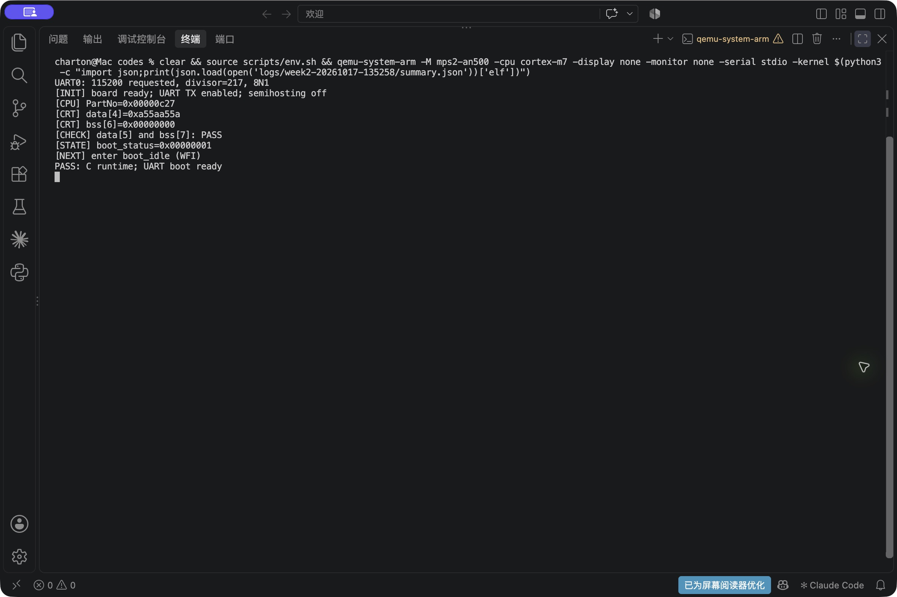
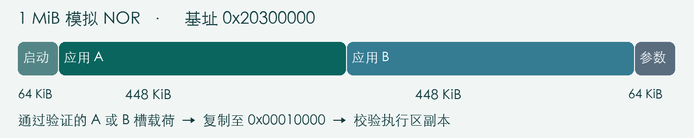
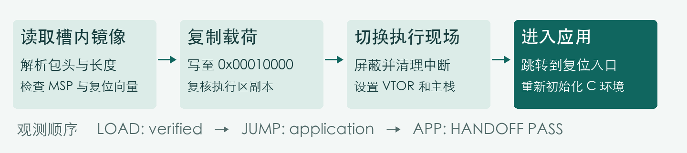
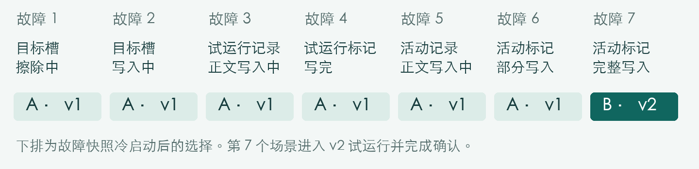
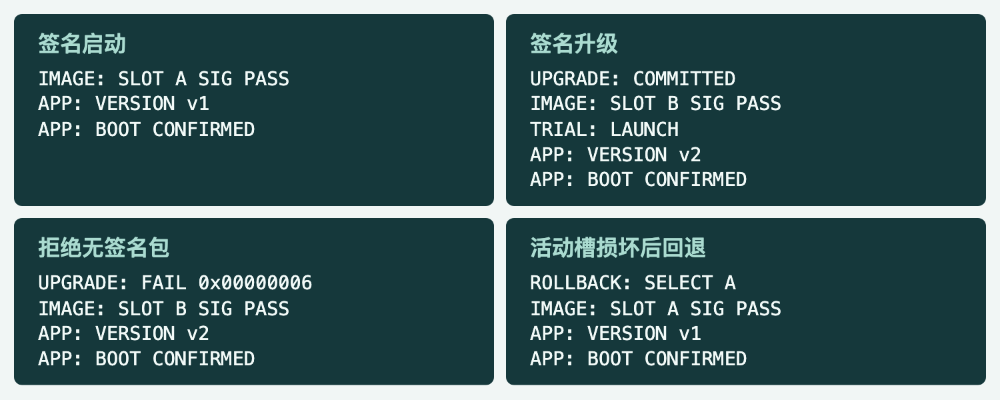

# 工业嵌入式 Bootloader 八周开发结项报告

2026 年 11 月 20 日 · QEMU MPS2-AN500 / Arm Cortex-M7

八周开发交付了一套可以从空构建目录重建的启动与升级系统。它从模拟 NOR 中选择固件，校验镜像及签名，将应用装入执行区，并在新版本首次启动后记录确认结果。一次成功升级可从串口追踪至新应用，一次被拒绝的升级也可追踪至仍在运行的旧应用。第八周在同一套源码和实验密钥下比较链接配置，将正式固件的装载体积从 27,204 字节降到 24,216 字节。对接收工程的同学，最短的复核路径是先运行四场演示，再查看全量测试摘要，最后从有疑问的输出回到对应接口。

## 一　八周工作如何形成一条启动链

项目开始时，屏幕上出现一行文字，只能回答工具链能否生成可执行文件、模拟器能否运行这段代码。项目结束时，一次启动要回答更多问题。启动器需要知道上次选中了哪个槽、该槽记录是否完整、镜像的入口能否执行、当前安装的版本是否获得授权，以及上次启动的新应用有没有完成确认。缺失其中任何一个条件，都可能让串口上的“启动成功”与系统实际状态脱节。八周的开发顺序正好对应这些问题逐个进入验收范围的过程。

第一周建立交叉编译、链接、运行和观察的最短路径。第二周给启动流程加入独立串口和可识别的故障状态。第三周将输入变成可在中断和前台之间传递的字节，把存储拆成带边界的分区。第四周第一次把一个独立链接的应用从槽中装入执行内存。到这里，项目已有可靠的读取路径，还需要处理现场更新时写到一半的镜像，以及重启后究竟应相信哪一份状态记录。

第五周为串口更新定义传输与提交顺序。第六周在可启动的基础上引入签名、试运行确认与回退策略。第七周专门把写入错误、记录撕裂和双槽异常送进测试，修正了只观察正常流程时容易遗漏的问题。第八周把这些阶段连成一项可以交给他人运行的工程。最终验收既要回到最小启动程序，也要检查带签名的正式固件；前者给出了简洁的定位手段，后者给出了系统对用户真正可见的行为。

规划书中的工时是预计投入，没有逐日工时记录可以支持实际消耗的统计。因此，本报告按可检查的产物描述工作量。代码与测试有明确入口，测试按顶层检查或框架用例给出分母，性能数据保留测量条件。真机调试、板级掉电和带教签收分别需要相应设备、试验和确认，在最终交付清单中各自占一行。这些边界直接影响后续能用本项目回答哪些工程问题。

## 二　第一周让复位到主程序的过程可观察

裸机程序没有桌面操作系统代为装载进程。复位后，处理器从向量表取得初始主栈指针和复位入口，随后由启动汇编建立 C 代码预期的内存状态。链接脚本给出初始化数据的装载位置、运行位置及边界；启动代码按这些边界复制有初值的全局变量，再清零零初始化段。一旦链接布局、拷贝单位和汇编循环使用的边界有一处不一致，就可能只在变量数量变化时出现错误。项目从最小程序开始保留这些符号，使调试器可以在进入主程序之前检查各段的实际内容。

第一次验收选择了有方向性的试验。如果模拟器恰好以零填充内存，仅在主程序里观察到零无法说明清零循环工作正常。测试使用调试器预先污染目标数据，运行复位处理程序，再比较主程序看到的值。对零初始化段还观察其邻近位置，确认这一次测试布局下写入没有继续越过末尾。这样的观察把“代码编译成功”推进到“这组输入上的复位状态正确”，同时给失败时的排查提供了具体地址和断点。

第一周的演示使用半主机调用，借助宿主输出检查工具链与目标程序的协作。后续的串口固件改用板上外设模型；两个入口在工程里分别保留。新环境中如果连最小演示都无法通过，应先查交叉编译器、架构选项、链接图和仿真机型。若最小演示通过而串口没有输出，再查外设寄存器和串口路由。先有这一层分界，才不会把构建路径错误诊断成升级状态问题。

从需求方面看，模拟器承担的是可重复执行的处理器与外设试验。项目参考了 SIMATIC 公开材料对装载、工作和保持存储的职责划分，取 CPU 1511-1 PN 作为文档样本。这个研究选择有助于解释为什么需要分别保存固件、运行应用和保留参数。样本的存储卡用途、工作存储容量与本项目实验地址属于不同层次。关于实际产品内部启动区和固件槽物理位置，还需要目标型号资料与硬件方确认。本工程交付的是 Cortex-M7 仿真实现。

## 三　第二周从日志定位到串口与异常状态

第二周的一个具体目标，是在关闭半主机服务时仍能读到启动阶段的输出。板级初始化提供模型时钟，串口模块据此计算分频，主流程在初始化、运行时检查和空闲等待之间打印可辨认的标记。测试核对了 AN500 的时钟配置，记录的输入为 25 MHz。请求速率为 115200 时，寄存器分频值为 217。这里能够复核的是分频选择与寄存器行为；串口输出的宿主时间戳无法代替示波器上的物理波形。

发送路径对调用者有清楚的承诺。写字节前必须检查发送是否启用，并在发送缓冲区可用时才写数据。等待有上限，错误沿调用链返回，主程序据此进入可识别的故障状态。反馈专项把发送队列置满，先在数据寄存器放入已知值，验证失败返回时该值还在；解除满状态后再验证新字节被写入。这两步一起排除了“返回错误但实际写入”和“总是返回错误”两种实现。早期驱动的等待上限按循环次数计，后续协议发送另用毫秒时基管理等待，两种超时应按各自接口理解。

异常也需要独立的观察手段。串口在发生早期异常时可能尚未完成初始化，因此默认异常入口先提取当前异常号，再把可供调试器读取的状态留在目标内存。实验人为触发了错误条件，通过 GDB 区分输出通道故障和处理器异常。正常固件通常在输出成功标记后进入等待指令，宿主主动结束模拟器是预期行为。验收脚本检查客体标记、寄存器和退出条件，避免将一个没有输出的超时进程记成通过。

这个阶段形成了后来反复使用的诊断习惯。先确定最后一个可信的串口标记，再选择这个标记前后的内存或外设状态作为第二条证据。例如，应用没有运行可能发生在校验、拷贝、交接或应用自己的初始化中。分别保留启动器的最后标记与应用的第一个标记，就能在完全相同的故障现象下缩短定位范围。串口在第三周变成接收通道，到第五周又传输二进制帧，第二周形成的有界返回约定一直保留到最终版本。

## 四　第三周把串口字节和存储地址变成可验证的接口

串口接收使用中断填充环形队列，主循环从队列取出字节。两端共享的索引需要在规定的临界区中访问。反馈核查关注了一个容易被忽视的情况：调用者进入驱动时可能已经屏蔽中断。函数返回时应恢复进入前的屏蔽状态，简单地在末尾打开中断会改变外层代码的假设。测试分别从已屏蔽和未屏蔽状态进入操作并检查返回结果。对上层协议而言，这比仅证明收到了一个字符更重要，因为升级会长时间依赖收发与定时中断共同工作。

队列容量、读空与缓冲区溢出有各自的语义。调用者读到暂时无数据时可以继续等待，接口参数错误则应结束本次操作。接收中断记录字节计数以及丢弃和溢出情况，传输适配器在发现数据丢失时终止本次接收。这样，上层能够区分暂时没有字符与已有字符无法恢复这两种状态。对二进制更新而言，静默丢掉一个字节后继续把后续内容当成本帧数据，比及时中止更难排查。

存储侧采用一块由调用者提供的 1 MiB 内存，映射到仿真地址 0x20300000。绑定设备不会清空已有内容。区域依次分成启动预留、应用 A、应用 B 和参数，容量分别为 64、448、448 和 64 KiB。每次读写都指定分区与区内偏移，调用者不需要自行计算槽的绝对地址。驱动在访问后端前检查分区编号、偏移、长度与缓冲区关系，使用剩余容量与请求长度比较，避免加法先回绕才做边界判断。

编程粒度为四字节，擦除粒度为四千零九十六字节。擦除将字节恢复为全一，编程只能把位从一变成零。驱动先检查整个请求能否按规则完成，再执行写入。因此，参数校验失败时不会留下已经修改的前半段；真实写入中途被打断的场景需要另外模拟。第四至第七周的升级测试延续了这个区别，分别检查非法操作以及停在一项合法操作中间的情况。启动预留分区在接口层受到写保护，硬件安全保护能力需由具体芯片证明。

显式快照为这个模型补足了跨进程复现实验的手段。宿主暂停虚拟机，把模拟 NOR 内容保存到文件，再把文件交给一个新的进程。旧输入保留，新的检查点也有独立名字。若验证参数保存失败，就应该检查之前的有效文件是否仍能启动。若验证中断恢复，就应该检查故障时生成的文件。错用最初的正常镜像会让恢复试验总能启动，却完全跳过本来要检查的状态。

## 五　第四周从镜像中的字节交接到独立应用

应用和启动器分别链接。镜像头放在存储槽开头，包含识别信息、版本、长度、装载地址及完整性字段；紧随其后的载荷才进入应用执行区。两个固件槽共用固定的执行地址 0x00010000，因此同一个应用包可以轮换放在 A 或 B。加载时不将包头复制到向量表位置。区分槽内地址、镜像内偏移和执行地址，是理解启动链的第一步，也解释了为什么不能把应用的 ELF 或整个存储快照当成单个升级包发送。

检查从外到内展开。镜像头能否正确解析、声明的长度是否容得下所需向量、执行范围能否完整覆盖载荷，都会影响下一步是否可以读取。源区校验成功后，从指定槽拷贝至执行区，再对目标副本进行检查。测试覆盖了头部和载荷异常，以及拷贝后目标内容被改动的情况。源区与目标区虽然在仿真器中都是内存，承担的职责却不同。只有分别核对，才能发现拷贝长度、偏移或写入目标出现差错。

向量表检查进一步缩小了可接受的入口范围。初始主栈指针应满足应用栈的范围与对齐约束，复位向量应具有正确的指令状态，地址应落在应用允许执行的代码内。保留向量和外部中断向量也依其规则检查。验收特意采用位于边界处的输入，例如恰好落在载荷末端的入口，以及落在向量表数据区域的入口。这类输入只差一个边界符号就可能被错误接纳。报告保留这些场景的名称，便于修改镜像格式后回归。

真正交接前，启动器处理自己使用过的外设、中断和时基，切换向量表，设置适当的控制状态。最后几条指令在汇编中完成，切换主栈指针之后不再通过旧 C 栈读取局部变量。应用进入自己的复位入口，重新进行运行时初始化，并通过串口报告运行时检查、交接检查和服务调用检查的结果。用调试器预置较脏的中断状态再执行这条路径，可以看到交接代码究竟是否承担了清理责任。

第四周的收益延续到签名升级。签名可以说明经验证的内容来自匹配的签名方，但单凭签名无法说明一个指针适合当前设备、一次内存复制确实完整，或者外设中断已交给应用。因此，后续增加签名后仍保留镜像结构、向量、复制回读和应用确认。最终集成测试同时观察这些标记，把字节正确、装载正确和应用已经运行连接到同一次仿真会话中。

## 六　第五周让升级失败后仍有一个可启动版本

启动已安装的固件与更新固件对状态的要求不同。读取操作失败可以停下并返回错误，更新一旦开始擦写就可能留下永久的半成品。第五周采用两个同容量固件槽。开始接收时读取最新的有效元数据，根据当前活动槽决定目标槽，先持久化接收状态，再擦除目标。正在运行的固件可以占据任意一槽，第二次成功升级时两个槽的职责会互换。因此不能把 A 永远写作“旧版”、把 B 永远写作“新版”。验收采用连续升级和重启，检查槽位随提交结果轮换。

宿主发送工具使用独立实现的 YMODEM，目标侧则接收单文件批传输。文件名和十进制长度来自起始帧，实际写入按声明长度进行。一个协议块可能比最后剩余的文件内容更长，末尾填充不能成为固件的一部分。接收器检查块号、反码和块校验，区分收到新数据与对端重发。确认字符丢失可能使发送方重发已经接收的块；再次应答即可，重复写入会破坏后续偏移和整个镜像。测试使用真实发送端覆盖不同块长和多个确认丢失位置。

超时设计处理了一个微妙的场景。串口一直有字节到达，并不保证一份文件正在向前推进。如果重复旧块或反复收到无效帧，每次收一个字节都重置等待时间，接收器可能长时间占用升级通道。实现同时限制连续无进展事件和无进展时间，只在接受有效起始信息或新文件数据后重置预算。传输结束还要收到批次结束的空起始帧。到达提交点以后，即使最后的确认发送失败，也不能反向撤销已经完成的写入，接收端必须让持久状态与对调用者报告的结果相符。

升级状态记录占用参数分区中的两页，每次把新一代记录写到不承载当前有效记录的页。记录保存活动槽、目标槽、状态、进度、候选版本及错误信息。先写正文与校验，读回核实，再写最后的提交标记，最后检查整份记录。这样，读者可以根据可见的字节判断一次写入越过了哪条边界。旧记录仍能解释时优先依约定选取有效记录；两页都损坏、读取失败或代际关系无法判断时，程序回到恢复流程。把一次读取错误推断成空白设备，可能让后续初始化覆盖本来仍有效的状态。

第五周测试的重要产物是中断瞬间的存储内容。验证活动槽不变时，除了检查元数据，还比较旧固件整个分区的字节。验证最终可以运行旧程序时，启动另一个虚拟机，从刚才保存的快照读出状态并观察应用输出。只核对元数据不能证明旧槽完好，只看到一次旧版输出也不能证明故障发生于预定位置。把故障钩子、存储快照和应用输出连起来之后，才有条件说明这一笔升级事务在哪个边界上生效。

## 七　第六周区分传输完整性、签名和启动确认

块校验回答收到的一帧是否完整，镜像校验回答一个包内的数据是否与头部记录相符，但这些数字本身没有授权含义。第六周在既有格式后附加签名尾，对包头与载荷一起计算摘要，并用编译进固件的实验公钥进行验证。这样，版本和长度等位于包头的内容也在签名覆盖内。测试既有损坏载荷的样本，也有重算头部校验后签名不匹配的样本。后者要求程序走到授权检查时仍拒绝提交，证明不同层的检查各自发挥作用。

签名版文件由三段组成。头部三十二字节，载荷保持应用原始二进制形式，尾部二百七十二字节保存算法说明等字段及二百五十六字节签名。可容纳载荷要从整槽容量同时扣除头和尾，不能直接用槽容量作为可升级应用上限。工具链将 ELF 转换为原始载荷后再打包，模拟 NOR 种子则是容纳分区与状态的另一种文件。将这三种文件放在演示说明中逐一对应，可避免接手人误把调试文件或整块存储镜像传给设备。

签名验证采用随源码交付的 Mbed TLS 子集。构建时在当前检出目录准备实验签名材料并生成公钥头，目标只携带验签需要的信息。接手者从新目录生成的固件和包应在同一实验密钥下组合使用。两次独立构建产生的包大小和行为可能一致，但来自不同实验密钥的包应被拒绝。这是演示中出现“包看起来正常却不能升级”时首先要核对的条件。生产密钥的供应、轮换、撤销、可信存储以及版本降级策略均需要另外设计和验证。

签名通过后，还要回答新应用是否能正确启动。升级端先记下试运行意图，包含新目标和上一已确认槽；新应用首次启动时记录进入试运行，启用模型看门狗。应用完成自己的初始化和必要检查后读取当前活动槽，确认此次试运行确实属于自己，写入确认状态，再解除看门狗。如果应用运行到了某个循环却没有确认，下一次启动仍能根据持久状态回退。这里刻意区分“已经跳到应用”和“应用已经正常接管”，两者之间正是设备在更新后最需要保护的时段。

参数存储与升级日志共享参数分区，但使用不同的页和记录格式。启动窗口下限二百毫秒、上限六万毫秒，默认二千五百毫秒；自动启动开关另行保存。更新配置时先修改临时副本，提交并回读成功后才更新当前运行值。出厂操作要求立即确认，保留固件槽并重置配置和元数据。两页配置同时损坏时，启动器保留显式维护入口。自动沿用一个看似合理的默认试运行状态，会丢失上一次更新究竟走到了哪里的关键事实。

## 八　第七周用故障点解释一次提交何时生效

一条成功的升级日志会依次显示传输结束、提交、试运行与应用确认。问题在于任意两条日志之间都可能发生复位。第七周最重要的修复涉及活动槽和试运行意图之间的先后关系。如果新活动槽已经对启动器可见，而需要看门狗监督的意图仍未持久化，下次启动就有机会把一个从未确认的新应用当成普通应用。实现把试运行意图放在活动槽发布之前，并让应用确认路径同时核对试运行阶段与活动槽归属。旧应用在相反一侧的中断后启动时，也不能替新应用确认。

精确的故障测试采用独立目标，把存储操作边界暴露给试验脚本。脚本分阶段停在目标擦除、目标写入、试运行配置正文与标记、活动记录正文及标记的关键位置，保存当时的 NOR 内容。随后改用正式固件进行冷启动。正式目标的符号表也要检查，以免故障入口意外进入交付程序。这个设计解决了两个问题：故障点可以按字节复现，而恢复流程仍由接收人实际会使用的固件执行。

其中一对条件最容易看清提交边界。活动记录末尾的标记只写了一部分时，旧记录仍有解释力，冷启动选择 A 槽原应用。标记完整并通过记录校验后，活动选择变为 B，冷启动必须经过试运行并得到新应用确认。两种情况之间可能只差一次对很少字节的写入，对使用者而言却决定启动的是哪个版本。相同的方法还用于判断目标槽擦除和数据编程被打断之后，旧槽中的字节是否完整。可定位到记录与字段的证据比笼统的“支持断电保护”更能指导移植。

对应用挂起的检查分两步进行。真实运行模拟的看门狗，通过 QMP 记录客体复位事件；再取首次启动已经进入试运行、应用仍未确认时保存的 NOR 快照，启动新的虚拟机，观察启动器选回之前的确认槽。这样做与 AN500 上模拟存储的易失性有关。复位事件回答监督机制有没有动作，重启快照回答具有这份持久状态的设备会选择什么。两个结果支持模型内的完整恢复论证；真实 Flash 写入时序、供电跌落和芯片复位域的关系仍要上板验证。

除了事务问题，第七周还修正了运行时配置公布过早、数字转换溢出、过长命令被截断后仍有可能执行等边界。宿主单元测试覆盖输入与状态组合，QEMU 通过串口发送实际命令，重启后再读取参数。对解析器而言，仅测试一个超出允许范围的十进制数还不够，必须验证超过整数类型可表示范围的长数字也会被拒绝。对确认命令而言，要检查其他命令插入后，之前的确认意图已失效。这些测试把输入边界与最终持久化结果联系起来。

## 九　第八周用成对构建衡量链接时优化

前一周的正式版本已采用面向体积的编译选项，并让未引用的函数和数据段可以在链接时清除。剩余的机会主要来自密码库内部跨翻译单元的调用。每个源文件单独编译时，编译器对其他源文件中实际会走的分支、常量和未被使用的中间结果了解有限。第八周把签名验证入口和对应 Mbed TLS 源文件置于同一组链接时优化设置下，让编译器在最终链接时共同处理。主控制流和 Flash 适配器继续保有可定位的函数边界，调试与故障试验可以沿用已经验证的观察方法。

本轮通过一个可关闭的 CMake 选项完成对照。两组均从源码构建，使用同一个编译器、链接脚本、签名材料、应用载荷和体积统计工具，唯一的配置差异是密码路径是否启用链接时优化。正式固件的正文及只读常量计入 text，初始化数据计入 data；两项相加用于比较需装载的字节。带调试符号的 ELF 还包含大量不进入设备的调试与符号信息，用磁盘上的文件大小直接报告优化收益会混入无关内容。零初始化区及预留栈单独报告，静态体积也不能代表最大运行栈深度。

关闭时 text 为 27,196 字节，data 为 8 字节；开启时分别为 24,208 和 8 字节。以关闭时的 27,204 字节为分母，净减少 2,988 字节，约 10.98%。两个正式目标的 bss 均为 41,176 字节且含栈预留。以 65,536 字节的代码区与本项目装载口径比较，开启后还剩 41,320 字节。这个余量方便接手者评估未来加入功能的空间；它没有计入未来驱动、生产密钥管理及目标芯片相关开销，不能直接用来给另一块板分配余量。

时间对照沿用固定指令计数的模拟器设置，在同一输入上测量三次。实验将命令窗口固定为二百毫秒，从主程序、启动决策入口到交接点分别取样，从而能把等待操作员的时间与验证加载的时间分开。本轮两种链接配置在三千三百六十字节演示载荷上的验证加载中位数同为二十九毫秒，在一百二十八 KiB 载荷上同为一百六十三毫秒。对这两组输入，可以把本轮收益归入装载体积；在当前观测精度下没有得到额外的时间收益。第七周用不同密钥或不同轮次取得的绝对时间应按其原始报告保留。

在审核最小 C 运行库时，还修正了 memmove 对可能属于不同对象的指针做关系比较的问题。该实现针对 Cortex-M7 的平坦地址空间，将地址转换成可容纳指针的无符号整数后再决定复制方向，仍按重叠关系从合适的一端拷贝。两组链接配置包含相同的修正，避免把源代码修复混入链接配置的收益。宿主运行的内存与未定义行为检查有助于发现已覆盖路径上的问题，目标侧还要实际运行裸机汇编与外设路径。全套用例通过仍不能推出程序在所有输入下均没有未定义行为。

## 十　四场演示怎样读出系统的决定

最终演示连续使用几个不同的存储快照。第一场从只含已签名 v1 的 A 槽开始，读取当前选择，验证签名，将镜像装载到固定地址，再观察应用自己的版本与确认输出。第二场接着使用第一场保存的 NOR，上传已签名 v2。此时串口可以先看到提交，再看到试运行和应用确认。读演示时，第一句来自升级事务，第二句来自启动决策，最后一句来自应用；三个组件在同一份记录上达成了一致。演示脚本同时核对版本，避免把回退后正常启动的旧应用误认为升级成功。

第三场从已经运行 v2 的快照开始，尝试提交格式可解析但缺少签名的 v3。演示要求发送工具报告升级未提交，同时从客体输出中找到升级失败、继续运行 v2 和应用确认。对这种预期失败，不能简单地将任意非零退出码作为通过；例如发送工具找不到文件也会失败，却没有验证任何固件行为。因此脚本逐项检查同一 UART 记录，另外排除出现提交成功标记的情况。接手人读原始日志时可能先看到握手或确认类控制字节，这源于协议与诊断共用串口，需从文本标记定位事务结果。

第四场保留一次成功安装后的原快照，另复制一份并修改活动 B 槽中的一个载荷字节，让 A 的已签名 v1 完整保留。冷启动时程序发现活动槽无效，检查备用槽，提交回退选择，此后应用输出 v1 并确认运行。演示有意让第三、四场从同一个已知状态出发。这样既能说明“收到坏包时保住当前版本”，也能说明“已安装的活动镜像损坏后选回另一槽”，两个场景的旧版和新版含义清楚。完整套件还覆盖两槽都无效时留在维护入口的情况。

复核一场演示时，建议依次回答三个有具体证据的问题。起始 NOR 是否由指定的上一场生成？本场串口的版本信息是由启动器打印还是由应用打印？下次启动时读取的活动槽和试运行状态与本场结果是否一致？这样查看时，发送端成功返回、接收端完成提交、应用正常运行就是三个可以单独定位的事件。哪怕将来替换发送工具或更换开发板，这个阅读顺序也能继续使用。

## 十一　如何阅读最终测试与性能证据

第八周建立了覆盖历史入口和最终入口的串行验收命令。前几周的测试可以在较小的环境中准确定位错误，例如模拟寄存器检查满队列时有没有写入，或者验证解析器看到临界长度后的返回值。末期测试把实际固件装入模拟器，驱动用同样的串口协议接收数据，再观察应用和存储变化。两种执行环境负责不同问题。最近的全量记录逐项列出每个入口及其结果，打开对应摘要可核对检查名称，打开演示日志则可看到用户实际遇到的输出。

Unity 使用官方框架运行七套共九十三例，其中六套在宿主执行，目标机套件执行十一例。宿主编译带地址和未定义行为检查，全量入口把发现的未定义行为设为终止条件。最终系统摘要另列二十九个顶层检查分组，其中包括构建、符号隔离、升级、拒绝、存储错误、中断和看门狗场景。一个分组可能内部运行多次断言，也可能包含整套 Unity，因此报告分别给出两类结果。这里统计的是执行结果，没有把用例数换算成源码行覆盖率或缺陷发现概率。

对性能数据同样保留原始口径。测量脚本以相同数据生成演示镜像和补齐到一百二十八 KiB 的镜像，控制命令窗口和模拟器指令计数模式，在固定位置读取计时器。可检查的材料包括各次采样、载荷字节数、种子摘要、ELF 摘要、正式目标的段大小和编译链接配置。若后续工具链更新，应先在同一版本工具链上重新生成两组结果；直接将新的正式目标与几周前不同签名材料的时间对比，容易把测试环境差异计入优化收益。

如果全量测试失败，排查应从第一项失败的检查开始，保留该次构建的固件、运行日志与快照。对于串口场景，先检查模拟器是否启动、命令窗口是否出现，再看协议数据和启动标记；对于持久化问题，先确认快照来自真正命中的故障点，再检查元数据代际与所选槽；对于优化差异，核对链接命令和实际输入对象。在这些条件未对齐之前，降低校验强度或放宽预期只会掩盖问题。此次整理后的目录保留紧凑的最终证据，完整的原始证据可通过同一命令重新生成。

## 十二　交接范围与仍需实物验证的事项

项目交接包含两种不同用途的资料。工程级 README 和演示指南帮助首次使用者从空目录得到固件并运行四场演示。技术说明和 Doxygen 供修改者查找某个函数的输入、返回结果、状态归属与调用时序。按周归档的报告保留了当时的决定与局限，适合追查某项设计为何采用现有接口。旧报告里的相对日志地址指向当时工作目录；交付分支以本轮证据为当前入口，历史已提交材料还可从 Git 历史查阅。源码、测试、依赖和资料分开保存，有利于识别一个修改究竟会影响哪一类产物。

工业应用还需明确责任边界。安全开发过程可参考 IEC 62443-4-1，对组件技术能力的评估与 IEC 62443-4-2 相关。签名包拒绝试验能为“在本模型中检查固件授权”提供证据，不能由此推导某一工业组件的安全能力等级。实体控制器涉及制造时写入的信任根、生产签名服务、调试端口策略、硬件复位域、现场维护权限与更新授权。相应等级、角色和适用条件应由具体项目的需求方确认。第八周技术说明以可核对的公开资料补上前期研究记录，并把每个可模拟要求映射到实现和验证入口。

上板前首先要确定芯片、存储类型和调试适配器。当前一次协议块接收可能伴随参数记录更新，真实擦写延时、耐久性和断电后最小可见写入单位会改变更新策略。对最坏启动时间要在目标板时钟、缓存和总线负载条件下计量；对栈与静态区要做目标工具链分析，再观察实测高水位。调试器应实际接入 SWD 或 JTAG，由 OpenOCD 配置目标，在复位与交接处核对状态。仿真中已有的镜像、断言和故障分类可继续复用，物理观测与维护规程需补充独立证据。

八周结束时，工程可以具体回答三件事。面对一份候选更新，系统按传输、镜像、签名及状态条件作出接受或拒绝的决定；面对中途重启，系统根据持久记录判断继续试运行、选回确认槽或停在维护入口；面对后续代码变更，接手者能够重新构建、运行全量套件并核对原始输出。最终交付把这些能力落实到源码、操作命令、图示和可复查的运行记录中。实物验收以及使用单位对安全等级和部署条件的确认，保留在项目下一阶段的交接清单上。

### 复核资料

本工程资料可从同目录的《最终测试报告》进入。evidence/lto-comparison.json 保存开关两组的输入摘要、段统计和各次计时，evidence/summaries/week7.json 保存正式系统检查，evidence/demo 保存图十三的逐场原始输出。第一至七周各阶段的周报位于 reports 中对应周次。工业需求的原始资料、适用条件与实现映射见 codes/docs/week8-technical.md。
