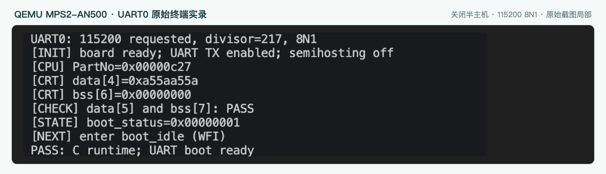
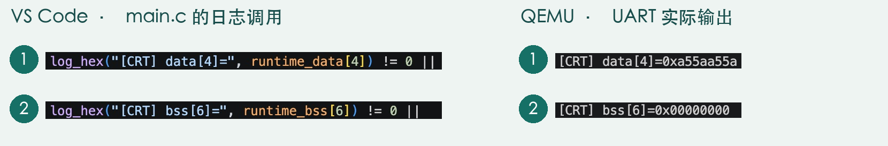
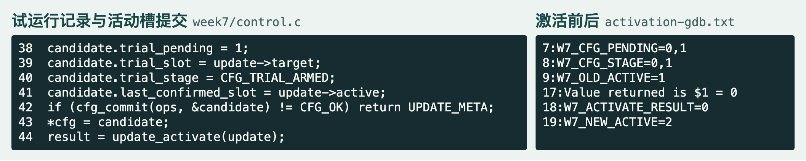
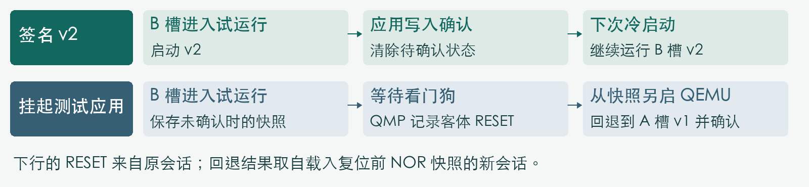
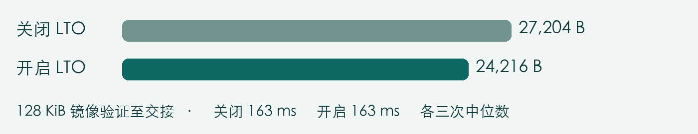
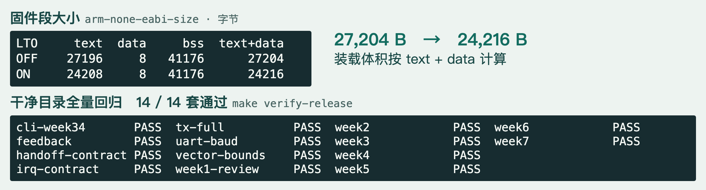
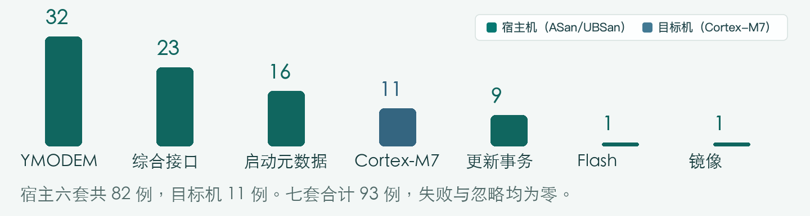

# 工业嵌入式 Bootloader 八周开发结项报告

2026 年 11 月 20 日（交付复验基线）· 2026 年 11 月 27 日修订 · QEMU MPS2-AN500 / Arm Cortex-M7
交付分支：week8-delivery（源自 fef3e14）· 正式目标：bootloader-week7.elf · 验收：make verify-release

八周开发交付了一套可从空构建目录重建的 Arm Cortex-M7 工业嵌入式 Bootloader（下文简称启动器）与固件升级系统。系统从模拟 NOR Flash 中选择固件槽，逐层校验镜像结构与数字签名，将应用载荷装入执行区，并在新版本首次启动后完成确认或自动回退。一次成功升级可经串口完整追踪至新版本应用，一次被拒绝的升级亦可追踪至继续运行的旧版本应用。第八周在同一套源码与实验密钥下对照密码路径链接时优化（LTO），将正式固件装载体积由 27,204 字节降至 24,216 字节。对接手工程的开发者而言，最短复核路径为先运行四场演示，再核对全量测试摘要，最后按存疑输出回溯至对应模块接口（八周阶段成果总览见图 1）。

## 一　开发目标与八周阶段成果

项目启动时，串口或半主机屏幕输出一行文字，只能回答工具链能否编译链接可执行文件以及 QEMU 仿真器能否运行该二进制。项目结项时，一次完整的冷启动必须依次回答更多工程问题：上次选中的活动槽是哪一槽、该槽状态记录是否完整有效、应用入口向量是否合法可执行、当前版本是否通过签名授权，以及上次试运行的新应用是否已完成确认。缺失其中任何一个条件，都可能导致串口提示“启动成功”但系统实际处于失控或未授权状态。八周的开发递进顺序，正是将这些工程问题逐项纳入实现与验收范围的过程（端到端执行路径见图 2）。

第一周打通交叉编译、链接、仿真运行与调试观察的最短闭环。第二周在关闭半主机后建立独立 UART0 输出通道与可识别的故障状态。第三周通过中断环形队列承接串口输入，并将模拟存储划分为边界受控的四个分区。第四周首次从固件槽校验并装载独立链接的应用至执行内存，完成控制权交接。至此，系统已具备可靠的只读启动链路，仍需解决更新中断及重启状态判定两类问题。

第五周围绕串口升级定义了 YMODEM 传输与双页元数据提交顺序。第六周在镜像校验之上引入 RSA-2048/SHA-256 签名验证、试运行确认与看门狗回退机制。第七周将写入错误、记录撕裂、看门狗复位和双槽损坏系统化纳入故障注入测试，修复了仅观测正常路径时容易遗漏的提交顺序与边界缺陷。第八周将前期成果收敛为可移交、可复现的完整工程：最终验收既保留最小启动入口用于快速隔离环境问题，也以带签名的正式固件验证对外交付行为。

规划书中的工时属于前期预估，因未建立逐日工时台账，本报告统一按可核查的工程产物与验收证据衡量工作量。代码构建与自动化回归均有唯一命令行入口；测试结果分别按“顶层检查分组数”和“Unity 用例数”两套口径统计，性能数据完整保留测量前提。真机 SWD/JTAG 调试、板级掉电时序以及带教签收仍需相应硬件与责任人确认，在移交清单中单列。表 1 汇总了当前交付基线的核心指标与验收依据。

**表 1　当前交付基线的核心指标与验收依据**

| 维度 | 当前交付基线（QEMU MPS2-AN500 / Cortex-M7） | 对应源码与验收依据 |
|---|---|---|
| 正式固件装载体积 | 24,216 B（`.text` 24,208 B + `.data` 8 B；64 KiB 代码区余量 41,320 B） | `cmake/week7.cmake`、`lto-comparison.json` |
| LTO 体积收益 | 较关闭密码路径 LTO（27,204 B）减少 2,988 B（10.98%） | 同密钥同轮开关对照构建 |
| 静态 RAM 占用 | `.bss` 41,176 B（含 24 KiB Mbed TLS 静态堆与 16 KiB 预留栈） | `src/week6/linker.ld`、`secure_image.c` |
| 验证至交接耗时 | 3,360 B 演示载荷 29 ms；128 KiB 载荷 163 ms（3 次中位数） | `icount shift=3`、25 MHz TIMER0 |
| 签名镜像规格 | 32 B 镜像头（`M7IM`）+ 最大 458,448 B 载荷 + 272 B 签名尾（RSA-2048/SHA-256） | `src/week4/image.h`、`src/week6/secure_image.h` |
| 自动化验收结果 | 14 套全量回归全部通过；Unity 七套共 93 例（宿主机 82 + 目标机 11）零失败 | `make verify-release`、`clean-check.json` |

## 二　Week 1　复位流程与 C 运行时初始化验证

裸机固件没有操作系统代为装载进程。处理器复位后，首先从中断向量表（`.isr_vector`）读取初始主栈指针（MSP）和复位入口 `Reset_Handler`，再由启动汇编建立 C 运行环境。链接脚本定义初始化数据段（`.data`）的装载地址与运行地址边界（`_sidata`、`_sdata`、`_edata`）以及零初始化段（`.bss`）的起止地址（`_sbss`、`_ebss`），并以 `ASSERT` 断言校验向量表长度（192 字节，48 项）、8 字节栈对齐与 4 字节字拷贝对齐约束。启动汇编按这些符号复制有初值的全局变量，再清零 `.bss` 段。一旦链接布局、拷贝字宽与循环边界存在偏差，缺陷往往只在全局变量排布变化时才暴露。工程从最小原型起便保留完整符号信息，便于在进入 `main` 之前借助调试器核查各段内存。

首轮验收采用了能够明确区分成败的注入试验。若仿真器默认将未初始化内存置零，仅在主程序中观察到零值并不能证明 `.bss` 清零循环生效。验收脚本在复位入口通过 GDB 预先向 `.data` 写入 `0xCC`、向 `.bss` 写入 `0xA5` 污染字节，随后执行复位处理程序，并在主程序入口回读内存（见图 3）。针对 `.bss` 还额外检查紧邻区间的哨兵变量，确认清零循环在当前测试布局下未发生越界写入。这一方法将“程序能够编译通过”推进到“给定输入下的 C 运行时初始化正确”，也为后续排查提供了确切的地址与断点依据。

第一周最小演示通过半主机调用借助宿主机输出信息，用于快速核验交叉编译器与目标机协作。自第二周起的串口固件改用板上外设模型，但两个入口在工程中长期并存。在新环境中若最小演示即失败，应优先排查工具链版本、架构编译选项、链接脚本及 QEMU 机型参数；若最小演示通过而串口无输出，再聚焦外设寄存器配置与串口路由。保持这一分层边界，可避免将底层构建问题误判为上层升级故障。

在需求调研层面，QEMU 仿真器承担的是可重复执行的处理器与外设实验平台职责。项目参考 SIMATIC 公开文档对装载存储、工作存储与保持存储的职责划分，选取 CPU 1511-1 PN 作为公开资料样本，用以解释为何需要将固件镜像、应用运行内存与持久化参数区隔离管理。该样本的存储卡形态、工作存储容量与本实验仿真地址处于不同抽象层次；实际产品内部启动区与物理分区布局须由目标硬件资料确认，本工程交付范围为 Cortex-M7 仿真实现。

## 三　Week 2　串口日志与启动异常诊断

第二周的核心目标是关闭半主机服务后仍能稳定读取启动阶段的诊断输出。板级初始化代码提供模型系统时钟，UART0 驱动据此按四舍五入规则计算波特率分频寄存器 `BAUDDIV`，主流程在初始化、运行时自检与空闲等待之间输出结构化标记（终端实录见图 4）。测试核对 MPS2-AN500 的 25 MHz 时钟配置，请求 115200 波特率时寄存器分频值为 217。此处能够验证的是分频计算与寄存器访问行为，宿主机采集的串口时间戳不能替代实板示波器上的物理电信号波形。

发送路径对上层调用者作出明确的有界返回约定。写入字节前须先确认发送使能位有效，并在发送缓冲区空闲时再写数据寄存器；等待过程设置上限，超时错误沿调用链向上传递，主程序据此转入可识别的故障状态。反馈专项测试先将发送缓冲区置满并在数据寄存器填入已知值，验证返回错误时原值未被覆盖；解除满状态后再验证新字节正确写入。这两步共同排除了“报错但已误写”和“恒定报错”两类缺陷实现。早期轮询驱动以循环次数限定等待，后续协议层另以毫秒时基管理超时，两类超时边界需按各自接口语义区分。

早期异常同样具备不依赖串口的独立观察手段。若异常发生在串口初始化完成之前，默认异常入口会先记录当前异常号 `exception_number`，并在目标内存中保存 `boot_status` 供调试器读取。实验通过人为构造错误条件，结合 GDB 区分串口输出失败与处理器硬件异常。正常固件在打印就绪标记后进入 `WFI` 空闲等待，由宿主机主动终止仿真器属于预期流程；验收脚本同步检查目标机串口标记、状态变量与退出条件，防止将无输出的超时进程误判为通过。

本阶段确立的诊断方法贯穿了后续所有开发周次：先定位最后一个可信串口标记，再读取该标记前后的内存与外设寄存器作为第二证据（源码调用与串口输出对照见图 5）。例如，应用未能运行时，故障可能位于镜像校验、载荷复制、控制权交接或应用自身初始化阶段；只要同时保留启动器末段标记与应用首条标记，就能在现象一致时迅速缩小排查范围。串口在第三周扩展为中断接收通道，在第五周承载二进制升级帧，而第二周确立的有界返回约定一直沿用至最终交付版本。

> 注：图 5 两组编号对应同名变量。启动器依次打印 `runtime_data[4]` 与 `runtime_bss[6]`，串口分别读回初值 `0xa55aa55a` 与清零值 `0x00000000`。

## 四　Week 3　串口接收与 Flash 分区读写

第三周为串口引入中断驱动接收：硬件中断 `UART0_RX_Handler` 将到达字节写入环形队列，主循环调用 `uart_getc()` 取出数据，共享读写索引在临界区内受保护访问。反馈专项测试重点核查了嵌套中断屏蔽场景——当调用者进入驱动时中断可能已处于关闭状态，驱动返回时必须通过 `irq_save()`/`irq_restore()` 恢复进入前的屏蔽现场，而非简单地无条件开中断。测试分别在开中断与关中断前提下调用接口并核对恢复结果，这对需要长时间与定时中断并发运行的升级协议尤为关键。

队列容量、读空与溢出在语义上严格分离。调用者读到暂无数据时可继续轮询等待，参数非法则立即报错返回。接收中断独立累计接收计数、软件丢包计数与硬件溢出计数；升级传输适配器一旦检测到任何丢弃或溢出标志，便立即中止本次接收。由此上层可准确区分“暂时无新字节”与“字节流已受损不可恢复”。在二进制固件传输中，静默丢失单个字节后继续把错位数据拼入当前帧，远比及时报错终止更难定位。

存储层采用调用者提供的 1 MiB 模拟 NOR 内存，映射于 `0x20300000`（`FLASH_SIM_BASE`），绑定设备时不清空既有内容。整个区域划分为启动预留、应用 A、应用 B 与参数区四个固定分区，具体布局见表 2 与图 6。读写接口均以分区枚举与区内偏移寻址，调用者无需自行换算绝对地址。驱动在访问后端前统一检查分区编号、偏移、长度以及输入输出缓冲区是否与模拟 NOR 后端发生地址重叠，并采用 `size > part->size - offset` 的减法方式比较剩余空间，彻底规避无符号加法回绕导致的越界绕过。

**表 2　模拟 NOR 分区布局与访问规则**

| 分区枚举 | 偏移范围（基址 `0x20300000`） | 容量 | 职责与访问规则 |
|---|---|---|---|
| `FLASH_BOOT` | `0x00000 – 0x10000` | 64 KiB | 启动预留区；接口层写保护，拒绝任何擦除与编程请求 |
| `FLASH_APP`（A 槽） | `0x10000 – 0x80000` | 448 KiB | 应用槽 A；与 B 槽轮换承载固件包，验证后复制至 `0x00010000` 执行 |
| `FLASH_BACKUP`（B 槽） | `0x80000 – 0xF0000` | 448 KiB | 应用槽 B；升级时依据当前活动槽决定写入目标 |
| `FLASH_PARAMS` | `0xF0000 – 0x100000` | 64 KiB | 页 0–1 存 48 B 升级记录（`M5BM`）；页 2–3 存 56 B 配置与试运行记录（`M6CF`） |

模拟 NOR 遵循 4 字节编程粒度与 4,096 字节（4 KiB）擦除粒度：擦除将整页恢复为 `0xFF`，编程仅允许将位从 `1` 置为 `0`。驱动先对整笔请求完成参数、对齐及位清零条件预检，全部满足后才执行写入；因此非法请求不会留下写到一半的脏数据，而合法操作中途断电的场景则通过独立故障注入另行模拟。第四至第七周测试严格延续了这一区分，分别验证非法操作拒绝与合法写入中断两类行为。`FLASH_BOOT` 的写保护目前在软件接口层实现，实体芯片的硬件写保护机制须按目标 MCU 规格另行确认。

显式存储快照为仿真环境提供了跨进程复现持久状态的方法。宿主机暂停仿真器后将模拟 NOR 内容转储至独立快照文件，再将其注入新的 QEMU 实例进行冷启动。原始种子与各检查点快照分别命名保留：验证参数保存失败时，须复核原有效快照仍可正常启动；验证写入中断恢复时，则须针对故障瞬间导出的快照做冷启动检查。若误用初始正常镜像代替故障快照，试验虽能启动却完全绕过了待测的受损状态。

## 五　Week 4　镜像校验、加载与控制权交接

应用固件与启动器分别独立链接。每个固件槽起始处放置 32 字节镜像头（魔数 `M7IM`），记录格式版本、头长度、载荷字节数、装载地址、版本号、载荷 IEEE CRC-32 与镜像头 CRC-32；紧随其后的原始载荷才会被装载至应用执行区。A、B 两个固件槽共用固定执行基址 `APP_EXEC_BASE`（`0x00010000`），使得同一份应用包可以轮换部署于任意一槽，装载时不会把镜像头复制到向量表位置。厘清槽内偏移、镜像内偏移与运行地址三者的关系，是理解启动链的基础，也决定了现场升级只能发送按格式打包的固件包，而非应用 ELF 或整块 NOR 快照。

镜像校验遵循由外及内的顺序。启动器先核对镜像头魔数、格式、长度与头部 CRC-32，再检查声明长度能否容纳 192 字节向量表且不超过槽容与执行区上限（448 KiB），并确认装载地址等于 `0x00010000`。源槽载荷通过流式 CRC-32 校验后，才由 `image_load_slot()` 复制至 `0x00010000`，随后由 `boot_verify_loaded()` 对执行区副本再次核对 CRC-32 与向量表。尽管源区与执行区在仿真中同属内存，两者职责截然不同，分别核验才能暴露复制偏移、长度或目标地址异常。

向量表检查进一步收紧了可接纳的应用入口范围。初始 MSP 必须落在应用 RAM 区间 `(0x20010000, 0x20200000]` 且满足 8 字节对齐；全部 48 项向量中，保留项（索引 7–10 与 13）必须为零，其余每项入口均须设置 Thumb 状态位且指向 `[APP_EXEC_BASE + 192, APP_EXEC_BASE + size - 2]` 区间内。边界专项测试专门构造了恰好落于载荷末端或回落至向量表数据区内的临界输入，这些用例往往仅差一个比较运算符就会被错误放行，保留这些边界用例集便于后续格式演进时快速回归。

移交控制权前，`boot_handoff()` 依次关闭或清理启动器占用过的 UART、SysTick、NVIC 使能与挂起位以及 SCB 异常挂起标志，将 `VTOR` 切换至 `0x00010000` 并插入 `DSB`/`ISB` 内存屏障（交接流程见图 7）。最后的上下文切换在汇编函数 `jump_to_app` 中完成：关中断后清零 `CONTROL`、`BASEPRI`、`FAULTMASK` 与 `PSP`，将返回地址 `LR` 设为陷阱循环，再切换 `MSP` 并执行 `bx` 跳转，确保切换主栈后绝不再访问旧 C 栈上的局部变量。应用进入自身复位入口重新初始化 C 运行时，并通过串口报告运行时、控制权交接及 SVC 服务调用检查结果。调试测试预先置位外设与中断挂起标志后再跑通交接，可直接核实启动器是否彻底清理了残留现场。

第四周建立的校验与交接防线在引入签名后依然完整保留。数字签名能够证明镜像来源经过授权，但无法替代对当前设备地址布局、载荷复制完整性及外设中断清理的检查。最终系统集成测试将签名通过、装载校验、控制权交接与应用自检串联在同一次仿真会话中，确保“字节授权”“装载正确”与“应用已接管”三者形成闭环。

## 六　Week 5　双槽升级与中断恢复

读取并启动既有固件与在线写入新固件对状态一致性的要求截然不同：只读失败只需停下报错，而擦写一旦开始却未能完成，就可能留下半成品镜像。第五周引入双同容固件槽机制：接收升级前先读取最新有效元数据，依据当前活动槽反推非活动目标槽，先持久化 `RECEIVING` 状态再擦除目标槽。运行中的固件可位于 A 槽或 B 槽，连续升级后两槽职责自动对调（槽位轮换见图 8），因此代码与测试均不将 A 槽硬编码为“旧版”或将 B 槽固定为“新版”，而是通过连续跨槽升级与重启验证轮换逻辑。

宿主机发送端采用独立实现的 YMODEM 协议工具，目标机侧按单文件批次接收固件。起始帧携带文件名与十进制字节长度，接收器严格按声明长度写入载荷，剥离最后一个协议块末尾的填充字节，防止填充数据污染固件尾部。接收状态机逐块核对序号、序号反码与 CRC-16 块校验，准确区分新数据块与发送端重传块：当确认字符（ACK）在链路中丢失导致发送端重发已落盘的旧块时，接收器仅重新应答而不重复写入，避免破坏槽内偏移。测试覆盖了 128 字节与 1,024 字节块长以及多处 ACK 丢失场景。

超时策略专门应对了“链路有字节但传输无进展”的隐患。若对端反复发送重复旧块或畸形帧，按单字节到达重置超时会导致升级通道被无限占用。实现同时限制连续无进展事件次数与无进展总时长，仅在收到有效起始帧或推进文件偏移的新数据块时才重置预算。传输末尾须收到空起始帧以结束批次；一旦越过提交边界，即便最后的确认字符发送失败也不得撤销已落盘状态，从而保证持久化状态与调用返回语义一致。

升级元数据占用参数分区前两页（页 0 与页 1，每页 4 KiB），每次写入均交替落盘至未承载当前有效记录的另一页。每条记录固定 48 字节（魔数 `M5BM`），保存代际号 `generation`、活动槽、目标槽、状态、进度、期望长度、候选版本、错误码、前 40 字节的 CRC-32 以及末尾 4 字节提交标记 `CMIT`。写入严格遵循“擦除备用页 → 写入正文与校验 → 回读核验 → 最后写入 `CMIT` 标记 → 整条复验”五步顺序，使任意时刻读取原始字节都能判定写入跨过了哪道边界。两页均有效时按代际号取新；单页受损时回落至另一有效页；若两页均损坏、发生 I/O 错误或代际顺序歧义，则转入显式恢复流程，绝不将读取错误误判为空白设备而覆盖有效历史。

第五周验证的核心证据是中断瞬间的 NOR 快照。确认旧活动槽未受波及时，除核对元数据字段外，还会逐字节比对旧槽全部分区内容；确认设备仍可运行旧固件时，则拉起新的 QEMU 实例加载该故障快照并观察串口输出。将故障钩子、瞬间快照与冷启动输出三者关联，才能准确证明升级事务究竟在哪条字节边界上生效。

## 七　Week 6　固件签名验证与试运行确认

传输层的 CRC-16 块校验仅确保单帧无误，镜像层的 CRC-32 仅确保包体与包头自洽，两者均不具备来源授权语义。第六周在既有镜像格式后附加 272 字节签名尾，对整个镜像头与载荷拼接区域计算 SHA-256 摘要，并利用编译进固件的实验公钥完成 RSA-2048（PKCS#1 v1.5）验签。由于包头位于摘要覆盖范围内，版本号、长度与装载地址同样受到签名保护。验收同时覆盖了载荷篡改样本以及“修改头部字段后重算头部 CRC-32 但签名失配”的样本，后者要求系统在授权检查环节依然拒绝提交，证明各层防线均在独立生效。

签名版升级包由三段连续结构组成（布局见图 9）：32 字节镜像头、原始应用二进制载荷以及 272 字节签名尾（前 16 字节包含魔数 `M6SG`、算法类型、签名长度 256 与保留字，后 256 字节为 RSA-2048 签名）。单槽可容纳的最大签名载荷须从 448 KiB（458,752 字节）中同时扣除头与尾，上限为 458,448 字节。构建脚本将应用 ELF 转为原始二进制后再封装签名包，而模拟 NOR 种子则是包含四分区布局与初始状态的另一种镜像文件；演示文档明确列出三类文件的对应关系，避免接手者误将调试 ELF 或整块存储快照通过串口下发。

验签核心集成随源码交付的 Mbed TLS 精简子集，并在 `.bss` 中预留 24 KiB 静态缓冲池 `crypto_heap` 供内存分配器使用，同时将链接脚本中的启动栈由 4 KiB 扩大至 16 KiB 以满足 RSA-2048 验签栈需求。构建时脚本在当前工作目录生成本地实验密钥对并导出公钥头文件，目标固件仅包含验签所需公钥。同一套固件与升级包必须在相同实验密钥下配对使用；两次独立检出生成的升级包即便体积与逻辑一致，跨密钥验证也会被拒绝。面向生产环境的密钥供应、轮换、撤销、可信根存储以及防降级策略，则需在量产阶段另行设计。

验签通过后，系统还需确认新版本在目标环境中确实能够正常运行。升级提交阶段先记录试运行意图（含目标槽与上一已确认槽，状态为 `CFG_TRIAL_ARMED`）；新应用首次启动前，启动器将状态推进为 `CFG_TRIAL_LAUNCHED` 并启用 CMSDK 模型看门狗（试运行超时 2,000 ms，常规服务期 30,000 ms）。新应用完成自身初始化与检查后，独立绑定模拟 NOR，读取当前活动槽与配置记录，核实本次试运行确属自身后清除待确认标志并提交，再停用看门狗。若新应用卡死或未完成确认即复位，下次冷启动将依据持久化状态自动回退至上一已确认槽。这一机制清晰隔离了“已完成跳转”与“新应用已健康接管”两个阶段。

启动参数与试运行状态共享 `FLASH_PARAMS` 分区，占用页 2 与页 3（偏移 `0x2000`/`0x3000`），采用 56 字节独立双页记录格式（魔数 `M6CF` 与末尾 `CMIT` 标记）。串口命令窗口下限为 200 ms、上限为 60,000 ms、默认 2,500 ms，并支持 `auto_boot` 自动启动开关。修改参数时先在临时副本上提交并回读校验，确认落盘成功后再更新内存运行值。出厂重置（`factory`）须紧接输入 `YES` 二次确认，保留两个固件槽内容仅重置参数与元数据。当配置双页同时损坏时，启动器拒绝自动沿用默认试运行状态，而是停在显式维护入口，避免掩盖上一次升级的真实进展。

## 八　Week 7　故障注入与升级提交边界验证

一条正常升级日志会依次呈现传输完成、状态提交、试运行启动与应用确认，但真实设备在任意两条日志之间都可能突然复位。第七周最关键的缺陷修复针对“试运行意图”与“活动槽切换”的提交先后顺序：若先公布新活动槽再写试运行意图，一旦两者之间掉电，下次冷启动就会把未经确认的新版本误认为普通已确认版本而跳过看门狗保护。修复后的 `trial_activate()`（见图 10）严格先在配置页持久化 `CFG_TRIAL_ARMED` 意图，确认成功后再调用 `update_activate()` 发布新活动槽；应用确认函数 `week6_app_confirm()` 同步校验 `trial_pending`、`trial_stage == CFG_TRIAL_LAUNCHED` 与当前 `active_slot` 归属，确保即便在两次提交之间发生复位、旧应用重新启动，也绝不会替未激活的新版本误签确认。

> 注：图 10 源码第 42 行先提交试运行意图，第 44 行再调用激活函数。GDB 在入口读到活动槽仍为 A（`1`），函数返回 `0` 后读到 B（`2`）；若两次提交之间发生复位，旧槽仍可安全启动。

为了以字节级精度复现写入中断，第七周构建了独立故障测试目标 `bootloader-week7-fault.elf`，通过链接器 `--wrap` 机制拦截 Flash 擦除、编程与读取边界。测试脚本在目标槽擦除、目标槽写入、试运行配置正文与标记、活动记录正文与标记等七个关键切点精准中止并导出 NOR 快照，随后全部改用无故障钩子的正式固件 `bootloader-week7.elf` 进行冷启动复验。同时自动化套件检查正式目标符号表，确保故障包装器绝不进入交付镜像。

七个中断点的冷启动结果清晰界定了提交生效的精确位置（见图 11）：故障 1 至故障 6 涵盖擦除、编程、配置写入乃至活动记录末尾 `CMIT` 标记仅部分写入的状态，此时旧记录仍然完整可读，冷启动稳定选择 A 槽运行 v1 且旧槽字节完好无损；唯有故障 7 在 `CMIT` 标记完整落盘并通过校验后，活动槽才原子切换为 B 槽，冷启动进入 v2 试运行并完成确认。仅差末尾数个字节的差异即决定了版本归属，这类精确到字段级的故障证据远比笼统宣称“支持断电保护”更具工程移植指导价值。

针对应用挂起的回退验证分两步完成（两条路径对比见图 12）：第一步加载挂起测试应用 `application-week7-hang.elf`，实际运行模拟看门狗并通过 QMP 捕获目标机触发的 `guest-reset` 复位事件；第二步提取首次进入试运行但尚未确认时保存的 NOR 快照，在新的 QEMU 实例中冷启动，观察启动器识别未确认状态并回退至 A 槽确认运行 v1。之所以拆分为两步，是因为 MPS2-AN500 模拟存储基于易失性 SRAM；前者证明看门狗超时能够真实触发复位，后者证明携带该持久状态的设备重启后必然执行回退。两者共同构成仿真模型内的完整论证，而实体 Flash 写入时序、供电跌落曲线与芯片复位域耦合关系仍须上板实测。

除事务边界外，第七周还集中修复了多处交互与解析边界缺陷：禁止配置在写盘成功前提前公布至运行态（`config_set()`）；在 `config_parse_u32()` 中加入防 `uint32_t` 乘法溢出检查，不仅拒绝超出业务范围的数值，也拒绝超出 32 位整数表示范围的超长数字串；在串口命令行解析中严格拦截超过 `LINE_MAX`（48 字节）的超长输入，防止截断后误执行；要求 `factory` 后紧邻输入 `YES` 方可生效，插入任意其他命令立即撤销待确认态。上述修复均通过宿主机单元测试与 QEMU 串口重启回读双重验证。

## 九　Week 8　链接时优化与固件体积对照

第七周正式固件已启用面向体积的 `-Os` 编译选项与 `--gc-sections` 节回收机制，剩余的主要压缩空间集中在密码库跨翻译单元的调用链中。按源文件独立编译时，编译器难以洞察 Mbed TLS 跨对象文件的常量传播、死分支与冗余路径；第八周通过默认开启的 CMake 选项 `BOOT_CRYPTO_LTO`，将 `src/week6/secure_image.c` 与全部 Mbed TLS 源文件纳入 `-flto` 链接时优化（LTO）范围，在最终链接阶段执行跨单元全局优化；与此同时，主控制流、Flash 适配层与故障注入边界保持常规目标文件编译，确保 `--wrap` 故障测试与 GDB 断点调试方式完全兼容。

本轮优化采用严格受控的同轮成对构建方案完成对照：开关两组均从同一份源码重建，使用完全一致的编译器（Arm GCC 16.2.0）、链接脚本、实验密钥、应用载荷与统计工具，唯一变量为是否开启密码路径 LTO。体积统计口径明确区分装载占用与静态内存：正式固件代码与只读常量计入 `.text`，初始化数据计入 `.data`，两者之和代表实际需烧录装载的字节数；带调试信息的 ELF 磁盘大小混杂大量不进入目标机的符号与调试段，不作为优化度量。零初始化段与预留栈合入 `.bss` 单独列示，静态 `.bss` 统计亦不等同于运行时最大栈深。

表 3 与图 13、图 14 给出了成对测量与复验结果。关闭 LTO 时 `.text` 为 27,196 字节、`.data` 为 8 字节，合计装载 27,204 字节；开启 LTO 后 `.text` 降至 24,208 字节、`.data` 保持 8 字节，合计 24,216 字节，净缩减 2,988 字节（10.98%）。两组 `.bss` 均为 41,176 字节（含 24 KiB 密码静态堆与 16 KiB 预留栈）。相对 65,536 字节（64 KiB）代码区上限，开启 LTO 后仍余 41,320 字节空间。该余量可供评估后续功能扩展，但尚未计入实体板级驱动、生产密钥管理及特定芯片安全外设开销，不可直接套用于异构硬件平台。

**表 3　密码路径 LTO 开关同轮对照结果**

| 正式固件配置 | `.text` (B) | `.data` (B) | 装载体积 (B) | `.bss` 含栈 (B) | 3,360 B 验证耗时 | 128 KiB 验证耗时 |
|---|---:|---:|---:|---:|---:|---:|
| 关闭密码路径 LTO | 27,196 | 8 | 27,204 | 41,176 | 29 ms | 163 ms |
| 开启密码路径 LTO | 24,208 | 8 | 24,216 | 41,176 | 29 ms | 163 ms |
| 变化量（ON − OFF） | −2,988 | 0 | −2,988（−10.98%） | 0 | 0 ms | 0 ms |

耗时对照沿用固定指令计数模式（QEMU `icount shift=3`）与 25 MHz `TIMER0`，对同一样本各测量 3 次取中位数。试验将命令窗口固定为 200 ms，并在主程序入口、启动决策入口与控制权交接点分别打点，将等待操作员输入的时间与实际校验装载时间解耦。在这两组输入下，LTO 的收益主要体现在装载体积缩减，3,360 字节演示载荷（中位数 29 ms）与 128 KiB 载荷（中位数 163 ms）的验证装载耗时在当前测量精度内未见变化。第七周采用不同密钥或轮次测得的历史数据按原报告口径保留，不与本轮数据跨条件混比。

在代码复审期间，还同步修正了最小 C 运行库 `src/week6/libc_min.c` 中 `memmove()` 对可能分属不同对象的指针直接做关系比较的未定义行为风险：结合 Cortex-M7 平坦地址空间特性，先将源目指针转换为 `uintptr_t` 无符号整数再判断拷贝方向，确保重叠区间仍从安全端复制。开关两组构建均包含该修复，避免将源码改动混计入 LTO 收益。宿主机侧的 ASan/UBSan 动态检查与目标机裸机实测互为补充，但全量用例通过仍不能在数学上证明程序对所有未覆盖输入均无未定义行为。

> 注：图 14 上半部分摘录同轮对照构建的 `arm-none-eabi-size` 段统计，下半部分列出干净检出目录执行 `make verify-release` 的 14 套回归结果。开启 LTO 后装载体积减少 2,988 字节，全部 14 套检查通过。

## 十　QEMU 启动、升级、签名拒绝与回退演示

最终端到端演示脚本 `scripts/demo-week8.sh` 通过链式传递 NOR 快照串联四场独立 QEMU 会话（串口输出节选见图 15）。第一场从仅含已签名 v1 的 A 槽种子启动，读取当前选择、验证 RSA-2048 签名、将载荷装入 `0x00010000`，随后观测到应用自身输出 `APP: VERSION v1` 与 `APP: BOOT CONFIRMED`。第二场承接第一场导出的快照，经串口通过 YMODEM 上传已签名 v2：串口依次打印升级事务提交（`UPGRADE: COMMITTED`）、启动决策进入试运行（`TRIAL: LAUNCH`）以及新应用确认运行（`APP: VERSION v2`、`APP: BOOT CONFIRMED`），直观展示升级事务、启动决策与应用确认三方在同一份持久记录上达成一致。脚本同步核对应用版本号，防止将回退后正常启动的旧应用误判为升级成功。

第三场从已稳定运行 v2 的快照出发，尝试下发格式合法但缺少签名尾的 v3 升级包。验收不仅要求发送工具报告升级未提交，更逐项校验同一段目标机串口日志：必须出现升级失败错误码（`UPGRADE: FAIL 0x00000006`）、继续验签启动 B 槽 v2 及应用确认标记，同时严格禁止出现 `UPGRADE: COMMITTED`。对于预期失败场景，单纯以非零退出码判通并不严谨——例如路径错误同样会导致发送工具失败，却未触达任何固件校验逻辑。接手者在阅读原始串口日志时，可能先看到少量协议握手控制字节，这是由于 YMODEM 数据流与诊断文本复用同一 UART0 通道，定位事务结果以文本标记为准。

第四场保留第二场成功安装 v2 后的快照副本，人为翻转活动 B 槽中的一个载荷字节，同时保持 A 槽内已签名 v1 完整无损。冷启动时启动器检测到当前活动槽校验失败，自动检查备用 A 槽、提交回退选择（`ROLLBACK: SELECT A`），最终应用输出 v1 并完成确认。第三场与第四场刻意从同一已知快照分支展开，从而清晰区分“拦截非法升级包以保住当前版本”与“已安装活动槽受损时自动切回备用槽”两种恢复语义；此外，完整测试套件还覆盖了双槽同时失效时滞留维护命令入口的兜底行为。

复核任意一场演示时，建议按以下三步逐项核对证据：其一，确认本场起始 NOR 快照确由指定的上一场会话生成；其二，确认串口中出现的版本信息由应用自身打印而非启动器预期日志；其三，核实下一次冷启动读出的活动槽与试运行状态与本场结论吻合。遵循这一核查顺序，可将发送端返回、接收端落盘与应用健康接管解耦为三个可独立定位的事件，即便未来更换上位机工具或迁移至实体开发板，该核查方法依然适用。

## 十一　全量回归结果与性能测量方法

第八周建立了贯通全周期的串行验收入口 `make verify-release`，覆盖第一至第七周主线套件、反馈补测与六个专项验证。前期单模块测试可在隔离环境中精准复现苛刻条件（例如在模拟寄存器中验证发送满队列时不覆盖数据，或验证解析器面对 32 位溢出数字串的返回值），而末期系统测试则将正式固件载入 QEMU 仿真器，经真实串口协议完成收发、故障中断与快照冷启动。两类环境分工明确：近期干净目录复验记录逐套列出了检查结果，打开对应 JSON 摘要可查具体断言名称，查看演示日志则可还原终端实测输出。

本轮在 Unity 框架下共执行 7 套测试、合计 93 个用例，零失败、零忽略（各套用例分布与执行平台见图 16）。其中 6 套共 82 例在宿主机执行，启用 ASan 与 UBSan 检查并以 `UBSAN_OPTIONS=halt_on_error=1` 作为失败门限；目标机套件在 Cortex-M7 仿真固件上运行 11 例，覆盖裸机外设与确认逻辑。最终系统摘要 `week7.json` 另包含 29 个顶层检查分组，涵盖构建、符号隔离、升级、四类拒绝、存储错误、七点写入中断与看门狗回退。由于单个顶层分组可能包含多项断言或整套 Unity，本报告始终将“分组数”与“Unity 用例数”分列统计，且仅陈述实际执行通过情况，不将其换算为源码行覆盖率或缺陷逃逸率。

性能测量脚本同样保留完整的可复核口径。脚本基于确定性数据构造演示载荷（3,360 字节）与填充至 128 KiB 的载荷，在固定命令窗口与 `icount` 模式下读取计时器并留存每次采样、输入种子 SHA-256、ELF 摘要、正式目标段统计及完整编译链接命令。若后续升级交叉工具链或调整 Mbed TLS 配置，应先在同一新环境中重新执行成对对照构建，切忌将新版构建耗时直接与早期不同实验密钥或旧工具链的记录对比，以免将环境波动误判为优化收益。

当全量回归出现失败项时，排查应从第一条报错的检查分组入手，现场保留该轮生成的 ELF、串口日志与 NOR 快照。串口类异常应依次核查仿真器拉起状态、命令窗口输出、协议握手字节与启动状态标记；持久化异常须先确认故障快照确由目标切点导出，再比对双页元数据代际号与所选活动槽；体积或性能差异则应优先比对链接命令与输入对象清单。在这些实验前提对齐之前，不应通过放宽断言条件掩盖根因。本次归档目录保留精简的最终证据集，完整中间日志与快照可随时经同一命令一键重建。

## 十二　项目移交范围与待验证的硬件事项

本次项目移交按读者角色分为两类资料。面向首次上手者的工程级 `README.md` 与 `codes/docs/week8-demo.md` 提供从空目录构建并运行四场演示的最短路径；面向二次开发者的技术说明 `codes/docs/week8-technical.md` 与离线 Doxygen API 文档（`API参考.zip`，覆盖 15 个公开头文件）用于检索函数契约、状态归属与调用顺序。按周归档的周报保留了各阶段的权衡背景与当时局限，便于追溯既有接口的演进原因。早期周报中的相对日志路径对应当时工作目录，当前有效证据以第八周交付索引为准，历史版本均可通过 Git 提交历史追溯。源码、测试、第三方依赖与文档分层存放，使后续变更的影响范围清晰可控。

面向工业控制场景落地，还须进一步厘清安全标准与工程责任边界。产品安全开发流程可参考 IEC 62443-4-1，组件级技术安全能力评估对应 IEC 62443-4-2。本工程完成的签名包拒绝与回退测试，仅证明“当前仿真模型实现了预期的固件完整性校验与更新授权拦截”，不能据此推导任何工业组件的正式安全等级（SL）。实体控制器还涉及产线烧录信任根、生产签名基础设施、调试接口锁定策略、硬件复位域隔离以及现场维护授权体系，相关等级与适用条件须由目标项目需求方与安全团队联合确认。第八周技术说明已补全前期公开手册（Arm DDI 0489B、SIMATIC 公开资料）的章节映射，明确了每项可仿真需求的实现与验证对应关系。

硬件上板移植前，须按“芯片选型 → 存储介质 → 调试链路”的顺序逐项核对平台假设（仿真已验与实板待验边界见表 4）。当前协议块接收可能伴随参数记录更新，真实 NOR 或片上 Flash 的擦写延时、擦写寿命以及突然掉电时的最小可见写入单位，均会影响日志提交频率与缓冲策略。最坏启动时间须在真实主频、指令/数据缓存（I-Cache/D-Cache）及总线负载条件下重新计量；静态区与运行栈须结合目标工具链静态分析与实测栈高水位综合评估。同时应接入物理 SWD 或 JTAG 调试器与 OpenOCD 脚本，在复位与控制权交接瞬间实测寄存器与内存现场。仿真阶段沉淀的镜像格式、边界用例集与故障分类模型均可直接复用，而物理电学观测与产线维护规程需补充独立实测证据。

**表 4　QEMU 仿真已验证与实体硬件待验证范围对照**

| 工程域 | QEMU 仿真已交付与验证 | 实体硬件上板待验证 |
|---|---|---|
| 启动与调试 | 复位段初始化、48 项向量边界、汇编交接、GDB 断点与异常号核查 | 物理 SWD/JTAG + OpenOCD 配置、实板复位域与启动时钟树 |
| 存储与断电 | 4 KiB 擦除/4 B 编程规则、7 个写入中断点快照冷启动恢复 | 真实 NOR/MCU Flash 擦写延时、寿命磨损与掉电最小可见写入单位 |
| 安全与授权 | RSA-2048/SHA-256 验签、4 类非法包拒绝、试运行看门狗回退 | 产线信任根、生产密钥签发/轮换/撤销、调试口锁定与防降级策略 |
| 性能与资源 | 静态段统计（24,216 B 装载）、`icount` 同轮计时对照 | 真实主频、I-Cache/D-Cache 与总线负载下的最坏启动时间及最大运行栈深 |

八周开发结束时，本工程已能基于可复现证据给出三项确定回答：面对一份候选固件，启动器按传输、镜像结构、数字签名与持久状态条件作出接受或拒绝决策；面对升级中途或试运行期间的异常复位，系统依据双页持久记录准确进入试运行、回退已确认槽或滞留维护入口；面对后续源码演进，接手者能够从空目录一键重建、运行全部 14 套回归并逐项复核原始输出。上述能力已完整固化于源码、自动化脚本、配图与归档证据中；实体板级验收以及使用方对安全等级和部署条件的最终签收，列入下一阶段的硬件移植与验收清单。

### 复核资料

本工程详细测试数据可从同目录《最终测试报告》进入：`evidence/lto-comparison.json` 保存 LTO 开关两组的输入摘要、段统计与三次计时原始样本；`evidence/summaries/week7.json` 保存正式固件 29 项系统检查记录；`evidence/demo/` 保存图 15 所示四场演示的完整串口原始日志。第一至七周阶段性周报位于 `reports/` 对应周次目录；工业标准原始资料、适用条件与源码映射详见 `codes/docs/week8-technical.md`。

图 4 裁剪自原始截图 `reports/week1-2/images/20261017-uart-native.png`，图 5 原始截图同位于 `reports/week1-2/images/`；图 10 摘自 `codes/src/week7/control.c` 与 `evidence/activation-gdb.txt`；图 14 上半部分取自 `evidence/运行证据.zip` 中 `benchmark-off` 与 `benchmark` 目录下的 `optimized-size.txt`，下半部分取自 `evidence/clean-check.json` 的 `suites` 字段。
